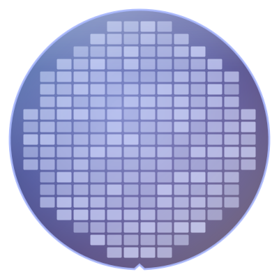

# 半導體製造概論 Introduction to Semiconductor Manufacturing

**跟著一片晶圓，走完從沙子到晶片的旅程** 
*Follow one wafer on its journey from sand to chip*

**🌐 選擇語言 · Choose a language**

## [繁體中文](zh-TW/README.md) ｜ [English](en/README.md)

---

## 這本書在講什麼 · About this book

一顆指甲大小的晶片上，有數十億個電晶體。它們全部是在一片薄薄的矽晶圓上，經過數百到上千個步驟、花上好幾個月「做」出來的。這本書會跟著**一片晶圓**，從沙子開始，一站一站走過晶圓廠、測試與封裝，看它怎麼變成一顆晶片。書裡不談艱深的物理和公式，專注在**流程**、**名詞**和**現場的 Know-how**。

A fingernail-sized chip holds billions of transistors, and every one of them is built on a thin silicon wafer through hundreds to more than a thousand steps over several months. This book follows **one wafer** from sand, through the fab, test and packaging, until it becomes a chip. It skips heavy physics and equations and focuses on **process flow**, **terminology** and **know-how from the fab floor**.

## 適合誰讀 · Who it is for

| 繁體中文 | English |
|---|---|
| 想知道晶片怎麼做出來的理工背景讀者，例如軟體、韌體、電機工程師與學生 | Readers with a science or engineering background who want to know how chips are made, such as software, firmware and electrical engineers and students |
| 準備進入半導體業的新人，想先熟悉製造流程和現場用語 | Newcomers preparing to join the semiconductor industry who want to learn the process flow and the language of the fab |
| 已經在半導體業工作，但只熟悉自己負責的那一段，想看看全貌的人 | People already in the industry who know their own area well and want to see the whole picture |

不需要半導體物理或化學背景，高中程度的理化知識就足夠了。 
No background in semiconductor physics or chemistry is needed. High-school science is enough.

## 每一章都有的三個小幫手 · Three helpers in every chapter

| | 繁體中文 | English |
|:---:|---|---|
| 📍 | **晶圓位置**：晶圓現在走到旅程的哪一站 | **Where the wafer is**: which stop of the journey the wafer has reached |
| 📖 | **名詞框**：定義、現場用法、相關名詞與常見混淆 | **Term boxes**: definition, how it is said in the fab, related terms and common confusions |
| 🔧 | **Know-how 框**：現場的做法，以及為什麼要這樣做、沒做會怎樣 | **Know-how boxes**: what the fab actually does, why, and what goes wrong if you skip it |

---

## 目錄 · Contents

### 第 0 部　開始之前 · Part 0: Before You Start

| 章 Ch. | 繁體中文 | English |
|:---:|---|---|
| 0 | [半導體製造全景](zh-TW/0-before-you-start/00-overview/README.md) | [The Big Picture](en/0-before-you-start/00-overview/README.md) |
| 1 | [晶圓廠如何運作](zh-TW/0-before-you-start/01-how-a-fab-works/README.md) | [How a Fab Works](en/0-before-you-start/01-how-a-fab-works/README.md) |

### 第 1 部　基礎 · Part 1: Fundamentals

| 章 Ch. | 繁體中文 | English |
|:---:|---|---|
| 2 | [從物理到電晶體](zh-TW/1-fundamentals/02-transistor-basics/README.md) | [From Physics to Transistors](en/1-fundamentals/02-transistor-basics/README.md) |
| 3 | [從沙子到晶圓](zh-TW/1-fundamentals/03-sand-to-wafer/README.md) | [From Sand to Wafer](en/1-fundamentals/03-sand-to-wafer/README.md) |

### 第 2 部　製程模組 · Part 2: Process Modules

| 章 Ch. | 繁體中文 | English |
|:---:|---|---|
| 4 | [微影](zh-TW/2-process-modules/04-lithography/README.md) | [Lithography](en/2-process-modules/04-lithography/README.md) |
| 5 | [薄膜](zh-TW/2-process-modules/05-thin-films/README.md) | [Thin Films](en/2-process-modules/05-thin-films/README.md) |
| 6 | [蝕刻](zh-TW/2-process-modules/06-etching/README.md) | [Etching](en/2-process-modules/06-etching/README.md) |
| 7 | [離子佈植與熱處理](zh-TW/2-process-modules/07-ion-implantation/README.md) | [Ion Implantation and Thermal Processing](en/2-process-modules/07-ion-implantation/README.md) |
| 8 | [CMP](zh-TW/2-process-modules/08-cmp/README.md) | [CMP](en/2-process-modules/08-cmp/README.md) |
| 9 | [清洗與污染控制](zh-TW/2-process-modules/09-cleaning/README.md) | [Cleaning and Contamination Control](en/2-process-modules/09-cleaning/README.md) |
| 10 | [金屬化](zh-TW/2-process-modules/10-metallization/README.md) | [Metallization](en/2-process-modules/10-metallization/README.md) |

### 第 3 部　製程整合 · Part 3: Process Integration

| 章 Ch. | 繁體中文 | English |
|:---:|---|---|
| 11 | [走一遍完整的 CMOS 流程](zh-TW/3-integration/11-cmos-process-flow/README.md) | [A Complete CMOS Process Flow](en/3-integration/11-cmos-process-flow/README.md) |
| 12 | [先進電晶體結構](zh-TW/3-integration/12-advanced-transistors/README.md) | [Advanced Transistor Structures](en/3-integration/12-advanced-transistors/README.md) |
| 13 | [記憶體製程](zh-TW/3-integration/13-memory/README.md) | [Memory Processes](en/3-integration/13-memory/README.md) |
| 14 | [「幾奈米」是什麼意思](zh-TW/3-integration/14-process-nodes/README.md) | [What Does "3 nm" Really Mean?](en/3-integration/14-process-nodes/README.md) |

### 第 4 部　品質與良率 · Part 4: Quality and Yield

| 章 Ch. | 繁體中文 | English |
|:---:|---|---|
| 15 | [量測與檢測](zh-TW/4-yield-and-quality/15-metrology/README.md) | [Metrology and Inspection](en/4-yield-and-quality/15-metrology/README.md) |
| 16 | [良率與故障分析](zh-TW/4-yield-and-quality/16-yield-analysis/README.md) | [Yield and Failure Analysis](en/4-yield-and-quality/16-yield-analysis/README.md) |
| 17 | [製程控制](zh-TW/4-yield-and-quality/17-process-control/README.md) | [Process Control](en/4-yield-and-quality/17-process-control/README.md) |
| 18 | [異常處理與工程變更](zh-TW/4-yield-and-quality/18-abnormality-handling/README.md) | [Handling Abnormalities and Engineering Changes](en/4-yield-and-quality/18-abnormality-handling/README.md) |

### 第 5 部　後段：測試與封裝 · Part 5: Back End — Test and Packaging

| 章 Ch. | 繁體中文 | English |
|:---:|---|---|
| 19 | [晶圓測試](zh-TW/5-backend/19-wafer-test/README.md) | [Wafer Test](en/5-backend/19-wafer-test/README.md) |
| 20 | [封裝](zh-TW/5-backend/20-packaging/README.md) | [Packaging](en/5-backend/20-packaging/README.md) |
| 21 | [先進封裝](zh-TW/5-backend/21-advanced-packaging/README.md) | [Advanced Packaging](en/5-backend/21-advanced-packaging/README.md) |
| 22 | [最終測試與可靠度](zh-TW/5-backend/22-final-test-and-reliability/README.md) | [Final Test and Reliability](en/5-backend/22-final-test-and-reliability/README.md) |

### 第 6 部　走出晶圓廠 · Part 6: Beyond the Fab

| 章 Ch. | 繁體中文 | English |
|:---:|---|---|
| 23 | [工廠如何被系統管理](zh-TW/6-beyond-the-fab/23-fab-systems/README.md) | [How Systems Run the Fab](en/6-beyond-the-fab/23-fab-systems/README.md) |
| 24 | [製程如何影響韌體](zh-TW/6-beyond-the-fab/24-process-and-firmware/README.md) | [How the Process Shapes Firmware](en/6-beyond-the-fab/24-process-and-firmware/README.md) |

### 附錄 · Appendices

| 附錄 | 繁體中文 | English |
|:---:|---|---|
| A | [術語總表](zh-TW/appendix/glossary.md) | [Glossary](en/appendix/glossary.md) |
| B | [現場行話](zh-TW/appendix/fab-jargon.md) | [Fab Jargon](en/appendix/fab-jargon.md) |
| C | [延伸閱讀](zh-TW/appendix/further-reading.md) | [Further Reading](en/appendix/further-reading.md) |

---

## 閱讀路線 · Reading paths

| 路線 · Path | 章節 · Chapters |
|---|---|
| 🚀 快速認識全貌 · Quick overview | 0, 1, 11, 14 |
| 💻 軟體與韌體工程師 · Software and firmware engineers | 0, 2, 11, 13, 14, 22, 23, 24 |
| 🏭 準備進入半導體業 · Joining the industry | 全書，特別是 1、11、15～18 與附錄 B · All chapters, especially 1, 11, 15–18 and Appendix B |
| 📦 封裝與測試 · Packaging and test | 0, 11, 19–22 |

---

## 參與這個專案 · Contributing

- **發現錯誤**：請到 [Issues](../../issues) 使用「勘誤回報」範本。 **Found a mistake?** Open an [issue](../../issues) with the "Erratum" template.
- **補充內容或圖片**：請閱讀[貢獻指南](CONTRIBUTING.md)與[寫作規範](STYLE_GUIDE.md)。 **Want to add content or figures?** Read the [contributing guide](CONTRIBUTING.md) and the [style guide](STYLE_GUIDE.md).
- **翻譯成其他語言**：請閱讀[翻譯指南](TRANSLATIONS.md)。 **Want to translate the book?** Read the [translation guide](TRANSLATIONS.md).

如果這本書對你有幫助，歡迎按下 ⭐ Star，讓更多人看到它。 
If this book helps you, please give it a ⭐ star so that more people can find it.

---

## 免責聲明 · Disclaimer

本書內容整理自公開資料與業界通用的知識，不包含任何公司的機密資訊、特定製程參數或內部作業流程，也與任何半導體公司沒有隸屬關係。書中的數字多半是量級或概略值，實際數值依製程、產品與公司而不同。

This book is based on public information and general industry knowledge. It contains no confidential information, process parameters or internal procedures of any company, and it is not affiliated with any semiconductor company. Most numbers are orders of magnitude or approximate values; actual values vary by process, product and company.

## 授權 · License

本書的文字與圖片採用 [CC BY-NC-SA 4.0](LICENSE) 授權：只要註明出處、不用於商業目的，並以相同的授權方式分享，就可以自由轉載、改編與翻譯。

The text and images are licensed under [CC BY-NC-SA 4.0](LICENSE). You may share, adapt and translate them for non-commercial purposes, as long as you give credit and share your work under the same license.
