<!-- source: zh-TW/0-before-you-start/00-overview/README.md | sha: 3e88352fe582 -->

# Chapter 0: The Big Picture — The Life of a Chip

> 📍 **Where the wafer is**
>
> - Previous stop: the journey has not started yet
> - **This chapter: a bird's-eye view of a chip's whole journey, from design to shipment**
> - Next stop: step inside the fab and see how it runs

---

## The journey of one wafer

Phones, computers, cars and home appliances all contain chips. A chip the size of a fingernail can hold billions or even hundreds of billions of transistors, and all of them are built on a thin slice of silicon called a wafer.

Semiconductor manufacturing is one of the most complex things humans make. A wafer goes through hundreds to more than a thousand steps over several months before it becomes usable chips. This book follows **one wafer** from the moment it is a blank slice of silicon, stop by stop, to the end of its journey.

This chapter gives you the map. At the start of every following chapter, "📍 Where the wafer is" tells you where on this map the wafer is now.

---

## Who does what: how the industry divides the work

A chip usually goes from idea to product through the hands of several kinds of companies:

| Role | What it does |
|---|---|
| Fabless IC design company | Designs the circuits of the chip but owns no factory |
| Foundry | Manufactures chips on wafers for its design customers |
| Integrated device manufacturer (IDM) | Designs, manufactures and sells its own chips |
| Outsourced semiconductor assembly and test (OSAT) | Cuts wafers into individual chips, packages them and tests them |
| Equipment and materials suppliers | Provide the tools, chemicals, gases and wafers used in manufacturing |

> [!NOTE]
> **📖 Term | Foundry (晶圓代工)**
>
> - **Definition**: A business model in which a company does not design its own chip products but manufactures chips for customers.
> - **On the floor**: "The customer just started wafers on this product." Foundries usually call each customer design a product.
> - **Related terms**: Fabless, IDM, OSAT
> - **Common confusion**: Both IDMs and foundries own fabs. The difference is that an IDM mainly makes its own products, while a foundry makes products for others.

---

## Map of the journey

**Design → Mask making → Wafer start → Front end → Wafer test → Packaging → Final test → Shipment**

| Stage | What happens | Chapter |
|---|---|---|
| Design | Engineers design the circuit with software and turn it into the patterns of each layer | Briefly in [Chapter 14](../../3-integration/14-process-nodes/README.md) |
| Mask making | The pattern of each layer is made into a mask | [Chapter 4](../../2-process-modules/04-lithography/README.md) |
| Wafer start | Blank wafers enter the fab and production officially begins | [Chapter 3](../../1-fundamentals/03-sand-to-wafer/README.md) |
| Front end | Transistors and metal wiring are built on the wafer layer by layer | [Chapters 4–18](../../2-process-modules/README.md) |
| Wafer test | Every chip on the wafer is checked to see whether it is good or bad | [Chapter 19](../../5-backend/19-wafer-test/README.md) |
| Packaging | The wafer is cut apart and the good chips are packaged | [Chapters 20 and 21](../../5-backend/20-packaging/README.md) |
| Final test | The packaged chips are tested again and checked to make sure they will last for years | [Chapter 22](../../5-backend/22-final-test-and-reliability/README.md) |

*Animated figure. [Open the interactive version](https://simon99.github.io/Semiconductor_Manufacturing_Introduction/ch00/chip-life.html) to try it yourself.*

---

## Front end and back end

The most common way to divide semiconductor manufacturing is into the **front end** and the **back end**:

- **Front end**: Inside the fab, the circuit is built on the wafer layer by layer. This is the subject of Parts 2 to 4 of this book. It is also the most time-consuming part, usually taking two to three months or longer.
- **Back end**: The finished wafers are tested, cut and packaged into individual chips that can be soldered onto circuit boards.

> [!NOTE]
> **📖 Term | Front end and back end (前段與後段)**
>
> - **Definition**: The front end is wafer fabrication; the back end is packaging and test.
> - **On the floor**: "She does process work in the front end." "This chip is stuck in the back end."
> - **Related terms**: FEOL, BEOL, assembly and test
> - **Common confusion**: "Front end" and "back end" have two meanings. Besides splitting wafer fabrication from packaging and test, people inside a fab also call the steps that build transistors the front end of line (FEOL) and the steps that build metal wiring the back end of line (BEOL). See [Chapter 11](../../3-integration/11-cmos-process-flow/README.md). Use the context to tell which one is meant.

---

## Wafers, dies and chips

A wafer carries many identical circuits arranged in a neat grid. Each circuit is called a **die**. Between the dies are narrow **scribe lines**. At the end, the wafer is cut along the scribe lines, and each die is packaged to become the **chip** we usually see.

A 300 mm wafer can produce anything from a few dozen to tens of thousands of dies, depending on the die size.

*Animated figure. [Open the interactive version](https://simon99.github.io/Semiconductor_Manufacturing_Introduction/ch00/wafer-die-chip.html) to try it yourself.*

---

## Three basic units in the fab

In a fab, you will hear these three words almost every day:

| Term | Meaning | Analogy |
|---|---|---|
| Lot | A group of wafers that move and are processed together, up to 25 wafers in one wafer carrier | A carton of eggs |
| Route | All the steps a product must go through, in order, from start to finish | The list of steps in a cooking recipe |
| Recipe | The settings a tool uses for a step, such as temperature, time and gas flow | The temperature and time you set on an oven |

---

## A loop that repeats again and again

The front end has hundreds to more than a thousand steps, but most of them are the same set of actions repeated in a loop:

**Deposit a material → Define a pattern with lithography → Etch or implant → Clean → Measure**

It is like building a skyscraper: every floor goes through similar work before the next floor goes on top. Part 2 of this book introduces each of these actions, and Part 3 connects them into a complete flow.

> [!TIP]
> **🔧 Know-how | Why chip supply cannot be increased overnight**
>
> - **Situation**: Demand for a certain chip suddenly jumps.
> - **Practice**: Chips are usually ordered and started months in advance, and fabs plan their capacity ahead of time.
> - **Why**: From wafer start to shipment, the front end plus the back end often takes three or four months or more, and the line is always full of wafers that are partway through.
> - **If you skip it**: When demand jumps, even wafers started immediately will not become chips for several months. This is one reason why supply cannot recover quickly during a chip shortage.
> - **Related chapters**: [Chapter 1: How a Fab Works](../../0-before-you-start/01-how-a-fab-works/README.md)

> [!TIP]
> **🔧 Know-how | Wafers are round, but chips are square**
>
> - **Situation**: Near the edge of the wafer, there is only room for incomplete dies.
> - **Practice**: When deciding how dies are laid out on the wafer, designers try to fit as many complete dies as possible.
> - **Why**: Wafers are sliced from a cylindrical crystal, so they are round. Dies have to be rectangular so they can be laid out and cut easily. Incomplete dies at the edge cannot be sold.
> - **If you skip it**: More area is wasted, and every chip costs more. This is also one reason why the industry keeps moving to larger wafers.
> - **Related chapters**: [Chapter 3: From Sand to Wafer](../../1-fundamentals/03-sand-to-wafer/README.md)

---

## Key takeaways

1. A chip goes through design, mask making, front-end fabrication, test and packaging, with different kinds of companies sharing the work.
2. The front end builds the circuit on the wafer, and the back end handles packaging and test. "Front end" and "back end" can also refer to FEOL and BEOL inside the fab.
3. A wafer carries many identical dies, which become chips after they are cut apart and packaged.
4. Lot, route and recipe are the three most basic units in a fab.
5. The front end is a loop that repeats: deposit, pattern, etch or implant, clean, and measure.

---

## Further reading

- Peter Van Zant, *Microchip Fabrication*, Chapter 1
- Michael Quirk and Julian Serda, *Semiconductor Manufacturing Technology*, Chapter 1

---

[Contents](../../README.md) | [Chapter 1: How a Fab Works →](../../0-before-you-start/01-how-a-fab-works/README.md)
