<!-- source: zh-TW/0-before-you-start/01-how-a-fab-works/README.md | sha: ed90b49484ad -->

# Chapter 1: How a Fab Works — Cleanrooms, Automation, Tools and People

> 📍 **Where the wafer is**
>
> - Previous stop: a look at the map of the whole journey
> - **This chapter: the fab, the place where the journey happens, and how it runs day and night**
> - Next stop: meet the thing we are building, the transistor

---

## What a fab looks like

From the outside, a wafer fab looks like a huge box-shaped building. Inside, it is roughly divided into three levels:

- **Top level**: A huge air-handling and filtration system that sends clean air downward
- **Middle level**: The cleanroom, where the tools and wafers are
- **Bottom level**: Dense piping, vacuum pumps and chemical supply equipment that support the tools above

The cleanroom where wafers are actually made is only part of the building. Everything else is there to serve it.

*Animated figure. [Open the interactive version](https://simon99.github.io/Semiconductor_Manufacturing_Introduction/ch01/fab-cross-section.html) to try it yourself.*

---

## The cleanroom: cleaner than an operating room

The lines on a chip are only tens of nanometers wide, or even smaller. A single particle smaller than a bacterium landing on the wafer can kill a whole die. That is why wafers must be made in an extremely clean environment.

A typical office has hundreds of thousands to millions of particles of 0.5 micrometers or larger in every cubic foot of air. In the critical areas of a cleanroom, the count must be kept below single digits. Air blows down from filters in the ceiling and is pulled out through a perforated floor, so particles are constantly carried downward and away.

People are the biggest source of contamination in a cleanroom: skin flakes, hair, sweat and cosmetics all bring particles and contaminants. Before entering, everyone puts on a full-body cleanroom suit and walks through an air shower that blows dust off their body.

> [!NOTE]
> **📖 Term | Cleanroom (無塵室)**
>
> - **Definition**: A production space in which particles, temperature, humidity and airflow are strictly controlled.
> - **On the floor**: "Remember to suit up before you go into the cleanroom." "This area is Class 1."
> - **Related terms**: cleanroom suit (bunny suit), air shower, mini-environment
> - **Common confusion**: A cleanroom is not completely free of dust. It is classified by how many particles there are per unit volume. People still often use the old classes such as "Class 1" and "Class 10"; the smaller the number, the cleaner the room.

Modern fabs also rely on an important idea: the **mini-environment**. Wafers spend most of their time inside sealed wafer carriers, which are only opened inside the tools, and the front end of each tool is itself a small ultra-clean space. So the whole building does not need the highest cleanliness class. Only the places the wafers pass through have to be that clean.

---

## How wafers move: FOUPs and automation

In a 300 mm fab, wafers travel inside sealed boxes called **FOUPs**, each holding up to 25 wafers. A full FOUP weighs about eight kilograms, too heavy to carry around all day, so automated systems do the moving:

- **Overhead hoist transport (OHT)**: Vehicles that run on rails in the ceiling and carry FOUPs from one tool to another.
- **Stocker**: Temporarily stores FOUPs that are waiting.
- **Load port**: The platform at the front of a tool where a FOUP is placed so the tool can take the wafers out.

*Animated figure. [Open the interactive version](https://simon99.github.io/Semiconductor_Manufacturing_Introduction/ch01/oht-foup.html) to try it yourself.*

> [!NOTE]
> **📖 Term | FOUP (Front Opening Unified Pod, 前開式晶圓傳送盒)**
>
> - **Definition**: The sealed box used in 300 mm fabs to hold, protect and carry up to 25 wafers.
> - **On the floor**: "That FOUP is still in the stocker. Call it down first."
> - **Related terms**: lot, OHT, stocker, load port
> - **Common confusion**: A FOUP is the box; a lot is the group of wafers. Usually one lot sits in one FOUP, but they are not the same thing, and wafers can be moved to another FOUP.

---

## Tools: the stars of the fab

A fab contains more than a thousand tools, usually grouped by process type, such as the lithography (photo) bay, etch, furnaces, thin films, ion implantation, CMP, wet cleaning and metrology.

Tools fall into two broad types:

- **Single-wafer tools**: Process one wafer at a time, such as scanners and most etch tools.
- **Batch tools**: Process many wafers at once, such as furnaces, which can hold more than a hundred wafers.

A tool does not run all the time. Besides running and waiting, it is regularly stopped for **preventive maintenance** (PM), and it can also break down unexpectedly. People on the floor say the tool is "down."

> [!TIP]
> **🔧 Know-how | A tool fresh from maintenance cannot run product right away**
>
> - **Situation**: A tool has just finished maintenance. Parts have been replaced and the chamber has been cleaned.
> - **Practice**: Run test wafers first and check particles, film thickness, etch rate and so on. Only after the results pass is the tool released for production. People on the floor often call this check a "qual."
> - **Why**: Maintenance changes the conditions inside the tool, and new parts and freshly cleaned chambers are not always stable right away.
> - **If you skip it**: If something is actually wrong with the tool, the first lot of product wafers through it may be scrapped.
> - **Related chapters**: [Chapter 6: Etching](../../2-process-modules/06-etching/README.md), [Chapter 15: Metrology and Inspection](../../4-yield-and-quality/15-metrology/README.md)

---

## The lifeblood of the fab: facilities

Tools need a large, steady supply of resources to run. The **facilities** team takes care of them:

- **Ultrapure water**: Used for cleaning wafers. It is far purer than drinking water, and the fab uses huge amounts of it.
- **Specialty gases and chemicals**: Many are toxic, corrosive or flammable, so they need dedicated supply and detection systems.
- **Electric power**: Even a very brief voltage dip can ruin the wafers being processed.
- **Exhaust and wastewater treatment**: Handle the waste gases and liquids produced by the processes.
- **Temperature, humidity and vibration control**: Precision tools such as scanners are very sensitive to changes in their environment.

---

## Who works in a fab

A fab runs 24 hours a day, every day of the year, so technicians and some engineers work in shifts. Common roles include:

| Role | Main work |
|---|---|
| Process engineer (PE) | Owns the recipes and quality of one type of process and handles process abnormalities |
| Equipment engineer (EE) | Maintains and repairs tools and keeps them running stably |
| Process integration engineer (PIE) | Looks at the product across the whole flow, coordinates the process areas, and makes sure electrical performance and yield meet targets |
| Yield engineer (YE) | Analyzes yield and defect data to find the causes of yield loss |
| Manufacturing (MFG) | Schedules production and operates and monitors the tools so wafers come out on time |
| Facilities engineer | Keeps water, power, gases, chemicals and the cleanroom environment stable |
| Quality engineer (QA) | Owns the quality system, reliability qualification and customer quality issues |
| CIM engineer | Develops and maintains the factory's automation and information systems |

---

## How a fab measures its performance

Fabs watch three metrics most closely:

- **Cycle time**: How long it takes a lot to go from wafer start to completion.
- **Yield**: What fraction of the chips made are good.
- **Output**: How many wafers are finished in a given period.

Another important idea is **work in process** (WIP): wafers that are still on the line and not yet finished. The more WIP there is, the longer each wafer waits in line for tools, just as more cars make a highway more congested.

With so many wafers, steps and tools, nobody could keep track of everything by memory. The fab's information systems record every stop each wafer passes through, which tool it used, and what was measured. This is covered in [Chapter 23](../../6-beyond-the-fab/23-fab-systems/README.md).

> [!TIP]
> **🔧 Know-how | The more hot lots, the slower the fab**
>
> - **Situation**: Some lots are flagged as hot lots, which get priority on the tools at every step.
> - **Practice**: Fabs strictly limit how many hot lots there can be.
> - **Why**: Every time a hot lot jumps the queue, other lots have to wait a little longer. A batch tool may even start a run without waiting to fill up, just for a hot lot, which wastes capacity.
> - **If you skip it**: If every lot is a hot lot, then no lot is a hot lot, and the cycle time of the whole fab actually gets longer.
> - **Related chapters**: [Chapter 23: How Systems Run the Fab](../../6-beyond-the-fab/23-fab-systems/README.md)

---

## Key takeaways

1. A fab is divided into three levels, and the cleanroom where production happens needs the support of the whole building.
2. Cleanrooms strictly control particles, and people are the biggest source of contamination.
3. Wafers travel in FOUPs, moved automatically by overhead vehicles and stockers.
4. Tools are either single-wafer or batch tools, and they must pass a qualification after maintenance before running product.
5. Cycle time, yield and output are the three key metrics of a fab, and more WIP means longer cycle time.

---

## Further reading

- Peter Van Zant, *Microchip Fabrication*, chapters on contamination control
- Wallace J. Hopp and Mark L. Spearman, *Factory Physics*, on cycle time and work in process

---

[← Chapter 0: The Big Picture](../../0-before-you-start/00-overview/README.md) | [Contents](../../README.md) | [Chapter 2: From Physics to Transistors →](../../1-fundamentals/02-transistor-basics/README.md)
