<!-- source: zh-TW/1-fundamentals/03-sand-to-wafer/README.md | sha: 4ef45a3e5ab1 -->

# Chapter 3: From Sand to Wafer — Where It All Begins

> 📍 **Where the wafer is**
>
> - Previous stop: we know the thing to build is the transistor
> - **This chapter: make a blank silicon wafer**
> - Next stop: the wafer is started in the fab and begins its run through the process modules

---

## It all starts with sand

Chips are made of silicon, and the most common source of silicon is quartz sand. Getting from sand to a wafer that can be used for chips takes extremely strict purification and processing.

Fabs usually do not make their own wafers. They buy them from specialized **wafer suppliers**. What arrives at the fab is a blank silicon wafer of extreme purity, with a surface as smooth as a mirror.

---

## From sand to high-purity polysilicon

1. **Metallurgical-grade silicon**: Quartz sand and carbon are heated together in a high-temperature arc furnace to remove the oxygen, giving silicon that is about 98% to 99% pure. For chips, this is nowhere near pure enough.
2. **Purification**: The silicon is reacted with hydrogen chloride to form a volatile chlorine compound, which is distilled many times to remove impurities. It is then decomposed at high temperature, depositing solid silicon again.
3. **Electronic-grade polysilicon**: The purity can reach 99.999999999%, or "eleven nines." That means fewer than one impurity atom for every hundred billion silicon atoms.

At this point the silicon is very pure, but its atoms are arranged in many small regions pointing in different directions. This is called **polysilicon**. Chips need **single-crystal silicon**, in which the atoms are lined up perfectly, so the material still has to go through crystal growth.

> [!NOTE]
> **📖 Term | Single crystal and polycrystalline (單晶與多晶)**
>
> - **Definition**: In a single crystal, all the atoms in the whole piece are arranged neatly in the same orientation. A polycrystalline material is made of many small grains with different orientations.
> - **On the floor**: "The wafer itself is single-crystal silicon." "This layer is poly." Poly is short for polysilicon.
> - **Related terms**: crystal growth, ingot, epitaxy
> - **Common confusion**: Polysilicon plays two roles in the semiconductor industry: it is the raw material for crystal growth, and it is also a thin film inside the chip, for example the gate material in older processes. Same material, different places.

---

## Crystal growth: pulling a perfect single crystal

The most common way to grow a crystal is the **Czochralski method** (CZ method):

1. Polysilicon is placed in a quartz crucible and heated above 1,400 °C until it melts.
2. A **seed crystal**, a small piece of single-crystal silicon, gently touches the molten silicon.
3. The seed is rotated and pulled upward very slowly. As the silicon solidifies under the seed, it follows the seed's atomic arrangement.
4. The result is a cylindrical single-crystal **ingot**.

A 300 mm ingot can be about two meters long and weigh several hundred kilograms. During growth, small amounts of boron or phosphorus are added to the melt so that the wafers start out P-type or N-type with a specified resistivity.

*Animated figure. [Open the interactive version](https://simon99.github.io/Semiconductor_Manufacturing_Introduction/ch03/cz-growth.html) to try it yourself.*

---

## From ingot to wafer

**Shape the ingot → Slice → Lap and edge-round → Etch → Polish → Clean and inspect**

1. **Shaping the ingot**: The ends are cut off, the outside is ground to a standard diameter, and a mark showing the crystal orientation is cut into the side.
2. **Slicing**: A wire saw slices the ingot into hundreds of wafers at once. A finished 300 mm wafer is about 775 micrometers thick.
3. **Lapping and edge rounding**: The surfaces are ground flat, and the edges are rounded so they do not chip during handling later.
4. **Etching**: Chemicals remove the damaged surface layer left by slicing and grinding.
5. **Polishing**: The surface is polished until it is as smooth as a mirror.
6. **Cleaning and inspection**: Flatness, particles and metal contamination are checked. Only wafers that pass are shipped.

A laser also writes an ID number on each wafer (the wafer ID). This number lets the fab track every stop each wafer goes through. See [Chapter 23](../../6-beyond-the-fab/23-fab-systems/README.md).

> [!TIP]
> **🔧 Know-how | The small notch on the wafer's edge**
>
> - **Situation**: Look closely at a 300 mm wafer and you will see a tiny V-shaped notch on its edge, called the notch.
> - **Practice**: Before processing a wafer, a tool first finds the notch and rotates the wafer to a fixed orientation.
> - **Why**: Silicon crystals behave differently in different directions; for example, etch rates and transistor performance are affected. Every layer of patterns must be aligned to the crystal in the same orientation.
> - **If you skip it**: If the wafer is oriented incorrectly, the patterns end up in the wrong direction and position, and later alignment fails.
> - **Related chapters**: [Chapter 4: Lithography](../../2-process-modules/04-lithography/README.md)

---

## Wafer sizes

| Diameter | Common name | Typical use |
|---|---|---|
| 150 mm | 6-inch | Power devices, compound semiconductors and other specialty products |
| 200 mm | 8-inch | Mature processes such as analog, power and sensors |
| 300 mm | 12-inch | Advanced logic, memory, and many mature processes |

The larger the wafer, the more dies one wafer can hold. A 300 mm wafer has 2.25 times the area of a 200 mm wafer, but processing one wafer does not cost 2.25 times as much, so each die becomes cheaper. The industry also studied 450 mm wafers, but they never took off because developing the equipment was too expensive.

---

## Special wafers

Besides ordinary polished wafers, there are two common special types:

- **Epitaxial wafers**: A layer of higher-quality single-crystal silicon is grown on top of a polished wafer. See [Chapter 5](../../2-process-modules/05-thin-films/README.md).
- **SOI wafers** (silicon on insulator): An insulating layer is buried under a thin layer of silicon to reduce leakage. They are often used in special products such as RF chips.

> [!TIP]
> **🔧 Know-how | Many wafers in a fab are not product**
>
> - **Situation**: Newcomers often notice tools running blank wafers with no circuits on them.
> - **Practice**: Fabs use large numbers of **monitor wafers** to check the condition of tools, for example by measuring film thickness or particles. They also use **dummy wafers** to fill the empty slots of batch tools. Used monitor and dummy wafers can be polished and reused; these are called reclaimed wafers.
> - **Why**: You cannot risk product wafers to test a tool, and batch tools need to be fully loaded so that temperature and gas flow are uniform.
> - **If you skip it**: Tool problems are found only after product goes wrong, and the price is a whole lot of scrapped product.
> - **Related chapters**: [Chapter 5: Thin Films](../../2-process-modules/05-thin-films/README.md), [Chapter 15: Metrology and Inspection](../../4-yield-and-quality/15-metrology/README.md)

---

## Key takeaways

1. Wafers start as quartz sand, which is purified into electronic-grade polysilicon with "eleven nines" of purity.
2. Crystal growth turns polysilicon into a single-crystal ingot with perfectly ordered atoms, most often by the CZ method.
3. The ingot is sliced, lapped, etched, polished and inspected to become wafers.
4. Larger wafers lower the cost per die, and today's most advanced fabs use 300 mm wafers.
5. Besides product wafers, fabs use large numbers of monitor and dummy wafers to watch over their tools.

---

## Further reading

- Peter Van Zant, *Microchip Fabrication*, chapters on crystal growth and wafer preparation
- James D. Plummer, Michael D. Deal and Peter B. Griffin, *Silicon VLSI Technology*, chapter on crystal growth

---

[← Chapter 2: From Physics to Transistors](../../1-fundamentals/02-transistor-basics/README.md) | [Contents](../../README.md) | [Chapter 4: Lithography →](../../2-process-modules/04-lithography/README.md)
