<!-- source: zh-TW/2-process-modules/04-lithography/README.md | sha: 0f6406fdf103 -->

# Chapter 4: Lithography — Printing the Circuit onto the Wafer

> 📍 **Where the wafer is**
>
> - Previous stop: thin film deposition, a new layer of material now covers the wafer
> - **This chapter: lithography, defining the circuit pattern on that layer**
> - Next stop: etching, carving the material into the shape of the pattern

---

## Why lithography matters so much

The circuits on a chip are built from dozens of patterned layers stacked one on top of another. Every layer goes through lithography once, which decides "where material stays and where it goes."

Lithography is a lot like photography:

- The **mask** is like the film negative, carrying the circuit pattern
- The **photoresist** is like photo paper, changing chemically wherever light hits it
- The **scanner** is like the camera, projecting a reduced image of the mask onto the wafer

The difference is that the patterns printed by lithography must be accurate to the nanometer, and every layer must line up exactly with the one before it. That is why lithography is the most expensive and most critical step in the whole process.

*Animated figure. [Open the interactive version](https://simon99.github.io/Semiconductor_Manufacturing_Introduction/ch04/camera-vs-litho.html) to try it yourself.*

> [!NOTE]
> **📖 Term | Lithography (微影)**
>
> - **Definition**: The process of using light to transfer the pattern on a mask into the photoresist on a wafer.
> - **On the floor**: Lithography areas use yellow lighting, so people often call the area the "photo bay" or "yellow room," as in "This lot is stuck in photo." In Taiwanese fabs it is simply called "yellow light" (黃光).
> - **Related terms**: mask, photoresist, scanner
> - **Common confusion**: Lithography only defines the pattern. The material is actually removed in the next step, etching.

---

## The three key players

**Mask (reticle)**: A quartz plate carrying a circuit pattern. Every layer of the circuit needs its own mask, and an advanced product may need dozens of them. The scanner projects the pattern on the mask onto the wafer at one-quarter of its size.

**Photoresist (PR)**: A light-sensitive material. After it is coated on the wafer and exposed, the exposed areas change chemically, and a developer then dissolves part of the resist, leaving the pattern behind.

**Scanner**: Exposes one small area of the wafer at a time (called an **exposure field**), then moves on to the next. Exposing a whole wafer takes more than a hundred repetitions.

---

## The lithography flow

Lithography is not just "exposure." It is a whole sequence of steps. The track, which handles coating and developing, is connected directly to the scanner, and wafers are passed between them automatically.

**Surface prep → Resist coat → Soft bake → Align and expose → Post-exposure bake → Develop → Inspect**

1. **Surface prep**: Treat the wafer surface so the photoresist sticks well.
2. **Resist coat**: Dispense photoresist onto the center of the wafer and spin the wafer at high speed to spread it evenly.
3. **Soft bake**: Heat the wafer to drive the solvent out of the resist.
4. **Align and expose**: Find the alignment marks left by the previous layer, lock in the position, and then expose.
5. **Post-exposure bake**: Heat the wafer to complete the chemical reaction in the resist. The temperature and time directly affect the size of the pattern.
6. **Develop**: A developer dissolves the unwanted resist, and the pattern appears.
7. **Inspect (ADI)**: Measure the pattern size and alignment, and check for defects.

*Animated figure. [Open the interactive version](https://simon99.github.io/Semiconductor_Manufacturing_Introduction/ch04/litho-flow.html) to try it yourself.*

> [!TIP]
> **🔧 Know-how | Lithography is the last chance to start over**
>
> - **Situation**: Inspection finds that the pattern size or alignment is out of spec.
> - **Practice**: Strip off all the photoresist and coat and expose the wafer again. This is called **rework**.
> - **Why**: At this point the wafer has only gained a layer of photoresist. The material underneath has not been touched.
> - **If you skip it**: Once the wafer goes through etching, the wrong pattern is permanently carved into the material, and the wafer may have to be scrapped. That is why the factory system automatically holds the lot when inspection fails.
> - **Related chapters**: [Chapter 6: Etching](../../2-process-modules/06-etching/README.md), [Chapter 18: Handling Abnormalities and Engineering Changes](../../4-yield-and-quality/18-abnormality-handling/README.md)

---

## How to print smaller

The most direct way to print finer patterns is to **use light with a shorter wavelength**, just as a finer pen can write smaller letters.

| Light source | Wavelength |
|---|---|
| Mercury lamp | 436 and 365 nm |
| KrF laser (DUV) | 248 nm |
| ArF laser (DUV) | 193 nm |
| EUV (extreme ultraviolet) | 13.5 nm |

The industry used 193 nm light for many years and developed a series of tricks to keep shrinking during that time:

- **Immersion lithography**: Adding a layer of water between the lens and the wafer improves the resolution further.
- **OPC**: Light distorts as it passes through extremely small patterns, so the patterns on the mask are deliberately drawn "wrong" so that they print correctly.
- **Multiple patterning**: When a pattern cannot be printed in one go, it is split into two or more exposures, at the cost of more steps and higher cost.

---

## EUV: the most advanced lithography

EUV light has a wavelength of only 13.5 nm and can print extremely fine patterns, but it is very hard to work with. Air and glass both absorb EUV, so the whole light path inside the machine must be in a vacuum, and no lenses can be used, only special mirrors. EUV took more than twenty years to go from research to volume production.

> [!NOTE]
> **📖 Term | EUV (Extreme Ultraviolet lithography, 極紫外光微影)**
>
> - **Definition**: Lithography that uses a 13.5 nm light source. The critical layers of the most advanced processes depend on it.
> - **On the floor**: "This is an EUV layer" means the layer has the finest patterns and costs the most.
> - **Related terms**: DUV (deep ultraviolet, the 248 nm and 193 nm light sources), reflective mask
> - **Common confusion**: Not every layer of a product uses EUV. Only the most critical layers do, and the rest still use DUV to keep costs down.

---

## Alignment: every layer must line up exactly

A circuit is a stack of layers. For example, a metal line must land exactly on the contact below it. If one layer is shifted, the layers above and below do not connect, and the circuit ends up open or shorted.

In advanced processes, the allowed misalignment between layers is only a few nanometers, roughly the width of a few dozen atoms.

> [!NOTE]
> **📖 Term | CD and overlay**
>
> - **Definition**: CD (critical dimension) is the dimension of a pattern that most needs to be controlled, such as a line width. Overlay is the alignment error between the current layer and the previous one.
> - **On the floor**: "CD is 2 nm large." "Overlay is shifted in X." These are the two phrases lithography engineers say most often.
> - **Related terms**: ADI, alignment mark
> - **Common confusion**: CD is not the "nanometer" in a process node name. See [Chapter 14](../../3-integration/14-process-nodes/README.md).

---

## Common problems

| Problem | Possible cause | Result |
|---|---|---|
| CD too large or too small | Exposure dose drift, post-exposure bake problem | Line width out of spec |
| Local defocus | A particle on the wafer backside lifts part of the wafer | Blurred pattern in one area |
| Overlay out of spec | Tool alignment error, wafer distortion | Layers do not connect |
| Resist defects | Bubbles or particles during coating | Missing or damaged patterns |

> [!TIP]
> **🔧 Know-how | Why is the lithography area yellow?**
>
> - **Situation**: People visiting a fab for the first time often notice that the lithography area is lit in yellow.
> - **Practice**: The lighting in the lithography area filters out short wavelengths and leaves only yellow light.
> - **Why**: Photoresist is sensitive to ultraviolet and blue light. Ordinary white light is enough to make it react, while yellow light hardly affects it.
> - **If you skip it**: Unexposed photoresist gets hit by room light, and pattern quality suffers.
> - **Related chapters**: [Chapter 1: How a Fab Works](../../0-before-you-start/01-how-a-fab-works/README.md)

---

## Key takeaways

1. Lithography defines the patterns on the wafer, and every layer of the circuit goes through it once.
2. The flow includes coating, exposure, developing and inspection, not just exposure.
3. The shorter the wavelength, the finer the pattern that can be printed. The most advanced option is EUV.
4. CD measures size and overlay measures alignment. They are the two most important numbers in lithography.
5. Lithography is the only step that can be redone. Once the wafer has been etched, mistakes cannot be undone.

---

## Further reading

- Peter Van Zant, *Microchip Fabrication*, chapters on lithography
- James D. Plummer, Michael D. Deal and Peter B. Griffin, *Silicon VLSI Technology*, chapter on lithography
- Chris Mack, *Fundamental Principles of Optical Lithography*

---

[← Chapter 3: From Sand to Wafer](../../1-fundamentals/03-sand-to-wafer/README.md) | [Contents](../../README.md) | [Chapter 5: Thin Films →](../../2-process-modules/05-thin-films/README.md)
