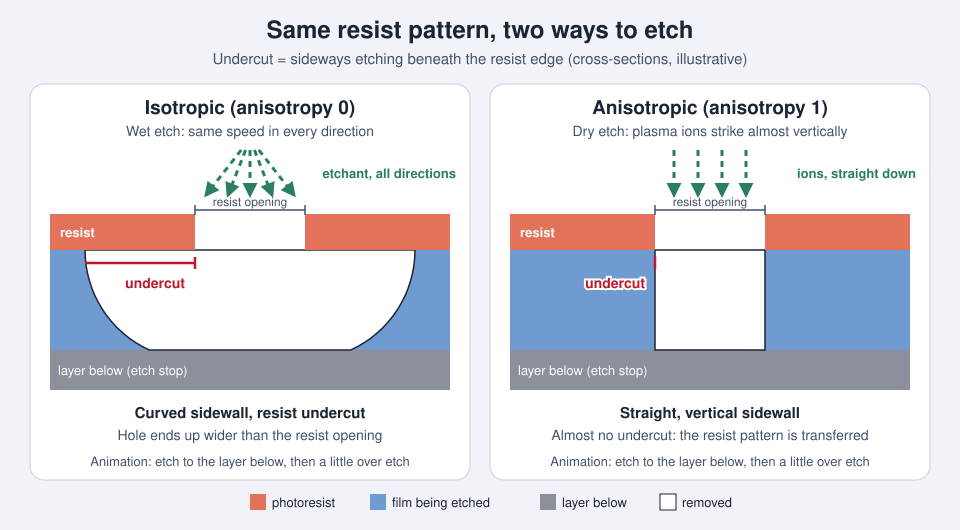

<!-- source: zh-TW/2-process-modules/06-etching/README.md | sha: f33e3fa12d05 -->

# Chapter 6: Etching — Carving Out the Pattern

> 📍 **Where the wafer is**
>
> - Previous stop: lithography, the photoresist now carries the circuit pattern
> - **This chapter: etching, removing the material underneath according to the resist pattern**
> - Next stop: strip the resist, clean, and then measure

---

## What etching does

After lithography, the circuit pattern exists only in the photoresist. The job of **etching** is to "transfer" that pattern into the material underneath: areas covered by resist are protected, and uncovered areas are removed.

Imagine sticking a cut-out stencil onto a sheet of glass and sandblasting it. Wherever the stencil does not cover is worn away. Peel off the stencil, and the design stays on the glass. The photoresist is that stencil.

---

## Wet etching and dry etching

**Wet etching** soaks the wafer in a chemical solution that dissolves the material, for example hydrofluoric acid dissolving silicon oxide. Wet etching proceeds at about the same speed in every direction, so it eats sideways under the edges of the resist. That makes it unsuitable for very fine patterns, and it is usually used to remove whole layers or for cleaning.

**Dry etching** uses a **plasma**. Charged ions are accelerated by an electric field and strike the wafer almost vertically, so the etch goes mainly downward and can produce straight sidewalls. The fine patterns of modern chips are made almost entirely by dry etching.

*Animated figure. [Open the interactive version](https://simon99.github.io/Semiconductor_Manufacturing_Introduction/ch06/etch-profiles.html) to try it yourself.*

> [!NOTE]
> **📖 Term | Isotropic and anisotropic (等向與非等向)**
>
> - **Definition**: Isotropic etching proceeds at the same speed in all directions. Anisotropic etching proceeds mainly in one direction, usually downward.
> - **On the floor**: "This step has to be anisotropic. We need vertical sidewalls."
> - **Related terms**: dry etch, wet etch, undercut, profile
> - **Common confusion**: Dry etching is not always anisotropic. Some dry etches are deliberately tuned to be isotropic to remove material from the side. The result depends on the process conditions.

---

## Plasma: the etching tool

A **plasma** is a gas that has been excited by high energy into a mixture of ions, electrons and highly reactive fragments of molecules. It is often called the fourth state of matter. An etch tool feeds specific gases into a vacuum chamber and turns them into a plasma with radio-frequency (RF) power, and the chamber gives off a faint glow.

The reactive fragments in the plasma react chemically with the material, while the ions provide the direction. Working together, they etch downward both fast and precisely.

---

## What to measure in etching

- **Etch rate**: How deep the etch goes per minute.
- **Uniformity**: Whether the etch is the same at different places on the wafer.
- **Selectivity**: How much faster the target material etches than the materials you do not want to etch.
- **Profile**: Whether the sidewalls are straight or bow inward or outward.
- **CD change**: How much the line width changes after etching compared with after lithography.

> [!NOTE]
> **📖 Term | Selectivity (選擇比)**
>
> - **Definition**: The ratio between the etch rate of the target material and the etch rate of another material. The higher the selectivity, the better the etch removes only what you want.
> - **On the floor**: "Selectivity to nitride isn't high enough. We punched through the stop layer."
> - **Related terms**: etch stop layer, over etch, resist consumption
> - **Common confusion**: Always say "selectivity to what." Selectivity to the photoresist and selectivity to the layer underneath are two different numbers.

---

## How to know when to stop

When the etch clears the target material and reaches the next layer, the chemistry of the plasma changes, and so do the color and intensity of the light it gives off. The tool watches this light continuously to tell when it has etched through. This is called **endpoint detection**.

After reaching the endpoint, the etch usually continues for a little longer to make sure the material is cleared everywhere on the wafer. This is called **over etch**. Too little leaves residue behind; too much damages the layer underneath.

---

## After etching

When etching is done, an oxygen plasma first burns off the photoresist. This is called **ashing** or **strip**. Then the wafer is cleaned, and the line width and defects are measured. This check is called **AEI** (after etch inspection).

Unlike lithography, etching usually cannot be redone if it goes wrong, because the material has already been removed.

---

## Digging deeper: high-aspect-ratio etching

Products such as memory need extremely deep and narrow holes, with depths dozens of times their width. The deeper the hole, the harder it is for ions to reach the bottom. The etch slows down, and the hole may bend, twist, or become wider in the middle. This is one of the hardest processes today. See [Chapter 13](../../3-integration/13-memory/README.md).

> [!TIP]
> **🔧 Know-how | A freshly cleaned chamber needs "seasoning" first**
>
> - **Situation**: An etch chamber has just been maintained, and its inner walls are spotless.
> - **Practice**: Run some dummy wafers first so that a stable layer of deposits coats the chamber walls, and only then start running product. This step is called **seasoning**.
> - **Why**: The plasma interacts with the chamber walls. Different wall conditions change the makeup of the plasma, which changes the etch rate.
> - **If you skip it**: The first few lots after maintenance etch differently, which can push line width or depth out of spec.
> - **Related chapters**: [Chapter 1: How a Fab Works](../../0-before-you-start/01-how-a-fab-works/README.md)

> [!TIP]
> **🔧 Know-how | On the same tool, different chambers must be matched**
>
> - **Situation**: An etch tool usually has several chambers, and the wafers of one lot are spread across them.
> - **Practice**: Engineers regularly compare the results of each chamber and keep them as close as possible. The system also records which chamber processed each wafer.
> - **Why**: Small differences between chambers create systematic differences between wafers.
> - **If you skip it**: A few wafers in a lot perform noticeably worse, and nobody can find out why. With chamber records, you can see that "all the problems came from the same chamber."
> - **Related chapters**: [Chapter 16: Yield and Failure Analysis](../../4-yield-and-quality/16-yield-analysis/README.md)

---

## Common problems

| Problem | Possible cause | Result |
|---|---|---|
| Under etch | Not enough time or power, wrong endpoint call | Leftover material causes open circuits |
| Over etch | Insufficient selectivity, too much time | Damage to the layer underneath |
| CD shift | Change in sidewall profile, too much resist consumed | Line width out of spec |
| Particles | Deposits flaking off the chamber walls | Defects, shorts |
| Loading effect | Dense and sparse areas of the pattern etch at different speeds | Different depths within one die |

---

## Key takeaways

1. Etching transfers the pattern in the photoresist into the material underneath.
2. Wet etching is isotropic, while dry etching uses plasma to etch anisotropically. Fine modern patterns rely mainly on dry etching.
3. Selectivity decides whether you can "remove only what you want."
4. Endpoint detection uses the light given off by the plasma to tell when to stop.
5. Etching usually cannot be redone, so managing the condition of the chamber is especially important.

---

## Further reading

- Peter Van Zant, *Microchip Fabrication*, chapters on etching
- James D. Plummer, Michael D. Deal and Peter B. Griffin, *Silicon VLSI Technology*, chapter on etching

---

[← Chapter 5: Thin Films](../../2-process-modules/05-thin-films/README.md) | [Contents](../../README.md) | [Chapter 7: Ion Implantation and Thermal Processing →](../../2-process-modules/07-ion-implantation/README.md)
