<!-- source: zh-TW/2-process-modules/10-metallization/README.md | sha: a059ae8006a5 -->

# Chapter 10: Metallization — Wiring the Transistors Together

> 📍 **Where the wafer is**
>
> - Previous stop: the transistors are finished (see Chapter 11 for the full sequence)
> - **This chapter: metallization, building the metal wires that connect the transistors**
> - Next stop: stack up layer after layer, and finally cover the chip with a passivation layer

---

## Connecting billions of transistors

Once the transistors are built, metal wires are needed to connect them into circuits. An advanced chip has billions of transistors, and one layer of wiring is nowhere near enough, so the wiring is stacked in several layers. Advanced chips have more than ten.

The wiring is a lot like a city's road network:

- **Lower layers**: Narrow and dense, like alleys, connecting nearby transistors.
- **Middle layers**: Wider, like city streets, connecting different circuit blocks.
- **Upper layers**: The thickest and widest, like highways, carrying signals over long distances and delivering power.

*Animated figure. [Open the interactive version](https://simon99.github.io/Semiconductor_Manufacturing_Introduction/ch10/metal-layers.html) to try it yourself.*

---

## Contacts and vias

Between the transistors and the first metal layer lies an insulating layer. To connect them, small holes are opened in the insulator and filled with metal. These holes are called **contacts**. Contacts are usually filled with **tungsten**, because CVD tungsten can fill small, deep holes completely. The excess tungsten is then removed with CMP.

The holes that connect one metal layer to another are called **vias**.

> [!NOTE]
> **📖 Term | Contact and via (接觸窗與導通孔)**
>
> - **Definition**: A contact connects a transistor to the first metal layer; a via connects two metal layers.
> - **On the floor**: "This via is open," meaning the via did not connect and there is an open circuit.
> - **Related terms**: tungsten plug, barrier layer, via chain
> - **Common confusion**: Both are "holes filled with metal." The difference is where they connect: contacts sit on top of transistors, and vias sit between metal layers.

---

## From aluminum to copper

Early wiring used **aluminum**. Aluminum was deposited over the whole wafer with PVD, and lithography and etching removed the unwanted aluminum, leaving the wires behind.

In the late 1990s, the industry began switching to **copper**. Copper has lower resistance than aluminum and is less likely to be damaged by long-term current flow. But copper has one big problem: it is very hard to pattern with dry etching. So the industry switched to the opposite approach: **dig the trenches first, then fill them with copper**.

---

## The damascene process

The name comes from an ancient inlay craft of Damascus: carve grooves into the surface of an object, fill them with metal, and then polish the surface flat. Copper wiring is made in almost exactly the same way:

**Deposit dielectric → Etch vias and trenches → Barrier and seed layers → Copper plating → Anneal → Copper CMP → Cap layer**

1. **Deposit dielectric**: Deposit a layer of insulating material with CVD.
2. **Etch**: Use lithography and etching to open the vias and the trenches for the wires.
3. **Barrier and seed layers**: First deposit an extremely thin barrier layer to keep copper from diffusing out, then a thin layer of copper as the starting point for plating.
4. **Copper plating**: Put the wafer in a plating bath and fill the holes and trenches with copper.
5. **Anneal**: Heat the wafer to stabilize the copper's structure.
6. **Copper CMP**: Polish away the copper outside the trenches.
7. **Cap layer**: Cover the copper surface with a thin cap layer to keep the copper from oxidizing or diffusing.

When the vias and trenches are filled with copper together, the process is called **dual damascene**, which saves one round of filling and polishing. Every metal layer repeats this flow, building up layer by layer.

*Animated figure. [Open the interactive version](https://simon99.github.io/Semiconductor_Manufacturing_Introduction/ch10/dual-damascene.html) to try it yourself.*

> [!NOTE]
> **📖 Term | Damascene process (大馬士革製程)**
>
> - **Definition**: A way of making wires by etching trenches into an insulator, filling them with metal, and polishing away the excess with CMP.
> - **On the floor**: "These layers are copper dual damascene."
> - **Related terms**: electroplating, barrier layer, seed layer, copper CMP
> - **Common confusion**: Aluminum wiring is "deposit metal, then etch it," while copper wiring is "etch trenches, then fill with metal." The order is reversed.

> [!TIP]
> **🔧 Know-how | Copper plating must fill from the bottom up**
>
> - **Situation**: Narrow, deep trenches have to be completely filled with copper.
> - **Practice**: Special additives in the plating bath make copper grow faster at the bottom of the hole than at the opening, so the hole fills from the bottom up.
> - **Why**: If copper grows faster at the opening, the opening closes first.
> - **If you skip it**: Voids are left inside the wires, resistance goes up, and the wires are more likely to break over long-term use.
> - **Related chapters**: [Chapter 5: Thin Films](../../2-process-modules/05-thin-films/README.md)

---

## Low-k dielectrics

The wires are separated by insulating material. Two wires close together act like a small capacitor, which slows signals down and increases power consumption. To reduce this effect, advanced processes use **low dielectric constant materials** (low-k) as the insulator between wires.

Low-k materials often contain tiny pores, which make them mechanically weak. They are easily damaged during etching, CMP and packaging, so they must be handled with special care.

---

## The challenges of ever-thinner wires

As wires get thinner, problems multiply:

- **Higher resistance**: In very thin wires, the barrier layer takes up a larger share of the space, and electrons scatter more easily. The industry is studying other metals for the thinnest wires.
- **Electromigration**: Long-term current flow pushes metal atoms away bit by bit, eventually forming voids that break the wire. See [Chapter 22](../../5-backend/22-final-test-and-reliability/README.md).

> [!TIP]
> **🔧 Know-how | Don't leave copper sitting after CMP**
>
> - **Situation**: Copper CMP is done, and the copper on the wafer surface is directly exposed to air.
> - **Practice**: There is a Q-time limit between CMP and the cap layer deposition. If it is exceeded, an engineer decides how to handle the lot.
> - **Why**: Bare copper oxidizes and corrodes easily.
> - **If you skip it**: The copper surface degrades, via contact resistance goes up, and reliability suffers.
> - **Related chapters**: [Chapter 9: Cleaning and Contamination Control](../../2-process-modules/09-cleaning/README.md)

---

## Common problems

| Problem | Possible cause | Result |
|---|---|---|
| Voids in copper fill | Plating conditions off, opening too narrow | Higher resistance, reliability problems |
| Copper residue | Insufficient CMP | Shorts between wires |
| Open vias | Under etch, residue at the bottom of the via | Open circuits |
| Barrier failure | Barrier too thin or discontinuous | Copper diffuses and causes leakage |
| Low-k damage | Stress from etching, CMP or packaging | Leakage, delamination |

---

## Key takeaways

1. Chips use multiple layers of metal wiring to connect transistors, narrow and dense at the bottom, thick and wide at the top.
2. Contacts connect transistors to the first metal layer, and vias connect metal layers to each other.
3. Since copper replaced aluminum, wires have been made by the damascene process: "etch trenches, fill with copper, polish flat."
4. Barrier layers keep copper from diffusing, and low-k dielectrics reduce interference between wires.
5. The thinner the wires, the worse the problems of resistance and electromigration.

---

## Further reading

- James D. Plummer, Michael D. Deal and Peter B. Griffin, *Silicon VLSI Technology*, chapter on back-end technology
- Hong Xiao, *Introduction to Semiconductor Manufacturing Technology*, chapter on metallization

---

[← Chapter 9: Cleaning and Contamination Control](../../2-process-modules/09-cleaning/README.md) | [Contents](../../README.md) | [Chapter 11: A Complete CMOS Process Flow →](../../3-integration/11-cmos-process-flow/README.md)
