<!-- source: zh-TW/3-integration/11-cmos-process-flow/README.md | sha: 7ad994e1e677 -->

# Chapter 11: A Complete CMOS Process Flow — Putting the Modules Together

> 📍 **Where the wafer is**
>
> - Previous stop: getting to know each process module
> - **This chapter: connecting the modules into one complete CMOS flow**
> - Next stop: see how transistors went from planar to three-dimensional

---

## From parts to a working machine

The process modules in the previous chapters are like building blocks. This chapter puts them together and walks through the flow of a CMOS chip, from a blank wafer to a finished one.

What follows is a simplified flow for planar transistors. Real advanced processes have many more steps, but the skeleton is the same. Once you understand this skeleton, you can roughly tell what each step is doing in any process flow you see.

---

## A loop that keeps repeating

The whole flow is long, but most of it is the same loop:

**Deposit a material → Define a pattern with lithography → Etch or implant → Strip resist and clean → Measure**

Each lithography step uses one mask and is called a **mask layer**. The whole flow can be divided by purpose into three big stages: FEOL, MOL and BEOL.

> [!NOTE]
> **📖 Term | FEOL, MOL and BEOL (前段、中段、後段製程)**
>
> - **Definition**: FEOL (front end of line) builds the transistors; MOL (middle of line) connects the transistors to the wiring above; BEOL (back end of line) builds the multilevel metal wiring.
> - **On the floor**: "This is a BEOL issue. It has nothing to do with FEOL."
> - **Related terms**: front end, back end, contact, metal layer
> - **Common confusion**: Where the three stages divide varies slightly from fab to fab, and MOL is sometimes counted as part of FEOL or BEOL. Also note that these "front end" and "back end" stages all happen inside the fab, which is different from the "back end" of packaging and test. See [Chapter 0](../../0-before-you-start/00-overview/README.md).

---

## Stage 1: FEOL, building the transistors

1. **Isolation**: Etch shallow trenches around each transistor, fill them with silicon oxide, and polish them flat with CMP so neighboring transistors do not interfere with each other.
2. **Wells**: Use lithography and implantation to form the P-wells (for NMOS) and the N-wells (for PMOS) separately, then anneal.
3. **Gate**: Grow an extremely thin gate insulator, deposit the gate material, and define the gates with lithography and etching. The gate length is one of the most critical dimensions in the whole flow.
4. **Light doping**: Implant a shallow, light dose on both sides of the gate.
5. **Sidewall spacers**: Deposit a film and then etch the whole wafer straight down, leaving only a small piece on each side of the gate. These are the **spacers**.
6. **Source and drain**: Implant a deep, heavy dose. The spacers keep this implant a small distance away from the gate. Then anneal to activate.
7. **Silicide**: Deposit a metal and heat it so it reacts with the silicon on the source, drain and gate, forming a compound with very low resistance that makes the later connections easier.

*Animated figure. [Open the interactive version](https://simon99.github.io/Semiconductor_Manufacturing_Introduction/ch11/feol-flow.html) to try it yourself.*

> [!NOTE]
> **📖 Term | STI (Shallow Trench Isolation, 淺溝槽隔離)**
>
> - **Definition**: A structure that separates devices by etching shallow trenches between transistors and filling them with insulating material.
> - **On the floor**: "STI depth is on the shallow side." "After STI CMP, check the remaining nitride thickness."
> - **Related terms**: active area, CMP, isolation
> - **Common confusion**: STI is usually one of the first structures built in the flow. It does not conduct, but its shape affects the behavior and leakage of the transistors.

### How modern gates are made

Advanced processes no longer use silicon oxide and polysilicon for the gate. They use a **high-k dielectric** with a **metal gate** (HKMG). Because the metal gate cannot survive the high temperature of the source and drain anneal, a common approach is to first build a "dummy gate" from polysilicon to hold the place. After the high-temperature steps are over, the dummy gate is removed and replaced with the real metal gate. This "build a fake one first, then swap in the real one" way of thinking is very common in advanced processes. See [Chapter 12](../../3-integration/12-advanced-transistors/README.md).

---

## Stage 2: MOL, connecting the transistors

An insulating layer is deposited over the transistors. Lithography and etching open contacts aligned to the source, drain and gate, which are then filled with tungsten and polished flat with CMP. This step gives the transistors "sockets" that connect them to the outside.

---

## Stage 3: BEOL, building the wiring

Next, the damascene process from Chapter 10 builds the copper wiring layer by layer. The wires in the top few layers are the thickest. Finally, a **passivation layer** covers the chip, with openings only at the **bond pads**, so that test probes and package wires can reach the chip later.

When this is done, the wafer leaves the fab and moves on to test. See [Chapter 19](../../5-backend/19-wafer-test/README.md).

| Stage | Main purpose | Modules used |
|---|---|---|
| FEOL | Isolation, wells, gates, source and drain | Thin films, lithography, etching, implantation, thermal processing, CMP |
| MOL | Contacts | Lithography, etching, tungsten deposition, CMP |
| BEOL | Multilevel wiring, passivation, bond pads | Thin films, lithography, etching, electroplating, CMP |

---

## Mask count

A simple CMOS process needs about twenty masks. The most advanced processes, with multiple patterning, can need several dozen or more. Each extra layer means another round of "deposit, lithography, etch, clean, measure," adding cost and cycle time.

> [!TIP]
> **🔧 Know-how | Compare efficiency in "days per mask layer"**
>
> - **Situation**: You want to compare which of two products with different mask counts is being produced more efficiently.
> - **Practice**: Divide the cycle time by the number of mask layers to get the average number of days per mask layer. The industry often uses this metric to compare fab efficiency. Typical values are roughly one to two days per layer, and lower is better.
> - **Why**: More mask layers mean more steps, so the total time is naturally longer. Dividing by the layer count makes the comparison fair.
> - **If you skip it**: Looking only at total days, you would wrongly conclude that the product with more layers is being made less efficiently.
> - **Related chapters**: [Chapter 1: How a Fab Works](../../0-before-you-start/01-how-a-fab-works/README.md)

> [!TIP]
> **🔧 Know-how | A wafer comes back to the same tools many times**
>
> - **Situation**: Over the whole flow, a wafer returns to the lithography area dozens of times.
> - **Practice**: Dispatching has to take into account where each lot is in its flow, and keep the busiest tools, usually lithography, from sitting idle.
> - **Why**: Newly started wafers and nearly finished wafers compete for the same tools. This "re-entrant" flow is why fab scheduling is especially complex.
> - **If you skip it**: Wafers pile up in front of the bottleneck tools, and the cycle time of the whole fab grows.
> - **Related chapters**: [Chapter 23: How Systems Run the Fab](../../6-beyond-the-fab/23-fab-systems/README.md)

---

## Key takeaways

1. The whole flow is made of the loop "deposit, lithography, etch or implant, clean, measure."
2. FEOL builds the transistors, MOL connects them, and BEOL builds the multilevel wiring.
3. Advanced processes often build a dummy gate first and then replace it with a metal gate.
4. The more mask layers, the higher the cost and the longer the cycle time.
5. Wafers return to the same kinds of tools again and again, which makes scheduling very complex.

---

## Further reading

- James D. Plummer, Michael D. Deal and Peter B. Griffin, *Silicon VLSI Technology*, Chapter 2 (a complete CMOS flow)
- Michael Quirk and Julian Serda, *Semiconductor Manufacturing Technology*, chapters on process integration

---

[← Chapter 10: Metallization](../../2-process-modules/10-metallization/README.md) | [Contents](../../README.md) | [Chapter 12: Advanced Transistor Structures →](../../3-integration/12-advanced-transistors/README.md)
