<!-- source: zh-TW/3-integration/12-advanced-transistors/README.md | sha: 4a40ff048c2e -->

# Chapter 12: Advanced Transistor Structures — From Planar to 3D

> 📍 **Where the wafer is**
>
> - Previous stop: walking through a planar-transistor CMOS flow
> - **This chapter: how the transistor structure went from planar to three-dimensional**
> - Next stop: memory processes

---

## The limits of the planar transistor

Chapter 2 mentioned that once a transistor shrinks past a certain point, the gate has more and more trouble controlling the channel. The reason is that in a planar transistor, the gate controls the channel only **from above**. When the source and drain get too close together, current "sneaks through" deeper down, even when the gate is off, like a faucet that will not shut tight.

The other problem is the gate insulator. To give the gate better control, the insulator was made thinner and thinner, until it was only a few atomic layers thick and electrons could tunnel straight through it, causing leakage.

The industry took two paths to solve this: **change the materials** and **change the structure**.

---

## Changing the materials: strained silicon and HKMG

- **Strained silicon**: Slightly stretching or squeezing the silicon crystal lattice lets electrons and holes move faster. For example, silicon germanium is grown into the source and drain of a PMOS transistor to squeeze the channel.
- **HKMG**: A high-k gate insulator gives the same control with a thicker layer, reducing leakage. The gate also moved from polysilicon back to metal. See [Chapter 11](../../3-integration/11-cmos-process-flow/README.md).

---

## FinFET: making the channel stand up

A **FinFET** turns the channel into a thin vertical "fin," and the gate wraps around it on **three sides**. More control surface means much less leakage. FinFETs entered volume production in the early 2010s and were the mainstream for advanced processes for more than a decade.

The fins are packed so closely that they usually need the multiple patterning tricks from Chapter 4. And a transistor's drive strength depends on how many fins it uses, so designers can only choose "one fin, two fins, three fins" and cannot tune it freely.

*Animated figure. [Open the interactive version](https://simon99.github.io/Semiconductor_Manufacturing_Introduction/ch12/planar-finfet-gaa.html) to try it yourself.*

> [!NOTE]
> **📖 Term | FinFET (鰭式場效電晶體)**
>
> - **Definition**: A transistor structure in which the channel is a vertical fin and the gate wraps it on three sides.
> - **On the floor**: "This device uses three fins."
> - **Related terms**: fin, multiple patterning, GAA
> - **Common confusion**: The name FinFET comes from its shape, which looks like a fish fin. It has nothing to do with the material.

---

## GAA: the gate wraps all the way around

When FinFETs also reached their limits, the next step was to let the gate wrap the channel on **all four sides**. This is called **GAA** (gate-all-around). The mainstream GAA design makes the channel out of a few thin sheets stacked horizontally, called **nanosheets**, and it began volume production in the 2020s.

The key process steps are roughly:

**Alternate silicon and SiGe epitaxy → Form fin-shaped stacks → Build dummy gate → Form inner spacers → Remove SiGe to release the channels → Fill in the gate**

The most critical step is removing the silicon germanium. An etch with extremely high selectivity removes only the SiGe layers sandwiched in between, leaving sheets of silicon channel suspended in the air. ALD then fills the gaps between the sheets with the gate insulator and metal.

The width of the nanosheets can be adjusted, so designers are no longer limited to choosing a number of fins as with FinFETs.

> [!NOTE]
> **📖 Term | GAA and nanosheet (環繞式閘極與奈米片)**
>
> - **Definition**: GAA is a transistor structure in which the gate completely surrounds the channel. A nanosheet is today's mainstream way to build GAA, with a channel made of a few horizontally stacked thin sheets.
> - **On the floor**: "This generation moves to GAA with three stacked sheets."
> - **Related terms**: silicon germanium, channel release, inner spacer
> - **Common confusion**: GAA is the concept, and the nanosheet is one way to realize it. There are other forms, such as nanowires, and the names are often used interchangeably.

---

## Backside power delivery: moving the power lines to the back

Traditionally, signal lines and power lines all crowd into the metal layers on the front of the wafer. The denser the transistors, the more congested the wiring, and power lines that are too thin cause voltage drop.

**Backside power delivery** moves the power network to the back of the wafer. The front of the wafer is first bonded to a carrier wafer, the stack is flipped over, the original wafer is thinned until it is extremely thin, and then power wiring is built on its back. This leaves the front for signal wiring and makes the power supply more stable. The technology began entering volume production in the mid-2020s.

---

## The evolution at a glance

| Structure | Sides of the channel wrapped by the gate | Volume production began | Main process challenge |
|---|---|---|---|
| Planar transistor | One | Very early; still widely used in mature processes | Leakage, short-channel effects |
| FinFET | Three | 2010s | Fin shape and uniformity |
| GAA nanosheet | Four | 2020s | Selective etching, inner spacers |

Looking further ahead, the industry is researching structures that stack NMOS and PMOS on top of each other, as well as new materials for the channel.

> [!TIP]
> **🔧 Know-how | Build a fake one first, then swap in the real one**
>
> - **Situation**: Newcomers often wonder why so many materials are deposited only to be removed later.
> - **Practice**: Advanced processes make heavy use of **sacrificial layers**: building a dummy gate and replacing it with a metal gate, growing SiGe and then removing it, and creating helper patterns in multiple patterning that are removed afterward.
> - **Why**: The final material may not survive the high temperatures of earlier steps, or it simply cannot be formed into that shape directly, so an easy-to-process material "holds the place" first.
> - **If you skip it**: Many advanced structures could not be built at all. Once you understand this way of thinking, complex process flows become much easier to follow.
> - **Related chapters**: [Chapter 4: Lithography](../../2-process-modules/04-lithography/README.md), [Chapter 13: Memory Processes](../../3-integration/13-memory/README.md)

> [!TIP]
> **🔧 Know-how | The more 3D the structure, the harder it is to measure**
>
> - **Situation**: In a GAA transistor, the channels are hidden inside the gate and cannot be seen from above at all.
> - **Practice**: Use optical models to infer the dimensions of the 3D structure, and regularly cut wafers open and look at the cross-sections with an electron microscope.
> - **Why**: For a planar structure, you can measure line width from the top. A 3D structure has height, sidewall angle and the thickness of each layer to check.
> - **If you skip it**: Structural problems cannot be caught during processing and only show up at electrical test.
> - **Related chapters**: [Chapter 15: Metrology and Inspection](../../4-yield-and-quality/15-metrology/README.md)

---

## Key takeaways

1. As planar transistors shrank, the gate lost control and leakage grew worse and worse.
2. Strained silicon and HKMG improved transistor performance through materials.
3. FinFETs wrap the gate around the channel on three sides, and GAA wraps it on all four.
4. Backside power delivery moves the power lines to the back of the wafer, leaving the front for signals.
5. Advanced processes make heavy use of sacrificial layers: "build a fake one first, then swap in the real one."

---

## Further reading

- IEEE IRDS (International Roadmap for Devices and Systems), More Moore chapter
- Papers from IEEE IEDM (International Electron Devices Meeting)

---

[← Chapter 11: A Complete CMOS Process Flow](../../3-integration/11-cmos-process-flow/README.md) | [Contents](../../README.md) | [Chapter 13: Memory Processes →](../../3-integration/13-memory/README.md)
