<!-- source: zh-TW/3-integration/14-process-nodes/README.md | sha: e89889c74dda -->

# Chapter 14: What Does "3 nm" Really Mean? — Understanding Process Nodes

> 📍 **Where the wafer is**
>
> - Previous stop: the structures of logic and memory chips
> - **This chapter: understanding the "X-nanometer process" you hear about in the news**
> - Next stop: the world of quality and yield

---

## There is nothing 3 nm in "3 nm"

News reports often say a chip uses a "3 nm process," and many people assume something on the chip is only 3 nm wide. In fact, on a chip from the 3 nm generation, the distance between transistor gates is around forty to fifty nanometers, and you will not find any structure that is 3 nm.

The "nanometer" figure is really **the name of a generation**, not an actual dimension.

---

## Where the names came from

In the early days of the industry, the node name roughly matched the gate length of the transistor or the width of the densest lines, so the name and the real dimensions agreed.

The industry habit was to shrink dimensions to about 0.7 times each generation. Multiplying both the length and the width by 0.7 cuts the area roughly in half, so twice as many transistors fit in the same area. That is why node names followed the sequence 180, 130, 90, 65, 45, 32, 22, 14, 10, 7, 5 and 3 nm, with "half-node" generations such as 40, 28, 20 and 16 nm in between.

Later, transistor structures became more and more complex, the real dimensions could not keep up with the names, and the two gradually came apart. Recently, some companies have also started naming new generations in angstroms (Å, 0.1 nm), which are likewise just generation labels.

> [!NOTE]
> **📖 Term | Process node (製程節點)**
>
> - **Definition**: The name of a generation of process technology, usually given in nanometers.
> - **On the floor**: "This product is moving from 7 nm to 5 nm."
> - **Related terms**: scaling, Moore's law, transistor density
> - **Common confusion**: A node name is a generation label, not the real size of any structure on the chip. It is also a different thing from the CD measured in lithography.

---

## The dimensions that actually matter

To compare two processes, these numbers are more meaningful:

- **Contacted poly pitch** (CPP): The distance between two neighboring gates.
- **Minimum metal pitch** (MMP): The pitch of the densest metal layer.
- **Transistor density**: How many transistors fit per square millimeter, often given in millions of transistors per square millimeter.
- **SRAM cell area**: The size of one SRAM memory cell, often used as a reference for density.

*Animated figure. [Open the interactive version](https://simon99.github.io/Semiconductor_Manufacturing_Introduction/ch14/pitch.html) to try it yourself.*

> [!NOTE]
> **📖 Term | Pitch (間距)**
>
> - **Definition**: In a repeating pattern, the total width of one line plus one space.
> - **On the floor**: "The pitch on this layer is too tight to print in a single exposure."
> - **Related terms**: CPP, MMP, half pitch, CD
> - **Common confusion**: Pitch is line plus space, while CD usually refers only to the line itself. Half of the pitch is called the half pitch.

---

## Why different companies' "nanometers" cannot be compared directly

There is no common standard for node names, and every company names its nodes in its own way. Processes with the same name can differ a lot in density, and a process with a larger number can even be denser.

In addition, one generation usually comes in several versions, such as performance-enhanced, low-power and low-cost variants, and their characteristics are not all the same.

---

## Scaling is not only about the process

Much of the recent scaling has come from **design-technology co-optimization** (DTCO). For example, redesigning the layout of standard cells and reducing the number of metal tracks each cell needs can make a chip smaller even when the process dimensions have not shrunk much.

The fab gives designers a package of data that includes the **design rules** they must follow and the electrical models of the transistors. This is called the **PDK** (process design kit). Designing according to the PDK ensures that the chip can actually be made and will behave as expected.

> [!TIP]
> **🔧 Know-how | To compare processes, look at density and pitch, not the name**
>
> - **Situation**: A news story says one company's "N nm" beats another company's "M nm."
> - **Practice**: Compare transistor density, gate pitch, metal pitch, SRAM area, and performance and power under the same conditions.
> - **Why**: Node names have no common definition, so looking only at the numbers is misleading.
> - **If you skip it**: You reach wrong conclusions, such as believing that the process with the smaller number must be denser or better.
> - **Related chapters**: [Chapter 12: Advanced Transistor Structures](../../3-integration/12-advanced-transistors/README.md)

---

## Mature processes matter just as much

The most advanced processes get the most attention, but a huge number of chips in the world still use **mature processes** of twenty-something nanometers and above, such as automotive electronics, power management, microcontrollers, sensors and display drivers.

> [!TIP]
> **🔧 Know-how | Not every chip needs the most advanced process**
>
> - **Situation**: A new product has to choose which process generation to use.
> - **Practice**: Choose based on performance needs, cost, volume, and any analog or high-voltage requirements, rather than always chasing the newest generation.
> - **Why**: Masks and design for advanced processes are extremely expensive, and only high-volume, high-performance products can justify them. Many analog and high-voltage circuits actually work better on mature processes, whose reliability has also been proven over many years.
> - **If you skip it**: The product costs too much to compete, or fails to meet its analog, voltage and reliability requirements.
> - **Related chapters**: [Chapter 22: Final Test and Reliability](../../5-backend/22-final-test-and-reliability/README.md)

---

## Key takeaways

1. "X nanometers" is a generation name, not the real size of any structure on the chip.
2. Early node names matched real dimensions, but the two gradually came apart.
3. To compare processes, look at gate pitch, metal pitch, transistor density and SRAM area.
4. Scaling also comes from design-technology co-optimization, and the PDK is the bridge between design and manufacturing.
5. Mature processes still support a huge number of chip products.

---

## Further reading

- IEEE IRDS (International Roadmap for Devices and Systems), More Moore chapter
- WikiChip pages on technology nodes

---

[← Chapter 13: Memory Processes](../../3-integration/13-memory/README.md) | [Contents](../../README.md) | [Chapter 15: Metrology and Inspection →](../../4-yield-and-quality/15-metrology/README.md)
