<!-- source: zh-TW/4-yield-and-quality/15-metrology/README.md | sha: 09a99ca8b907 -->

# Chapter 15: Metrology and Inspection — The Eyes of the Fab

> 📍 **Where the wafer is**
>
> - Previous stop: right after any important process step
> - **This chapter: metrology and inspection, checking whether the step was done right**
> - Next stop: if it passes, on to the next step; if not, the wafer is held for disposition

---

## The eyes of the fab

The structures on a chip are only a few to a few tens of nanometers in size, far too small to see with the naked eye. After every important step, the fab needs tools to check: Is the thickness right? Is the line width right? Are there any defects?

These tools are the eyes of the fab. The data they produce decides whether a wafer can move on, and it is also the foundation of process control and yield analysis.

---

## Metrology and inspection are not the same

> [!NOTE]
> **📖 Term | Metrology and inspection (量測與檢測)**
>
> - **Definition**: Metrology measures specific values, such as film thickness and line width. Inspection searches the wafer for defects, such as particles, scratches and pattern problems.
> - **On the floor**: "This step only measures film thickness. There's no defect scan."
> - **Related terms**: CD-SEM, film thickness measurement, defect scan, defect review
> - **Common confusion**: People on the floor often loosely call both "metrology" or "measurement." But metrology produces a set of numbers, while inspection produces a map of defect locations, and the two are used differently.

---

## Common measurements

| What is measured | How | Typical timing |
|---|---|---|
| Film thickness | Shine light on the film and analyze the reflected light | After deposition and CMP |
| Line width (CD) | Measure from above with an electron microscope (CD-SEM) | After lithography and etching |
| 3D profile | Analyze scattered light and fit it with a model (OCD) | Key steps for advanced structures |
| Overlay | Measure the alignment marks of two layers | After lithography |
| Sheet resistance | Touch the surface with four probes | After implantation, anneal and metal deposition |

Many measurements are not taken on the real circuits. Instead, specially designed measurement patterns are placed in the **scribe lines** between dies or at specific locations. This keeps the probes away from the circuits and also gives more stable results.

---

## Defect inspection

Defect inspection usually has two steps:

1. **Scan**: Sweep the whole wafer with light or an electron beam. The tool compares images of neighboring dies. Since every die should look exactly the same, any difference may be a defect.
2. **Review**: Take close-up images of the defects found with an electron microscope and classify them, for example as particles, scratches or pattern bridging.

The result is a defect map showing the position and type of every defect on the wafer.

*Animated figure. [Open the interactive version](https://simon99.github.io/Semiconductor_Manufacturing_Introduction/ch15/defect-inspection.html) to try it yourself.*

> [!NOTE]
> **📖 Term | Defect (缺陷)**
>
> - **Definition**: Any abnormality on the wafer that should not be there, such as particles, scratches, residue, or distorted or broken patterns.
> - **On the floor**: "The defect count on this wafer suddenly jumped. Put it on hold first."
> - **Related terms**: defect scan, review, killer defect, defect map
> - **Common confusion**: Not every defect kills a chip. Defects that cause failures are called killer defects; the others may be harmless. See [Chapter 16](../../4-yield-and-quality/16-yield-analysis/README.md).

---

## Sampling: not every wafer is measured

If every step of every wafer were measured, the metrology tools would become a huge traffic jam and cycle time would grow dramatically. So fabs usually use **sampling**: they measure only some lots, some wafers in each lot, and some sites on each wafer.

Stable processes can use lower sampling rates. New products, tools fresh from maintenance, and processes that recently had problems get higher sampling rates.

> [!TIP]
> **🔧 Know-how | Sampling is a trade-off between risk and cost**
>
> - **Situation**: You have to decide how often to measure a step and how many wafers to measure each time.
> - **Practice**: Set sampling rules based on how stable and how important the process is, and let the system apply them automatically, such as one lot out of every few, and which wafers within each lot.
> - **Why**: Measuring more catches problems earlier, but metrology takes time and tool capacity. Measuring less speeds up output but raises the risk.
> - **If you skip it**: Measuring too much slows down the whole fab. Measuring too little lets abnormal wafers flow far down the line before anyone notices, and more lots are affected.
> - **Related chapters**: [Chapter 18: Handling Abnormalities and Engineering Changes](../../4-yield-and-quality/18-abnormality-handling/README.md)

---

## Destructive analysis

Some information can only be seen by cutting the wafer open, such as the cross-section of a 3D structure or the thickness and shape of each layer. In that case, the cross-section is examined with an electron microscope. This kind of analysis destroys the wafer, so it is used mainly in process development and failure analysis. See [Chapter 16](../../4-yield-and-quality/16-yield-analysis/README.md).

> [!TIP]
> **🔧 Know-how | Metrology tools have to be managed too**
>
> - **Situation**: Two metrology tools measure the same wafer and get different results.
> - **Practice**: Metrology tools are calibrated regularly, checked for repeatability on the same tool, and matched against each other.
> - **Why**: Every process decision is built on metrology data. If the measurement itself is wrong, every decision that follows is wrong too.
> - **If you skip it**: Good wafers are judged bad, or bad wafers are released. Automatic process control systems also "correct" the process in the wrong direction based on bad data.
> - **Related chapters**: [Chapter 17: Process Control](../../4-yield-and-quality/17-process-control/README.md)

---

## Common metrology pitfalls

| Pitfall | Description |
|---|---|
| Measuring the wrong place | The measurement site misses the target structure, and the data is distorted |
| Tool-to-tool differences | Different tools give different results on the same wafer |
| The measurement itself has an effect | For example, the electron beam makes photoresist shrink slightly |
| Sampling misses the problem | The abnormality happens on wafers that were not measured |

---

## Key takeaways

1. Metrology produces values and inspection finds defects. Both are how a fab judges the state of a wafer.
2. Common measurements include film thickness, line width, 3D profile, overlay and sheet resistance.
3. Defect inspection finds differences by comparing neighboring dies, then classifies them with electron microscope review.
4. Metrology uses sampling, which is a trade-off between risk and cost.
5. Metrology tools themselves must be calibrated and matched, or the data will mislead decisions.

---

## Further reading

- Alain C. Diebold (ed.), *Handbook of Silicon Semiconductor Metrology*
- Michael Quirk and Julian Serda, *Semiconductor Manufacturing Technology*, chapters on metrology and inspection

---

[← Chapter 14: What Does "3 nm" Really Mean?](../../3-integration/14-process-nodes/README.md) | [Contents](../../README.md) | [Chapter 16: Yield and Failure Analysis →](../../4-yield-and-quality/16-yield-analysis/README.md)
