<!-- source: zh-TW/5-backend/22-final-test-and-reliability/README.md | sha: a326b5e36509 -->

# Chapter 22: Final Test and Reliability — Making Sure Chips Last for Years

> 📍 **Where the wafer is**
>
> - Previous stop: packaging is finished
> - **This chapter: final test and reliability, making sure the chips work now and keep working for years**
> - Next stop: shipment into products

---

## Why test again after packaging

The good dies were already picked once at wafer test, but packaging itself can cause damage, such as bad wire bonds or package stress. Some characteristics can also only be tested after packaging and at different temperatures. So before shipment, every chip goes through **final test**.

---

## Final test

In final test, a **handler** places packaged chips into test sockets, and a tester runs functional and electrical tests. Common practices include:

- Testing at both high and low temperatures to confirm that the chip works in every environment.
- Sorting chips of the same type into different grades according to the speed or power they actually achieve. This is called **binning**. Chips from the same design may be sold under different specifications as a result.

Some products also go through **system-level test** (SLT), in which the chip is placed in an environment close to a real product and runs actual software.

> [!NOTE]
> **📖 Term | FT (Final Test, 最終測試)**
>
> - **Definition**: Functional and electrical testing of a chip after packaging and before shipment.
> - **On the floor**: "This lot lost quite a few units at the FT hot test."
> - **Related terms**: CP, handler, binning, SLT
> - **Common confusion**: CP tests dies on the wafer, while FT tests packaged chips. Their test items and purposes are not exactly the same.

*Animated figure. [Open the interactive version](../../../docs/ch22/final-test-binning.html) to change the test temperature and watch the bins change.*

---

## Burn-in: weeding out weak chips early

How a chip's failure rate changes over time is often described by a curve shaped like a bathtub:

- **Early failure period**: Right at the start of use, some weak chips fail quickly.
- **Stable period**: For a long time after that, the failure rate is low and steady.
- **Wear-out period**: After many years of use, the materials begin to age and the failure rate rises again.

**Burn-in** runs chips at high temperature and somewhat higher voltage for a while before shipment, so that weak chips fail early in the factory and are screened out, instead of failing in the customer's hands.

*Animated figure. [Open the interactive version](../../../docs/ch22/bathtub-curve.html) to change the burn-in time and see how much of the early-failure region it removes.*

> [!NOTE]
> **📖 Term | Bathtub curve (浴缸曲線)**
>
> - **Definition**: A curve describing how a product's failure rate changes over time, high at both ends and low in the middle, shaped like a bathtub.
> - **On the floor**: "Burn-in is about burning off the left side of the bathtub."
> - **Related terms**: burn-in, early failure, wear-out, reliability
> - **Common confusion**: Burn-in can only screen out early failures. It cannot make chips last longer, and it cannot fix wear-out problems caused by the design or the process.

---

## Reliability: how long it lasts

**Reliability** is how long a chip keeps working properly under its intended operating conditions. Ordinary consumer products may be expected to last several years, while automotive chips are expected to last more than a decade.

But nobody can wait ten years before shipping, so reliability tests are **accelerated**: higher temperature, voltage or humidity makes failures happen sooner, and models are then used to estimate the lifetime under normal use. Common tests include:

| Test | How | What it simulates |
|---|---|---|
| High temperature operating life (HTOL) | Run powered at high temperature for a thousand hours or more | Aging from long-term use |
| Temperature cycling | Switch repeatedly between high and low temperatures | Expansion and contraction from power cycles and environmental changes |
| Highly accelerated stress test (HAST) | High temperature, high humidity and pressure | Moisture getting into the package |
| Electrostatic discharge (ESD) test | Apply simulated electrostatic discharges | Static electricity from people or machines |

The conditions for these tests mostly follow standards set by international organizations such as JEDEC. Automotive chips follow separate, stricter standards, such as AEC-Q100.

---

## How chips age

A chip ages because the materials and structures built during manufacturing are exposed to current, voltage and temperature over long periods:

| Failure mechanism | What happens |
|---|---|
| Electromigration (EM) | Long-term current pushes metal atoms along, forming voids that break the wire |
| Time-dependent dielectric breakdown (TDDB) | An insulating layer under a long-term electric field eventually breaks down |
| Hot carrier injection (HCI) | High-energy electrons get into the gate insulator, and the transistor's characteristics slowly change |
| Bias temperature instability (BTI) | High temperature plus voltage makes Vt drift over time |

*Animated figure. [Open the interactive version](../../../docs/ch22/accelerated-aging.html) to change the temperatures and see how many years a 1000-hour test stands for.*

These mechanisms are closely tied to earlier chapters. For the quality of the wiring, see [Chapter 10](../../2-process-modules/10-metallization/README.md); for the gate insulator, see [Chapter 12](../../3-integration/12-advanced-transistors/README.md).

> [!TIP]
> **🔧 Know-how | Reliability is a matter of statistics**
>
> - **Situation**: A customer asks, "Will this chip fail?"
> - **Practice**: Describe reliability as a failure rate. A common unit is the **FIT**, the number of failures per billion device-hours.
> - **Why**: Nobody can predict on which day a particular chip will fail, but test results from large samples can estimate the failure probability of a whole population of chips.
> - **If you skip it**: You cannot discuss quality with customers in a shared language, and you cannot estimate how many failures will occur after the product is on the market.
> - **Related chapters**: [Chapter 17: Process Control](../../4-yield-and-quality/17-process-control/README.md)

> [!TIP]
> **🔧 Know-how | Automotive chips face stricter requirements**
>
> - **Situation**: The same process is used to make both consumer chips and automotive chips.
> - **Practice**: Automotive chips use stricter qualification standards and more screening tests, and they must handle a wider operating temperature range and a longer lifetime. The goal is "zero defects."
> - **Why**: Automotive chips must work for more than a decade, in the heat next to an engine or the cold of winter, and a failure may affect driving safety.
> - **If you skip it**: A chip failing in a car costs far more than in a consumer product and can lead to large-scale recalls.
> - **Related chapters**: [Chapter 14: What Does "3 nm" Really Mean?](../../3-integration/14-process-nodes/README.md)

---

## Key takeaways

1. Packaged chips are tested again at different temperatures and sorted into grades by performance.
2. The bathtub curve describes how failure rates change over time, and burn-in screens out chips that would fail early.
3. Reliability tests are accelerated to estimate a chip's long-term lifetime in a short time.
4. Electromigration, dielectric breakdown, hot carrier injection and BTI are the main aging mechanisms.
5. Reliability is a matter of statistics, and automotive chips face stricter requirements than consumer products.

---

## Further reading

- J. W. McPherson, *Reliability Physics and Engineering: Time-To-Failure Modeling*
- JEDEC, JESD47, *Stress-Test-Driven Qualification of Integrated Circuits*
- Automotive Electronics Council, AEC-Q100

---

[← Chapter 21: Advanced Packaging](../../5-backend/21-advanced-packaging/README.md) | [Contents](../../README.md) | [Chapter 23: How Systems Run the Fab →](../../6-beyond-the-fab/23-fab-systems/README.md)
