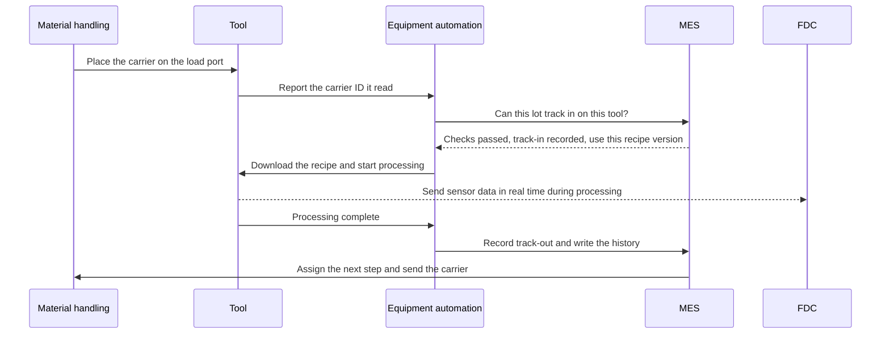

<!-- source: zh-TW/6-beyond-the-fab/23-fab-systems/README.md | sha: 75496740d2fb -->

# Chapter 23: How Systems Run the Fab — Why a Wafer Never Takes a Wrong Turn

> 📍 **Where the wafer is**
>
> - Previous stop: we have followed the wafer through the whole journey
> - **This chapter: looking at the fab again, this time from the point of view of its systems**
> - Next stop: after the chips ship, how the process shapes firmware

---

## A factory no one could keep in their head

Imagine this: thousands of lots are in production at the same time, and each one has to go through hundreds of steps. More than a thousand tools each have their own status and recipes, and the factory runs 24 hours a day. If any lot goes to the wrong step or uses the wrong recipe, the whole lot may be scrapped.

No one could keep a factory like this in their head. In a modern fab, almost every move a wafer makes is directed and recorded by systems, like an airport control tower combined with a logistics center.

---

## The main systems in a fab

| System | What it is responsible for | Analogy |
|---|---|---|
| MES (manufacturing execution system) | Records where every lot is and what its next step is, and controls every move in and out of a step | The brain and the ledger of the fab |
| Equipment automation | Connects tools to the MES, downloads recipes, starts processing and collects data | The tools' interpreter |
| Material handling control | Directs the overhead vehicles and stockers to deliver carriers to the right place | The logistics center |
| Dispatching | Decides which lot each tool should run next | Traffic lights |
| Recipe management | Manages the recipes of every tool and their versions | A recipe library |
| Process control | SPC, FDC and R2R, which monitor and control process quality | The quality inspector |
| Yield analysis | Combines process and test data to analyze yield | The detective |

> [!NOTE]
> **📖 Term | MES (Manufacturing Execution System, 製造執行系統)**
>
> - **Definition**: The core system that manages the production floor. It records the location, status and history of every lot and controls whether wafers may move on to the next step.
> - **On the floor**: "This lot shows hold in the MES. Find out why first."
> - **Related terms**: track-in, track-out, route, hold, dispatching
> - **Common confusion**: The MES is not every system in the fab. It is the core, but tool connections, material handling, dispatching and process control are usually handled by other systems that work together with it.

---

## What happens when a lot arrives at a tool

Take a lot arriving at an etch tool as an example:

1. An overhead vehicle places the wafer carrier on the tool's load port, and the tool reads the ID on the carrier.
2. The systems check, one by one: Should this lot be at this step now? Is this tool qualified for this product? Is the tool in a normal state? Is the lot on hold? Has its Q-time been exceeded? Does the carrier's contamination class match the tool?
3. Once every check passes, the system downloads the correct version of the recipe to the tool and records the **track-in**.
4. The tool starts processing and sends its sensor data to FDC in real time.
5. When processing is finished, the **track-out** is recorded, and the tool, chamber, recipe, time and other data are written into the lot's history.
6. The system decides the next step, and the material handling system delivers the carrier there or sends it to a stocker to wait.

> [!NOTE]
> **📖 Term | Track-in and track-out (進站與出站)**
>
> - **Definition**: Track-in is the record in the system that a lot has started processing at a step. Track-out is the record that processing is finished, which also moves the lot on to its next step.
> - **On the floor**: "The tool went down right after this lot tracked in. Somebody needs to fix the records."
> - **Related terms**: MES, route, history
> - **Common confusion**: The status in the system must always match the physical wafers. If the system shows a lot as tracked out while the wafers are actually still being processed, the records and reality do not match. Taiwanese fabs call this 帳實不符 ("the books don't match reality"), and it must be fixed immediately.

Tools come from many different vendors around the world. So that systems can talk to every tool in the same way, the industry has defined common communication standards, the most widely used being **SECS/GEM**. It is like a common language between tools and systems.

*Animated figure. [Open the interactive version](https://simon99.github.io/Semiconductor_Manufacturing_Introduction/ch23/lot-at-tool.html) to try it yourself.*

---

## Interlocks: making mistakes impossible

Every check in step 2 above is an **interlock rule**. For example:

- If the lot is not supposed to be at this step, it cannot track in.
- If the tool is not qualified, it cannot run this product.
- If the recipe version is wrong, processing cannot start.
- If the Q-time has expired or the lot is on hold, it cannot continue.
- A carrier that has touched copper cannot be placed on a front-end tool.

Many of these checks used to be done by people. Now they are written as system rules and enforced automatically. People get tired and distracted, but the system checks every single time.

> [!TIP]
> **🔧 Know-how | Behind every interlock rule, there is usually an incident**
>
> - **Situation**: A hot lot is rushing to ship, and someone wants to skip a system check "just this once."
> - **Practice**: Exceptions must go through a formal request and approval, be recorded, and be reviewed afterward to see whether the rule needs adjusting.
> - **Why**: Many rules were learned from past incidents. A rule often looks like a nuisance precisely because it has stopped the mistake from happening again, and people have forgotten why it exists.
> - **If you skip it**: The same incident happens again, and because the rule was bypassed, it is also hard to trace afterward.
> - **Related chapters**: [Chapter 18: Handling Abnormalities and Engineering Changes](../../4-yield-and-quality/18-abnormality-handling/README.md)

---

## History: the complete record of every wafer

The systems keep a complete **history** for every wafer: which steps it went through, which tools and chambers it used, which recipe versions, when, and what the measurements were.

These records are the memory of the whole factory and are used in many ways:

- When yield is abnormal, for commonality analysis to find what the bad wafers share. See [Chapter 16](../../4-yield-and-quality/16-yield-analysis/README.md).
- When a tool has a problem, to find which wafers were affected. See [Chapter 18](../../4-yield-and-quality/18-abnormality-handling/README.md).
- When a customer reports a problem, to trace a chip all the way back to its wafer, its lot and the conditions at every step.

---

## Data and smart manufacturing

A fab produces enormous amounts of data every day, including tool sensor data, measurements, test results and production records. This data is now being used for more and more:

- **Predictive maintenance**: Predicting when parts will need replacing from changes in tool data.
- **Virtual metrology**: Estimating measurement results from the tool's data during processing, so fewer real measurements are needed.
- **AI analysis**: Automatically recognizing wafer map patterns and finding the causes of yield loss.
- **Automated dispatching**: Deciding the best production order automatically based on the real-time situation.

> [!TIP]
> **🔧 Know-how | When the systems stop, the fab stops**
>
> - **Situation**: The MES suddenly crashes.
> - **Practice**: Core systems run on redundant architectures, system changes are fully tested and released at the times of least impact, and the fab prepares contingency procedures for system outages in advance.
> - **Why**: Every track-in and track-out goes through the systems. When the systems stop, the tools cannot keep producing even if they are working perfectly.
> - **If you skip it**: The whole fab stops, and lots that are waiting may exceed their Q-time and need rework or even be scrapped.
> - **Related chapters**: [Chapter 9: Cleaning and Contamination Control](../../2-process-modules/09-cleaning/README.md)

---

## Key takeaways

1. A fab is far too complex to manage by hand, so every move is directed and recorded by systems.
2. The MES is the core, working together with equipment automation, material handling, dispatching, recipe management and process control systems.
3. Before a lot tracks in, the systems check the step, the tool, the recipe, the Q-time, holds and the contamination class.
4. The complete history of every wafer is the foundation of yield analysis, abnormality handling and customer traceability.
5. Fab data is being used for predictive maintenance, virtual metrology and AI analysis.

---

## Further reading

- Heiko Meyer, Franz Fuchs and Klaus Thiel, *Manufacturing Execution Systems: Optimal Design, Planning, and Deployment*
- Wallace J. Hopp and Mark L. Spearman, *Factory Physics*
- SEMI standards for equipment communication (SECS/GEM)

---

[← Chapter 22: Final Test and Reliability](../../5-backend/22-final-test-and-reliability/README.md) | [Contents](../../README.md) | [Chapter 24: How the Process Shapes Firmware →](../../6-beyond-the-fab/24-process-and-firmware/README.md)
