<!-- source: zh-TW/6-beyond-the-fab/24-process-and-firmware/README.md | sha: 4eb0d45ae5e0 -->

# Chapter 24: How the Process Shapes Firmware — Hardware Truths for Software and Firmware Engineers

> 📍 **Where the wafer is**
>
> - Previous stop: the chips have shipped and are inside products
> - **This chapter: once the chips are running, how the process shapes firmware and software**
> - Next stop: the journey ends here; the appendices have a glossary and further reading

---

## Hardware truths that software never sees

Engineers who write firmware or drivers often run into "rules": memory must be refreshed regularly, ECC should be turned on, flash memory needs wear leveling, and a certain chip comes with a long errata list. These rules look like the hardware's quirks, but most of them come from the physical limits of the manufacturing process.

This chapter connects what you have learned about manufacturing with the problems software and firmware engineers face every day.

---

## Why DRAM needs refresh

Chapter 13 explained that DRAM stores charge in capacitors, and capacitors slowly leak. So the memory controller must regularly read out every row of data and write it back. Typically, all the data has to be refreshed once every few tens of milliseconds.

The higher the temperature, the faster the leakage, so refresh usually has to happen more often at high temperatures. During refresh, the memory cannot be accessed normally, and refresh also consumes power, so refresh is a fixed cost in DRAM performance and power.

> [!NOTE]
> **📖 Term | Refresh (刷新)**
>
> - **Definition**: Regularly reading the data in DRAM and writing it back to replace the charge the capacitors have lost, so the data is not lost.
> - **On the floor**: "At high temperature the refresh rate doubles, so we lose some bandwidth."
> - **Related terms**: DRAM, capacitor, data retention time, memory controller
> - **Common confusion**: Refresh is done automatically in the background by the memory controller and the DRAM, not by the operating system or applications, but firmware sets the related parameters.

---

## Row Hammer: memory cells packed too close

As DRAM cells get denser, neighboring cells disturb each other more easily. In 2014, researchers published the finding that simply accessing the same row of memory repeatedly and rapidly can flip the data in **neighboring rows**. This phenomenon is called **Row Hammer**.

It is not only a reliability problem but also a security problem, because an attacker may use it to change data they should not be able to change. Today's DRAM and memory controllers include mechanisms that detect this pattern and refresh the neighboring rows to defend against it.

*Animated figure. [Open the interactive version](https://simon99.github.io/Semiconductor_Manufacturing_Introduction/ch24/dram-refresh-rowhammer.html) to try it yourself.*

---

## ECC: errors will happen

Even when a chip is perfectly healthy, data can occasionally go wrong. For example, trace radioactive material in the package or particles from cosmic rays can flip a bit. These are called **soft errors**. Add weaker cells caused by process variation, and errors simply cannot be avoided completely.

> [!NOTE]
> **📖 Term | ECC (Error Correction Code, 錯誤更正碼)**
>
> - **Definition**: Extra check bits added to data so the system can detect and correct a small number of bit errors.
> - **On the floor**: "ECC must be enabled on this server's memory."
> - **Related terms**: soft error, bit flip, parity
> - **Common confusion**: ECC has a limit. It can correct only a certain number of errors; beyond that, it can only detect them. The ECC inside newer DRAM chips and system-level ECC are also two different things.

---

## The quirks of NAND flash

The 3D NAND described in Chapter 13 has several physical limits, and each one maps to a feature in firmware:

| Physical limit of NAND | Firmware countermeasure |
|---|---|
| Data cannot be overwritten in place; it must be erased first, and the erase unit is large | Address mapping (FTL) and garbage collection |
| Every program/erase cycle wears the storage layer, so the number of cycles is limited | Wear leveling |
| There are bad blocks from the factory, and more appear during use | Bad block management |
| Charge slowly leaks away, and reads disturb neighboring cells | Strong ECC, read retry, periodically moving data |

The more bits each cell stores, the more charge states must be told apart and the narrower the gaps between them, so the cells can be erased fewer times and need stronger ECC. This is where the differences in endurance between SLC, MLC, TLC and QLC come from.

---

## Every chip is different

Because the process varies, chips made from the same design differ slightly in speed and leakage. The binning described in Chapter 22 exists for exactly this reason.

Some chips have their characteristics or calibration values written into on-chip fuses during test. At boot, firmware reads this data and sets the most suitable voltage and frequency for each individual chip. Chip temperature and long-term aging also mean that firmware needs thermal protection, and specifications keep a safety margin.

> [!TIP]
> **🔧 Know-how | "Magic numbers" in firmware often come from the process**
>
> - **Situation**: The firmware code contains timing parameters, voltages or delays that seem to make no sense.
> - **Practice**: Before changing them, find out where these numbers came from, such as the datasheet, characterization reports or the vendor's recommended values.
> - **Why**: These numbers are usually based on measurements of large numbers of chips at different temperatures and voltages, and they already include margin for process variation and aging.
> - **If you skip it**: Everything looks fine on a few samples in the lab, but after mass production, hard-to-reproduce errors appear on some chips at some temperatures.
> - **Related chapters**: [Chapter 22: Final Test and Reliability](../../5-backend/22-final-test-and-reliability/README.md)

---

## Errata and chip revisions

Even after a chip is in mass production, design errors may still be found. Vendors collect the known problems and their workarounds in an **errata** document, and many of these problems have to be worked around in firmware or drivers.

Actually fixing a problem requires a new version of the chip, usually called a **stepping**. A common naming convention is that a letter change (for example, A to B) means the transistors at the bottom were also changed and most masks had to be remade, while a number change (for example, A0 to A1) means only the upper metal wiring was changed. The actual rules vary from company to company.

> [!TIP]
> **🔧 Know-how | Changing only the metal layers makes fixes fast and cheap**
>
> - **Situation**: A design error is found in a chip, and a fixed version is needed as soon as possible.
> - **Practice**: Designers scatter some spare logic gates across the chip in advance. When an error is found, changing just the masks of a few upper metal layers is enough to connect these spare gates into the circuit. The fab can even park some wafers just before the metal layers, so production can continue as soon as the fixed masks arrive.
> - **Why**: The masks for the transistor layers at the bottom are the most numerous and most expensive, and those layers take the longest to process. Changing only the upper metal saves a great deal of cost and time.
> - **If you skip it**: Every fix would have to start over from the beginning, wait several months, and cost much more.
> - **Related chapters**: [Chapter 11: A Complete CMOS Process Flow](../../3-integration/11-cmos-process-flow/README.md), [Chapter 18: Handling Abnormalities and Engineering Changes](../../4-yield-and-quality/18-abnormality-handling/README.md)

---

## Key takeaways

1. DRAM capacitors leak, so they must be refreshed regularly, and more often at higher temperatures.
2. The denser the memory cells, the more they disturb each other. Row Hammer is the classic example.
3. Soft errors cannot be avoided completely, and ECC is an important protection.
4. The physical limits of NAND map to firmware features such as the FTL, wear leveling, bad block management and ECC.
5. When a chip is revised, changing only the metal layers is much faster and cheaper than remaking every mask.

---

## Further reading

- Bruce Jacob, Spencer W. Ng and David T. Wang, *Memory Systems: Cache, DRAM, Disk*
- Rino Micheloni, Luca Crippa and Alessia Marelli, *Inside NAND Flash Memories*
- Yoongu Kim et al., "Flipping Bits in Memory Without Accessing Them: An Experimental Study of DRAM Disturbance Errors," ISCA 2014

---

[← Chapter 23: How Systems Run the Fab](../../6-beyond-the-fab/23-fab-systems/README.md) | [Contents](../../README.md) | [Appendix A: Glossary →](../../appendix/glossary.md)
