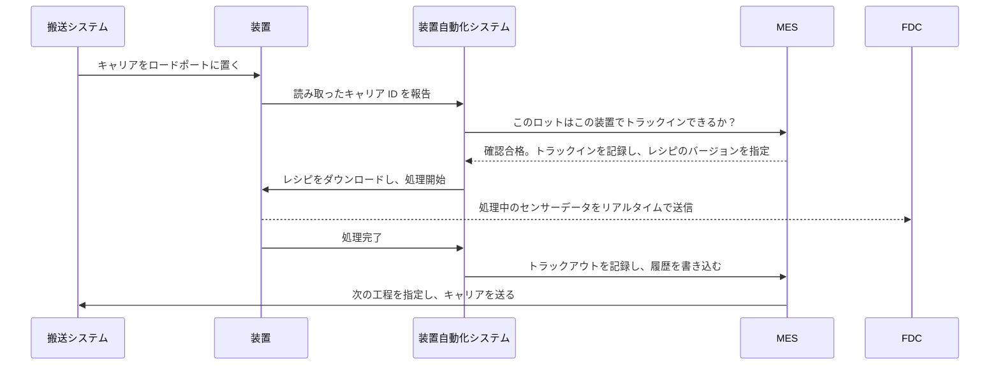

<!-- source: zh-TW/6-beyond-the-fab/23-fab-systems/README.md | sha: 75496740d2fb -->

# 第 23 章　システムによるファブ運営：ウェーハが道を間違えない理由

> 📍 **ウェーハの現在地**
>
> - 前の工程：ウェーハと一緒に旅の全体をたどった
> - **この章：システムの視点から、工場をもう一度見る**
> - 次の工程：チップが出荷されたあと、プロセスがファームウェアに与える影響

---

## 人の記憶では回らない工場

想像してみてください。工場では数千のロットが同時に生産されていて、どのロットも数百の工程を通らなければなりません。千台を超える装置はそれぞれ自分の状態とレシピを持ち、しかも工場は 24 時間止まらずに動いています。どれか一つのロットが工程を間違えたり、レシピを取り違えたりするだけで、ロット丸ごと廃棄になりかねません。

このような工場を人の記憶で回すことはできません。現代のファブでは、ウェーハのほぼすべての動きがシステムによって指示され、記録されています。空港の管制塔と物流センターを組み合わせたようなものです。

---

## 工場の主なシステム

| システム | 何を担当するか | たとえ |
|---|---|---|
| MES（製造実行システム） | 各ロットがどこにいて、次に何をするかを記録し、工程への出入りを一つずつ管理する | 工場の頭脳であり帳簿 |
| 装置自動化システム | 装置と MES をつなぎ、レシピのダウンロード、処理の開始、データ収集を行う | 装置の通訳 |
| 搬送制御システム | 天井搬送車とストッカーに指示し、キャリアを正しい場所へ届ける | 物流センター |
| ディスパッチシステム | 各装置が次にどのロットを処理するかを決める | 信号機 |
| レシピ管理システム | 各装置のレシピとそのバージョンを管理する | レシピのデータベース |
| プロセス制御システム | SPC、FDC、R2R で、プロセスの品質を監視・制御する | 品質検査員 |
| 歩留まり解析システム | プロセスとテストのデータを統合し、歩留まりを解析する | 探偵 |

> [!NOTE]
> **📖 用語｜MES（Manufacturing Execution System、製造実行システム、製造執行系統）**
>
> - **定義**：生産現場を管理する中核システム。各ロットの位置、状態、履歴を記録し、ウェーハが次の工程に進めるかどうかを管理する。
> - **現場での使い方**：「MES 上でこのロットはホールドになってる。まず理由を確認して」。
> - **関連用語**：トラックイン、トラックアウト、ルート、ホールド、ディスパッチ
> - **よくある混同**：MES は工場のすべてのシステムではない。中核ではあるが、装置との接続、搬送、ディスパッチ、プロセス制御はふつうほかのシステムが担い、互いに連携している。

---

## ロットが装置に着いたとき、何が起きるか

エッチング装置にロットが到着した場合を例にとります。

1. 天井搬送車がキャリアを装置のロードポートに置き、装置がキャリアの ID を読み取る。
2. システムが一つずつ確認する。このロットは今この工程にいるべきか。この装置はこの製品を処理する資格があるか。装置の状態は正常か。ロットはホールドされていないか。Q タイムを超えていないか。キャリアの汚染区分は装置と合っているか。
3. すべての確認に合格したら、システムが正しいバージョンのレシピを装置にダウンロードし、**トラックイン** を記録する。
4. 装置が処理を始め、同時にセンサーデータをリアルタイムで FDC に送る。
5. 処理が終わったら **トラックアウト** を記録し、使った装置、チャンバー、レシピ、時刻などをそのロットの履歴に書き込む。
6. システムが次の工程を決め、搬送システムがキャリアをそこへ運ぶか、ストッカーに入れて待たせる。

> [!NOTE]
> **📖 用語｜トラックインとトラックアウト（進站與出站）**
>
> - **定義**：トラックインは、ロットがある工程で処理を始めたことをシステムに登録すること。トラックアウトは処理が終わったことを登録し、ロットを次の工程へ進めること。
> - **現場での使い方**：「このロットをトラックインした直後に装置がダウンした。データの整合を取らないと」。
> - **関連用語**：MES、ルート、履歴
> - **よくある混同**：システム上の状態と実物のウェーハは常に一致していなければならない。システムではトラックアウト済みなのに、実際のウェーハはまだ処理中、というのはデータと実物の不一致であり、すぐに正す必要がある。台湾のファブではこれを「帳實不符（帳簿と実物が合わない）」と呼ぶ。

装置は世界中のさまざまなメーカーのものです。システムがどの装置とも同じ方法でやり取りできるように、業界は共通の通信規格を定めています。最も広く使われているのが **SECS/GEM** で、装置とシステムの間の共通語のようなものです。

---

## インターロック：ミスを起こせなくする

上の手順 2 の確認は、一つひとつが **インターロック（ポカヨケ）のルール** です。たとえば次のようなものです。

- ロットがこの工程にいるべきでなければ、トラックインできない。
- 装置が認定を受けていなければ、この製品を処理できない。
- レシピのバージョンが違えば、処理を始められない。
- Q タイムを超えていたり、ロットがホールドされていたりすれば、先へ進めない。
- 銅に触れたキャリアは、前工程の装置に置けない。

かつては多くの確認を人が照合していましたが、今はシステムのルールとして書かれ、システムが自動的に止めます。人は疲れたり気が散ったりしますが、システムは毎回必ず確認します。

> [!TIP]
> **🔧 ノウハウ｜インターロックのルールの裏には、たいてい事故がある**
>
> - **状況**：特急ロットの出荷を急いでいて、システムの確認を「今回だけ」飛ばしたいという人がいる。
> - **やり方**：例外処理には正式な申請と承認が必要で、記録を残し、あとでルールの見直しが必要かを検討する。
> - **理由**：多くのルールは過去の事故から学んだものである。ルールが面倒に見えるのは、それが止めてきたミスがもう起きなくなり、皆がそのルールの存在理由を忘れているからであることが多い。
> - **やらないとどうなる**：同じ事故がまた起き、しかもルールを飛ばしたせいで、あとから追跡するのも難しくなる。
> - **関連する章**：[第 18 章 異常処置と変更管理](../../4-yield-and-quality/18-abnormality-handling/README.md)

---

## 履歴：ウェーハ 1 枚ごとの完全な記録

システムは、ウェーハ 1 枚ごとに完全な **履歴** を残します。どの工程を通り、どの装置とチャンバーを使い、どのバージョンのレシピで、いつ処理され、測定結果はいくつだったか。

これらの記録は工場全体の記憶で、さまざまな場面で使われます。

- 歩留まりに異常があれば、共通性解析で共通点を見つける。[第 16 章](../../4-yield-and-quality/16-yield-analysis/README.md)を参照。
- 装置に問題があれば、影響を受けた範囲を特定する。[第 18 章](../../4-yield-and-quality/18-abnormality-handling/README.md)を参照。
- 顧客から問題が報告されたら、1 個のチップからそのウェーハ、ロット、各工程の生産条件までさかのぼる。

---

## データとスマート製造

ファブは毎日、装置のセンサーデータ、計測結果、テスト結果、生産記録など、膨大なデータを生み出しています。これらのデータは、ますます多くの用途に使われています。

- **予知保全**：装置データの変化から、部品の交換時期を予測する。
- **バーチャルメトロロジー**：装置の処理中のデータから計測結果を推定し、実際の計測回数を減らす。
- **AI による解析**：ウェーハマップのパターンを自動認識し、歩留まり損失の原因を見つける。
- **自動ディスパッチ**：リアルタイムの状況をもとに、最適な生産順序を自動で決める。

> [!TIP]
> **🔧 ノウハウ｜システムが止まれば、工場も止まる**
>
> - **状況**：MES が突然ダウンした。
> - **やり方**：中核システムは冗長構成で運用し、システムの変更は十分にテストしたうえで影響の最も小さい時間帯に適用する。工場はシステム停止時の緊急手順もあらかじめ用意しておく。
> - **理由**：ウェーハのトラックインとトラックアウトはすべてシステムを通る。システムが止まれば、装置が正常でも生産を続けられない。
> - **やらないとどうなる**：工場全体のラインが止まり、待っていたロットは Q タイムを超えて、リワークや廃棄が必要になることもある。
> - **関連する章**：[第 9 章 洗浄と汚染管理](../../2-process-modules/09-cleaning/README.md)

---

## この章のポイント

1. ファブの複雑さは人の手に負えず、あらゆる動きがシステムによって指示され、記録される。
2. MES が中核となり、装置自動化、搬送、ディスパッチ、レシピ管理、プロセス制御などのシステムと連携する。
3. ロットがトラックインする前に、システムは工程、装置、レシピ、Q タイム、ホールド、汚染区分を確認する。
4. ウェーハ 1 枚ごとの完全な履歴が、歩留まり解析、異常処置、顧客への追跡の土台である。
5. 工場のデータは、予知保全、バーチャルメトロロジー、AI 解析に活用されている。

---

## 参考文献

- Heiko Meyer、Franz Fuchs、Klaus Thiel『Manufacturing Execution Systems: Optimal Design, Planning, and Deployment』
- Wallace J. Hopp、Mark L. Spearman『Factory Physics』
- SEMI の装置通信に関する規格（SECS/GEM）

---

[← 第 22 章　最終テストと信頼性](../../5-backend/22-final-test-and-reliability/README.md) ｜ [目次](../../README.md) ｜ [第 24 章　プロセスとファームウェア →](../../6-beyond-the-fab/24-process-and-firmware/README.md)
