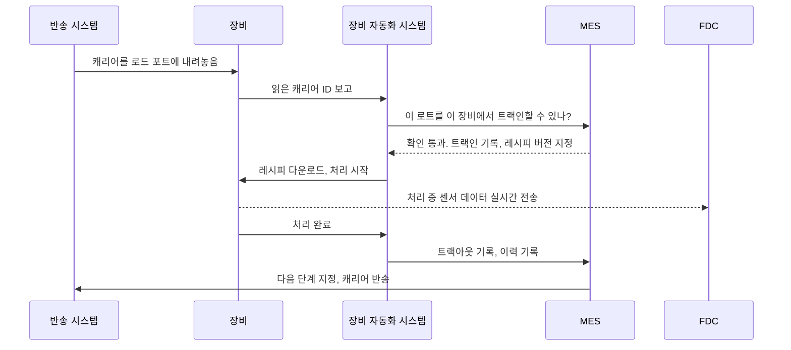

<!-- source: zh-TW/6-beyond-the-fab/23-fab-systems/README.md | sha: 75496740d2fb -->

# 제23장 시스템이 팹을 운영하는 방법: 웨이퍼가 길을 잃지 않는 이유

> 📍 **웨이퍼의 현재 위치**
>
> - 이전 단계: 웨이퍼와 함께 여정 전체를 걸어왔다
> - **이 장: 시스템의 관점에서 공장을 다시 본다**
> - 다음 단계: 칩이 출하된 뒤, 공정이 펌웨어에 미치는 영향

---

## 사람의 기억으로는 돌아가지 않는 공장

상상해 보세요. 공장에서는 수천 개의 로트가 동시에 생산되고 있고, 로트마다 수백 개의 단계를 거쳐야 합니다. 천 대가 넘는 장비는 저마다 상태와 레시피가 있고, 공장은 24시간 쉬지 않고 돌아갑니다. 로트 하나가 단계를 잘못 가거나 레시피를 잘못 쓰기만 해도 로트 전체를 폐기해야 할 수 있습니다.

이런 공장을 사람의 기억으로 운영할 수는 없습니다. 현대의 팹에서는 웨이퍼의 거의 모든 움직임을 시스템이 지시하고 기록합니다. 공항 관제탑과 물류 센터를 합친 것과 같습니다.

---

## 공장의 주요 시스템

| 시스템 | 맡는 일 | 비유 |
|---|---|---|
| MES（제조 실행 시스템） | 로트마다 어디에 있고 다음에 무엇을 할지 기록하고, 단계마다 들어가고 나가는 것을 관리한다 | 공장의 두뇌이자 장부 |
| 장비 자동화 시스템 | 장비와 MES를 잇고, 레시피 다운로드, 처리 시작, 데이터 수집을 한다 | 장비의 통역사 |
| 반송 제어 시스템 | 천장 반송 차량과 스토커에 지시해 캐리어를 올바른 곳으로 보낸다 | 물류 센터 |
| 디스패칭 시스템 | 장비마다 다음에 어느 로트를 처리할지 정한다 | 신호등 |
| 레시피 관리 시스템 | 장비마다 레시피와 그 버전을 관리한다 | 레시피 데이터베이스 |
| 공정 제어 시스템 | SPC, FDC, R2R로 공정 품질을 감시하고 제어한다 | 품질 검사원 |
| 수율 분석 시스템 | 공정과 테스트 데이터를 통합해 수율을 분석한다 | 탐정 |

> [!NOTE]
> **📖 용어｜MES（Manufacturing Execution System, 製造執行系統）**
>
> - **정의**: 생산 현장을 관리하는 핵심 시스템. 로트마다 위치, 상태, 이력을 기록하고, 웨이퍼가 다음 단계로 넘어갈 수 있는지를 관리한다.
> - **현장에서는**: "MES에서 이 로트 홀드로 떠 있어. 먼저 사유부터 확인해."
> - **관련 용어**: 트랙인, 트랙아웃, 루트, 홀드, 디스패칭
> - **흔한 혼동**: MES가 공장의 모든 시스템은 아니다. 핵심이긴 하지만, 장비 연결, 반송, 디스패칭, 공정 제어는 보통 다른 시스템이 맡고 서로 연동한다.

---

## 로트가 장비에 도착하면 무슨 일이 일어나나

식각 장비에 로트가 도착한 경우를 예로 들어 봅시다.

1. 천장 반송 차량이 캐리어를 장비의 로드 포트에 내려놓고, 장비가 캐리어 ID를 읽는다.
2. 시스템이 하나씩 확인한다. 이 로트는 지금 이 단계에 있어야 하는가? 이 장비는 이 제품을 처리할 자격이 있는가? 장비 상태는 정상인가? 로트가 홀드되어 있지 않은가? Q-타임을 넘지 않았는가? 캐리어의 오염 등급이 장비와 맞는가?
3. 모든 확인을 통과하면, 시스템이 올바른 버전의 레시피를 장비에 다운로드하고 **트랙인**을 기록한다.
4. 장비가 처리를 시작하고, 동시에 센서 데이터를 실시간으로 FDC에 보낸다.
5. 처리가 끝나면 **트랙아웃**을 기록하고, 사용한 장비, 챔버, 레시피, 시각 등을 그 로트의 이력에 쓴다.
6. 시스템이 다음 단계를 정하고, 반송 시스템이 캐리어를 그곳으로 옮기거나 스토커에 넣어 기다리게 한다.

> [!NOTE]
> **📖 용어｜트랙인과 트랙아웃（進站與出站）**
>
> - **정의**: 트랙인은 로트가 어떤 단계에서 처리를 시작했음을 시스템에 등록하는 것이다. 트랙아웃은 처리가 끝났음을 등록하고 로트를 다음 단계로 넘기는 것이다.
> - **현장에서는**: "이 로트 트랙인하자마자 장비가 다운됐어. 데이터 정합을 맞춰야 해."
> - **관련 용어**: MES, 루트, 이력
> - **흔한 혼동**: 시스템상의 상태와 실물 웨이퍼는 항상 일치해야 한다. 시스템에서는 트랙아웃되었는데 실제 웨이퍼는 아직 처리 중이라면 데이터와 실물이 맞지 않는 것이며, 바로 바로잡아야 한다. 대만 팹에서는 이를 '장실불부(帳實不符, 장부와 실물이 맞지 않음)'라고 부른다.

장비는 세계 여러 제조사의 것입니다. 시스템이 어떤 장비와도 같은 방식으로 주고받을 수 있도록, 업계는 공통 통신 표준을 정해 두었습니다. 가장 널리 쓰이는 것이 **SECS/GEM**으로, 장비와 시스템 사이의 공용어 같은 것입니다.

---

## 인터록: 실수를 할 수 없게 만들기

위 2번 단계의 확인 하나하나가 **인터록(실수 방지) 규칙**입니다. 예를 들면 다음과 같습니다.

- 로트가 이 단계에 있으면 안 되는 상태라면 트랙인할 수 없다.
- 장비가 인증을 받지 않았다면 이 제품을 처리할 수 없다.
- 레시피 버전이 틀리면 처리를 시작할 수 없다.
- Q-타임을 넘었거나 로트가 홀드되어 있으면 진행할 수 없다.
- 구리에 닿은 캐리어는 전공정 장비에 올릴 수 없다.

예전에는 많은 확인을 사람이 대조했지만, 지금은 시스템 규칙으로 쓰여 시스템이 자동으로 막습니다. 사람은 지치거나 한눈을 팔 수 있지만, 시스템은 매번 반드시 확인합니다.

> [!TIP]
> **🔧 노하우｜인터록 규칙 뒤에는 대개 사고가 있다**
>
> - **상황**: 핫 로트 출하를 서두르다 보니, 시스템 확인을 '이번 한 번만' 건너뛰자는 사람이 있다.
> - **방법**: 예외 처리에는 정식 신청과 승인이 필요하고, 기록을 남기며, 나중에 규칙을 재검토해야 하는지 검토한다.
> - **이유**: 많은 규칙은 과거의 사고에서 배운 것이다. 규칙이 귀찮아 보이는 것은, 그것이 막아 온 실수가 더 이상 일어나지 않아 모두가 그 규칙이 있는 이유를 잊었기 때문인 경우가 많다.
> - **안 하면 어떻게 되나**: 같은 사고가 다시 일어나고, 규칙을 건너뛰었기 때문에 나중에 추적하기도 어렵다.
> - **관련 장**: [제18장 이상 처리와 엔지니어링 변경](../../4-yield-and-quality/18-abnormality-handling/README.md)

---

## 이력: 웨이퍼 한 장 한 장의 완전한 기록

시스템은 웨이퍼마다 완전한 **이력**을 남깁니다. 어떤 단계를 거쳤고, 어떤 장비와 챔버를 썼고, 어떤 버전의 레시피로, 언제 처리되었으며, 측정 결과는 얼마였는지입니다.

이 기록은 공장 전체의 기억이며, 여러 곳에 쓰입니다.

- 수율에 이상이 있으면 공통성 분석으로 공통점을 찾는다. [제16장](../../4-yield-and-quality/16-yield-analysis/README.md)을 참고하자.
- 장비에 문제가 있으면 영향받은 범위를 찾는다. [제18장](../../4-yield-and-quality/18-abnormality-handling/README.md)을 참고하자.
- 고객이 문제를 보고하면, 칩 하나에서 그 웨이퍼, 로트, 각 단계의 생산 조건까지 거슬러 올라간다.

---

## 데이터와 스마트 제조

팹은 매일 장비 센서 데이터, 계측 결과, 테스트 결과, 생산 기록 등 막대한 데이터를 만들어 냅니다. 이 데이터는 점점 더 많은 곳에 쓰이고 있습니다.

- **예지 정비**: 장비 데이터의 변화로 부품 교체 시기를 예측한다.
- **가상 계측**: 장비의 처리 중 데이터로 계측 결과를 추정해, 실제 계측 횟수를 줄인다.
- **AI 분석**: 웨이퍼 맵 패턴을 자동으로 인식하고, 수율 손실의 원인을 찾는다.
- **자동 디스패칭**: 실시간 상황을 바탕으로 최적의 생산 순서를 자동으로 정한다.

> [!TIP]
> **🔧 노하우｜시스템이 멈추면 공장도 멈춘다**
>
> - **상황**: MES가 갑자기 다운되었다.
> - **방법**: 핵심 시스템은 이중화로 운영하고, 시스템 변경은 충분히 테스트한 뒤 영향이 가장 작은 시간대에 적용한다. 공장은 시스템이 멈췄을 때의 비상 절차도 미리 마련해 둔다.
> - **이유**: 웨이퍼의 트랙인과 트랙아웃은 모두 시스템을 거친다. 시스템이 멈추면 장비가 정상이어도 생산을 계속할 수 없다.
> - **안 하면 어떻게 되나**: 공장 전체의 라인이 멈추고, 기다리던 로트는 Q-타임을 넘겨 리워크나 폐기가 필요해질 수도 있다.
> - **관련 장**: [제9장 세정과 오염 관리](../../2-process-modules/09-cleaning/README.md)

---

## 이 장의 핵심

1. 팹의 복잡성은 사람의 손으로 감당할 수 없어, 모든 움직임을 시스템이 지시하고 기록한다.
2. MES가 핵심이 되어 장비 자동화, 반송, 디스패칭, 레시피 관리, 공정 제어 등의 시스템과 연동한다.
3. 로트가 트랙인하기 전에, 시스템은 단계, 장비, 레시피, Q-타임, 홀드, 오염 등급을 확인한다.
4. 웨이퍼마다 완전한 이력이 수율 분석, 이상 처리, 고객 추적의 토대다.
5. 공장의 데이터는 예지 정비, 가상 계측, AI 분석에 활용되고 있다.

---

## 참고 자료

- Heiko Meyer, Franz Fuchs, Klaus Thiel, 『Manufacturing Execution Systems: Optimal Design, Planning, and Deployment』
- Wallace J. Hopp, Mark L. Spearman, 『Factory Physics』
- SEMI의 장비 통신 표준(SECS/GEM)

---

[← 제22장 최종 테스트와 신뢰성](../../5-backend/22-final-test-and-reliability/README.md) ｜ [목차](../../README.md) ｜ [제24장 공정이 펌웨어에 미치는 영향 →](../../6-beyond-the-fab/24-process-and-firmware/README.md)
