# 第 0 章　半導體製造全景：一顆晶片的一生

> 📍 **晶圓位置**
>
> - 前一站：還沒出發
> - **本章：鳥瞰一顆晶片從設計到出貨的完整旅程**
> - 下一站：走進晶圓廠，看看它怎麼運作

---

## 一片晶圓的旅程

手機、電腦、汽車、家電，裡面都有晶片。一顆指甲大小的晶片上，可能有數十億到上千億個電晶體，而這些電晶體全部是在一片薄薄的矽晶圓上「做」出來的。

半導體製造是人類最複雜的製造工作之一：一片晶圓要經過數百到上千個步驟、花上好幾個月，才能變成可以使用的晶片。這本書會跟著**一片晶圓**，從它還是空白的矽片開始，一站一站走完整趟旅程。

本章先給你一張地圖。之後每一章開頭的「📍 晶圓位置」，都會告訴你晶圓現在走到地圖上的哪裡。

---

## 誰負責什麼：半導體產業的分工

一顆晶片從無到有，通常由好幾種公司分工完成：

| 角色 | 做什麼 |
|---|---|
| IC 設計公司（Fabless） | 設計晶片的電路，但沒有自己的工廠 |
| 晶圓代工廠（Foundry） | 接受設計公司委託，在晶圓上把電路製造出來 |
| 整合元件製造廠（IDM） | 從設計、製造到銷售都自己來 |
| 封裝測試廠（OSAT） | 把晶圓切成一顆顆晶片、封裝並測試 |
| 設備與材料供應商 | 提供製造用的機台、化學品、氣體、晶圓等 |

> [!NOTE]
> **📖 名詞｜晶圓代工（Foundry）**
>
> - **定義**：不設計自己的晶片產品，專門替客戶製造晶片的商業模式。
> - **現場用法**：「這個產品是客戶投片進來的」，代工廠習慣把每個客戶的設計稱為一個產品。
> - **相關名詞**：Fabless、IDM、OSAT
> - **常見混淆**：IDM 和代工廠都有晶圓廠，差別在於 IDM 主要製造自己設計的產品，代工廠則替別人製造。

---

## 旅程地圖

**設計 → 光罩製作 → 投片 → 前段製程 → 晶圓測試 → 封裝 → 最終測試 → 出貨**

| 階段 | 發生什麼事 | 本書章節 |
|---|---|---|
| 設計 | 工程師用軟體設計電路，最後轉成每一層的圖形 | [第 14 章](../../3-integration/14-process-nodes/README.md)稍有提及 |
| 光罩製作 | 把每一層圖形做成一片光罩 | [第 4 章](../../2-process-modules/04-lithography/README.md) |
| 投片 | 空白晶圓放進工廠，正式開始生產 | [第 3 章](../../1-fundamentals/03-sand-to-wafer/README.md) |
| 前段製程 | 在晶圓上一層一層做出電晶體和金屬導線 | [第 4～18 章](../../2-process-modules/README.md) |
| 晶圓測試 | 檢查晶圓上每一顆晶片的好壞 | [第 19 章](../../5-backend/19-wafer-test/README.md) |
| 封裝 | 把晶圓切開，把好的晶片包裝起來 | [第 20、21 章](../../5-backend/20-packaging/README.md) |
| 最終測試 | 封裝後再測一次，並確保晶片能用很多年 | [第 22 章](../../5-backend/22-final-test-and-reliability/README.md) |

*動態圖解。[開啟互動版](https://simon99.github.io/Semiconductor_Manufacturing_Introduction/zh-TW/ch00/chip-life.html)自己動手調整看看。*

---

## 前段與後段

半導體製造最常見的分法是**前段**和**後段**：

- **前段**：在晶圓廠裡，把電路一層一層做在晶圓上。這是本書第 2 到第 4 部的主題，也是最花時間的部分，通常要兩到三個月甚至更久。
- **後段**：把做好的晶圓測試、切割、封裝成一顆顆可以焊到電路板上的晶片。

> [!NOTE]
> **📖 名詞｜前段與後段**
>
> - **定義**：前段指晶圓製造，後段指封裝與測試。
> - **現場用法**：「他在前段做製程」「這顆晶片卡在後段」。
> - **相關名詞**：FEOL、BEOL、封測
> - **常見混淆**：「前段、後段」有兩種意思。除了晶圓製造與封測的分法，晶圓廠內部也會把製造電晶體的步驟叫前段（FEOL），把做金屬導線的步驟叫後段（BEOL），見[第 11 章](../../3-integration/11-cmos-process-flow/README.md)。聽到時要看上下文判斷。

---

## 晶圓、晶粒與晶片

一片晶圓上會整齊排列很多個相同的電路，每一個電路叫做一個**晶粒**（Die）。晶粒之間留有窄窄的**切割道**，最後沿著切割道把晶圓切開，再把晶粒封裝起來，就成了我們平常看到的**晶片**（Chip）。

一片 300 mm 晶圓可以做出幾十顆到上萬顆晶粒，數量取決於晶粒的大小。

*動態圖解。[開啟互動版](https://simon99.github.io/Semiconductor_Manufacturing_Introduction/zh-TW/ch00/wafer-die-chip.html)自己動手調整看看。*

---

## 工廠裡的三個基本單位

在晶圓廠裡，有三個詞幾乎每天都會聽到：

| 名詞 | 意思 | 比喻 |
|---|---|---|
| Lot（批） | 一起移動、一起生產的一組晶圓，最多 25 片，裝在同一個晶圓盒裡 | 一盒雞蛋 |
| Route（流程） | 一個產品從頭到尾要經過的所有步驟和順序 | 食譜的步驟清單 |
| Recipe（配方） | 某個步驟在機台上要用的參數，例如溫度、時間、氣體流量 | 烤箱的溫度與時間設定 |

---

## 不斷重複的循環

前段製程雖然有數百到上千個步驟，但大部分都是同一組動作在反覆循環：

**鋪上材料 → 用微影定義圖形 → 蝕刻或佈植 → 清洗 → 量測**

就像蓋大樓一樣，每一層都要經過類似的工序，然後再往上蓋下一層。本書第 2 部會逐一介紹這些動作，第 3 部再把它們串成一條完整的流程。

> [!TIP]
> **🔧 Know-how｜晶片為什麼不能說加產就加產？**
>
> - **情境**：市場對某種晶片的需求突然增加。
> - **做法**：晶片通常要提前好幾個月下單投片，工廠也要提前規劃產能。
> - **為什麼**：一片晶圓從投片到出貨，前段加上後段往往要三、四個月以上，而且生產線上隨時都有大量還在半路上的晶圓。
> - **沒做會怎樣**：需求突然增加時，就算立刻投片，也要好幾個月後才拿得到晶片。這也是晶片短缺時，供貨無法馬上恢復的原因之一。
> - **相關章節**：[第 1 章 晶圓廠如何運作](../../0-before-you-start/01-how-a-fab-works/README.md)

> [!TIP]
> **🔧 Know-how｜晶圓是圓的，晶片卻是方的**
>
> - **情境**：晶圓邊緣只放得下不完整的晶粒。
> - **做法**：設計晶粒在晶圓上的排列方式時，會盡量讓一片晶圓擺進最多顆完整的晶粒。
> - **為什麼**：晶圓是從圓柱狀的晶棒切下來的，所以是圓的；晶粒則要方形才方便排列和切割。邊緣不完整的晶粒不能當作產品。
> - **沒做會怎樣**：浪費的面積變多，每顆晶片的成本就變高。這也是產業一直改用更大尺寸晶圓的原因之一。
> - **相關章節**：[第 3 章 從沙子到晶圓](../../1-fundamentals/03-sand-to-wafer/README.md)

---

## 本章重點

1. 一顆晶片要經過設計、光罩、前段製程、測試、封裝等階段，由不同角色分工完成。
2. 前段在晶圓上製造電路，後段負責封裝與測試；「前段、後段」也可能指晶圓廠內部的 FEOL 與 BEOL。
3. 一片晶圓上有很多相同的晶粒，切開並封裝後才成為晶片。
4. Lot、Route、Recipe 是晶圓廠最基本的三個單位。
5. 前段製程是「鋪材料、定義圖形、蝕刻或佈植、清洗、量測」的反覆循環。

---

## 延伸閱讀

- Peter Van Zant，《Microchip Fabrication》，第 1 章
- Michael Quirk、Julian Serda，《Semiconductor Manufacturing Technology》，第 1 章

---

[目錄](../../README.md) ｜ [下一章：第 1 章 晶圓廠如何運作 →](../../0-before-you-start/01-how-a-fab-works/README.md)
