# 第 5 章　薄膜：一層一層鋪上材料

> 📍 **晶圓位置**
>
> - 前一站：清洗，晶圓表面已經處理乾淨
> - **本章：薄膜沉積，在晶圓表面鋪上一層新材料**
> - 下一站：微影，在這層材料上定義圖形

---

## 為什麼需要薄膜

晶片是由許多層不同的材料疊起來的，每一層都是一層**薄膜**，厚度從幾個原子到幾微米不等。這些薄膜各有用途：

- **絕緣**：例如氧化矽、氮化矽，把導線和元件隔開
- **導電**：例如金屬和多晶矽，用來傳遞訊號
- **輔助製程**：例如硬遮罩、蝕刻停止層，幫助後續步驟做得更準

可以把薄膜想像成在蛋糕上一層一層抹上不同的餡料，只是每一層的厚度都要精準到奈米，甚至原子等級。

鋪薄膜的方法有好幾種，各有適合的材料和場合。

---

## 熱氧化：讓矽自己長出氧化層

把晶圓放進高溫的**爐管**中，通入氧氣或水蒸氣，矽表面就會和氧反應，長出一層二氧化矽。

- **乾式氧化**：使用氧氣，生長慢，但品質非常好。
- **濕式氧化**：使用水蒸氣，生長快，適合需要較厚氧化層的地方。

熱氧化的特別之處是，氧化層是「吃掉」一部分矽長出來的，所以和矽之間的介面品質特別好。爐管屬於批次式機台，一次可以處理上百片晶圓。

---

## CVD：用氣體「長」出薄膜

**化學氣相沉積**（CVD）是用途最廣的薄膜方法：把幾種氣體通進腔體，讓它們在晶圓表面發生化學反應，留下固態的薄膜，反應後的廢氣則被抽走。這有點像冬天窗戶上結霜，氣體在表面變成固體；不同的是，CVD 靠的是化學反應，而不只是單純的凝結。

依照提供反應能量的方式，常見的 CVD 有兩種：

- **LPCVD**（低壓 CVD）：靠高溫提供能量，薄膜均勻、品質好，但溫度高。
- **PECVD**（電漿輔助 CVD）：用電漿提供能量，可以在較低溫度下沉積，適合已經有金屬的晶圓，因為金屬承受不了高溫。

> [!NOTE]
> **📖 名詞｜CVD（Chemical Vapor Deposition，化學氣相沉積）**
>
> - **定義**：讓氣體在晶圓表面發生化學反應，形成固態薄膜的方法。
> - **現場用法**：「這層氮化矽是 CVD 長的」，現場常把沉積薄膜說成「長膜」。
> - **相關名詞**：LPCVD、PECVD、ALD、磊晶
> - **常見混淆**：CVD 是一大類方法的總稱。ALD 和磊晶從原理上看也屬於 CVD 的特殊形式，但現場通常把它們當成獨立的製程來稱呼。

---

## PVD：把原子「撞」下來

**物理氣相沉積**（PVD）最常見的形式是**濺鍍**：在真空腔體中，用帶電的氬離子撞擊一塊材料（稱為**靶材**），被撞出來的原子飛到晶圓上，堆積成薄膜。就像用撞球去撞一堆球，被撞飛的球落到晶圓上。

PVD 主要用來沉積金屬，例如鋁、鈦、氮化鈦，以及銅製程中的阻障層和晶種層，見[第 10 章](../../2-process-modules/10-metallization/README.md)。

---

## ALD：一次只鋪一層原子

**原子層沉積**（ALD）把兩種反應氣體輪流通入：第一種氣體會在表面鋪滿一層後就自動停止，抽乾淨後再通第二種氣體與它反應。每一輪只長出大約一層原子厚的薄膜。

這就像鋪磁磚，一次鋪一層，鋪滿了就自然停下來。ALD 的薄膜極度均勻，連深孔的側壁和底部都能鋪得一樣厚，但速度很慢，所以只用在需要極薄、極精準的地方，例如先進電晶體的閘極絕緣層。

---

## 磊晶：長出延續晶格的單晶

**磊晶**是一種特殊的 CVD，新長出的薄膜會延續底下晶圓的原子排列，成為單晶。磊晶除了用來做磊晶晶圓，也用在先進電晶體中，例如交替堆疊的矽與矽鍺層，見[第 12 章](../../3-integration/12-advanced-transistors/README.md)。

| 方法 | 原理 | 典型用途 | 特點 |
|---|---|---|---|
| 熱氧化 | 矽和氧反應 | 高品質氧化層 | 品質好，需要高溫 |
| CVD | 氣體在表面反應 | 氧化矽、氮化矽、多晶矽、鎢 | 用途最廣 |
| PVD | 撞出靶材的原子 | 金屬、阻障層 | 適合金屬，深孔較難覆蓋 |
| ALD | 一次一層原子 | 極薄膜、閘極絕緣層 | 最均勻，但速度慢 |
| 磊晶 | 延續晶格生長 | 磊晶矽、矽鍺 | 可以長出單晶 |

*動態圖解。[開啟互動版](https://simon99.github.io/Semiconductor_Manufacturing_Introduction/zh-TW/ch05/deposition.html)自己動手調整看看。*

---

## 薄膜要看哪些指標

- **膜厚**：厚度是否符合目標。
- **均勻度**：同一片晶圓不同位置、不同晶圓之間的厚度是否一致。
- **階梯覆蓋**：在高低不平的表面上，薄膜能不能均勻地蓋住。
- **應力**：薄膜內部的拉扯力量，太大會讓晶圓翹曲或薄膜剝落。
- **微粒**：沉積過程中有沒有帶進顆粒。

> [!NOTE]
> **📖 名詞｜階梯覆蓋（Step Coverage）**
>
> - **定義**：在有溝槽或孔洞的表面上，薄膜在頂部、側壁和底部的厚度是否一致。
> - **現場用法**：「這個孔的覆蓋不好，底部太薄。」
> - **相關名詞**：保形性（Conformality）、深寬比、空洞（Void）
> - **常見混淆**：覆蓋均勻不一定是好事。要把窄溝填滿時，如果側壁同時長厚，開口可能先被封住，裡面就留下空洞，所以填溝時反而希望從底部往上長。

> [!TIP]
> **🔧 Know-how｜清洗完要趕快進爐管**
>
> - **情境**：晶圓完成爐前清洗，正在等待進入氧化爐管。
> - **做法**：兩站之間設定等待時間上限（Q-Time），超過時間就必須重新清洗。
> - **為什麼**：清洗後的矽表面很「新鮮」，放久了會重新長出一層原生氧化層，也會吸附空氣中的污染物。
> - **沒做會怎樣**：長出來的氧化層品質變差，影響電晶體的電性和可靠度。
> - **相關章節**：[第 9 章 清洗與污染控制](../../2-process-modules/09-cleaning/README.md)

> [!TIP]
> **🔧 Know-how｜爐管一次決定上百片晶圓的命運**
>
> - **情境**：爐管一次處理好幾批晶圓，一跑就是好幾個小時。
> - **做法**：進爐前，系統會檢查同一爐的晶圓是否都在相同步驟、使用相同的 Recipe；爐內也會放幾片控片，事後量測膜厚，確認這一爐的結果。
> - **為什麼**：批次式機台一旦開始就無法中途修正，而且薄膜沉積通常無法重做。
> - **沒做會怎樣**：只要一個設定出錯，同一爐的好幾批晶圓會同時受影響。
> - **相關章節**：[第 23 章 工廠如何被系統管理](../../6-beyond-the-fab/23-fab-systems/README.md)

---

## 常見異常

| 異常 | 可能原因 | 結果 |
|---|---|---|
| 膜厚偏厚或偏薄 | 溫度、時間或氣體流量偏移 | 影響電性與後續蝕刻 |
| 均勻度差 | 腔體內的氣流或溫度分佈不均 | 晶圓不同位置的晶粒表現不同 |
| 微粒 | 腔體內壁的沉積物剝落 | 缺陷、良率下降 |
| 薄膜剝落或龜裂 | 應力太大、附著力不足 | 結構損壞 |
| 空洞 | 填溝時開口先被封住 | 斷路或可靠度問題 |

---

## 本章重點

1. 晶片由許多層薄膜組成，分別負責絕緣、導電和輔助製程。
2. 熱氧化讓矽直接長出高品質氧化層，CVD 用氣體反應沉積各種材料。
3. PVD 主要用來沉積金屬，ALD 一次一層原子，最均勻但最慢。
4. 磊晶可以長出延續晶格的單晶薄膜。
5. 膜厚、均勻度、階梯覆蓋和應力，是判斷薄膜好壞的主要指標。

---

## 延伸閱讀

- Peter Van Zant，《Microchip Fabrication》，氧化與沉積相關章節
- Hong Xiao，《Introduction to Semiconductor Manufacturing Technology》，CVD 與 PVD 章節

---

[← 上一章：第 4 章 微影](../../2-process-modules/04-lithography/README.md) ｜ [目錄](../../README.md) ｜ [下一章：第 6 章 蝕刻 →](../../2-process-modules/06-etching/README.md)
