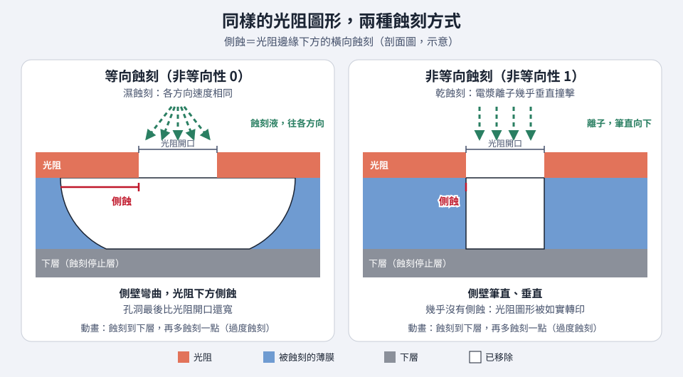

# 第 6 章　蝕刻：照著圖形把材料挖掉

> 📍 **晶圓位置**
>
> - 前一站：微影，光阻上已經有電路圖形
> - **本章：蝕刻，照著光阻的圖形把底下的材料挖掉**
> - 下一站：去除光阻、清洗，然後量測

---

## 蝕刻在做什麼

微影完成後，電路圖形只存在於光阻上。**蝕刻**的任務，是把這個圖形「轉印」到底下的材料：被光阻蓋住的地方受到保護，沒有被蓋住的地方就被去除。

可以想像在玻璃上貼一張鏤空的貼紙，再用噴砂把沒有被貼住的地方磨掉。撕掉貼紙後，圖案就留在玻璃上了。光阻就是那張貼紙。

---

## 濕蝕刻與乾蝕刻

**濕蝕刻**是把晶圓泡在化學溶液中，讓溶液溶掉材料，例如用氫氟酸溶掉氧化矽。濕蝕刻往各個方向的速度都差不多，會從側面往光阻底下「吃」進去，所以不適合做很細的圖形，通常用在去除整層材料或清洗。

**乾蝕刻**則是用**電漿**來蝕刻。帶電的離子被電場加速，幾乎垂直地撞向晶圓，所以主要往下挖，可以做出筆直的側壁。現代晶片的細微圖形，幾乎都靠乾蝕刻完成。

*動態圖解。[開啟互動版](https://simon99.github.io/Semiconductor_Manufacturing_Introduction/zh-TW/ch06/etch-profiles.html)自己動手調整看看。*

> [!NOTE]
> **📖 名詞｜等向與非等向（Isotropic / Anisotropic）**
>
> - **定義**：等向蝕刻往各方向的速度相同；非等向蝕刻主要往單一方向（通常是往下）進行。
> - **現場用法**：「這道要非等向，側壁要直。」
> - **相關名詞**：乾蝕刻、濕蝕刻、側蝕、輪廓
> - **常見混淆**：乾蝕刻不一定都是非等向。有些乾蝕刻會刻意調成等向，用來從側面去除材料，結果取決於製程條件。

---

## 電漿：蝕刻的工具

**電漿**是氣體被高能量激發後的狀態，裡面混合了離子、電子和非常活潑的原子團，常被稱為物質的第四態。蝕刻機台在真空腔體中通入特定氣體，再用射頻電力把它變成電漿，腔體裡會發出微弱的光。

電漿中的活潑原子團負責和材料發生化學反應，離子則負責提供方向，兩者合作，才能又快又準地往下挖。

---

## 蝕刻要看哪些指標

- **蝕刻率**：每分鐘可以挖多深。
- **均勻度**：晶圓上不同位置挖得是否一樣。
- **選擇比**：要挖的材料和不想挖的材料，蝕刻速度差多少。
- **輪廓**：側壁是不是筆直，有沒有往內縮或往外凸。
- **CD 變化**：蝕刻後的線寬和微影後相比，變了多少。

> [!NOTE]
> **📖 名詞｜選擇比（Selectivity）**
>
> - **定義**：目標材料的蝕刻速度，和其他材料蝕刻速度的比值。選擇比越高，越能只挖想挖的材料。
> - **現場用法**：「這道對氮化矽的選擇比不夠，停止層被吃穿了。」
> - **相關名詞**：蝕刻停止層、過度蝕刻、光阻消耗
> - **常見混淆**：講選擇比時一定要說清楚是「對什麼材料」。對光阻的選擇比和對下層材料的選擇比，是兩個不同的數字。

---

## 怎麼知道什麼時候該停

蝕刻挖穿目標材料、碰到下一層時，電漿中的化學成分會改變，發出的光的顏色和強度也跟著改變。機台持續監測這個光，就能判斷什麼時候挖到底了，這叫做**終點偵測**（Endpoint Detection）。

到達終點後，通常還會再多蝕刻一點點，確保整片晶圓上的材料都清乾淨，這叫**過度蝕刻**（Over Etch）。挖不夠會留下殘留，挖太多則會傷到下層。

---

## 蝕刻之後

蝕刻完成後，先用氧電漿把光阻燒掉，稱為**去光阻**（Ashing 或 Strip），再經過清洗，接著量測線寬和缺陷，這個檢查稱為 **AEI**（After Etch Inspection）。

和微影不同，蝕刻做壞了通常無法重來，因為材料已經被挖掉了。

---

## 越挖越深：高深寬比蝕刻

記憶體等產品需要挖出非常深又非常窄的孔，深度可以是寬度的數十倍。孔越深，離子越難抵達底部，蝕刻速度會變慢，孔也可能變彎、扭曲，或是中段被挖得比較寬。這是目前最困難的製程之一，見[第 13 章](../../3-integration/13-memory/README.md)。

> [!TIP]
> **🔧 Know-how｜清潔完的腔體要先「養」一下**
>
> - **情境**：蝕刻腔體剛做完保養，內壁被清潔得乾乾淨淨。
> - **做法**：先跑一些擋片，讓腔體內壁蓋上一層穩定的沉積物，再開始跑產品。這個步驟現場叫 **Seasoning**。
> - **為什麼**：電漿會和腔體內壁互相作用。內壁的狀態不同，電漿的成分就不同，蝕刻率也會跟著變。
> - **沒做會怎樣**：保養後的前幾批晶圓蝕刻結果偏移，可能造成線寬或深度異常。
> - **相關章節**：[第 1 章 晶圓廠如何運作](../../0-before-you-start/01-how-a-fab-works/README.md)

> [!TIP]
> **🔧 Know-how｜同一台機台，不同腔體也要比對**
>
> - **情境**：一台蝕刻機通常有好幾個腔體，同一批晶圓會分散到不同腔體處理。
> - **做法**：工程師會定期比對各腔體的結果，讓它們盡量一致，系統也會記錄每片晶圓是在哪個腔體做的。
> - **為什麼**：腔體之間的微小差異，會讓晶圓之間出現系統性的差異。
> - **沒做會怎樣**：同一批晶圓中有幾片表現特別差，卻查不出原因。有腔體紀錄，才能找出「問題都出在同一個腔體」。
> - **相關章節**：[第 16 章 良率與故障分析](../../4-yield-and-quality/16-yield-analysis/README.md)

---

## 常見異常

| 異常 | 可能原因 | 結果 |
|---|---|---|
| 蝕刻不足 | 時間或功率不足、終點判斷錯誤 | 殘留材料，造成斷路 |
| 過度蝕刻 | 選擇比不足、時間太長 | 傷到下層材料 |
| CD 偏移 | 側壁輪廓改變、光阻消耗太多 | 線寬不合格 |
| 微粒 | 腔體內壁的沉積物剝落 | 缺陷、短路 |
| 負載效應 | 圖形密的地方和疏的地方蝕刻速度不同 | 同一顆晶粒內深度不一致 |

---

## 本章重點

1. 蝕刻把光阻上的圖形轉印到底下的材料上。
2. 濕蝕刻是等向的，乾蝕刻用電漿可以做到非等向，現代細微圖形主要靠乾蝕刻。
3. 選擇比決定能不能「只挖想挖的材料」。
4. 終點偵測透過電漿發出的光，判斷什麼時候該停。
5. 蝕刻做壞通常無法重來，所以腔體狀態的管理特別重要。

---

## 延伸閱讀

- Peter Van Zant，《Microchip Fabrication》，蝕刻相關章節
- James D. Plummer、Michael D. Deal、Peter B. Griffin，《Silicon VLSI Technology》，蝕刻章節

---

[← 上一章：第 5 章 薄膜](../../2-process-modules/05-thin-films/README.md) ｜ [目錄](../../README.md) ｜ [下一章：第 7 章 離子佈植與熱處理 →](../../2-process-modules/07-ion-implantation/README.md)
