# 第 8 章　CMP：把晶圓磨平

> 📍 **晶圓位置**
>
> - 前一站：薄膜沉積，表面因為底下的圖形而高低不平
> - **本章：CMP，把晶圓表面磨平**
> - 下一站：清洗，然後進行下一層微影

---

## 為什麼要磨平

每做完一層圖形再鋪上薄膜，表面就會順著底下的圖形起伏。層數一多，晶圓表面就像丘陵地一樣高低不平。

這會帶來兩個問題：

- **微影對不準焦**：第 4 章提到，圖形越細，曝光時能清楚成像的焦距範圍越淺。表面高低差太大，高處和低處無法同時清楚。
- **多餘的材料去不掉**：例如銅導線的做法，是先把銅鋪滿整片晶圓，再把溝槽外多餘的銅去掉，見[第 10 章](../../2-process-modules/10-metallization/README.md)。

**化學機械研磨**（CMP）就是用來解決這些問題的。就像蓋房子時，每一層樓板都要先抹平，才能繼續往上蓋。CMP 的出現，讓晶片能夠堆疊越來越多層金屬導線。

---

## CMP 怎麼運作

CMP 機台的主要零件：

- **研磨墊**：貼在旋轉平台上的特殊墊子。
- **研磨液**（Slurry）：含有微小研磨顆粒和化學品的液體。
- **研磨頭**：把晶圓正面朝下壓在研磨墊上，並控制不同區域的壓力。
- **修整器**：表面有鑽石顆粒的圓盤，持續刮磨研磨墊，讓它保持粗糙。

研磨時，研磨液中的化學品先讓晶圓表面變軟或起反應，研磨顆粒再把這層變軟的材料磨掉。凸起的地方受到的壓力比較大，磨得比較快，所以表面會越磨越平。

*動態圖解。[開啟互動版](https://simon99.github.io/Semiconductor_Manufacturing_Introduction/zh-TW/ch08/cmp-tool.html)自己動手調整看看。*

> [!NOTE]
> **📖 名詞｜CMP（Chemical Mechanical Planarization，化學機械研磨）**
>
> - **定義**：結合化學反應與機械研磨，把晶圓表面磨平或去除多餘材料的製程。
> - **現場用法**：「這層 CMP 磨過頭了」，現場也常直接說「研磨」。
> - **相關名詞**：研磨液、研磨墊、Dishing、Erosion
> - **常見混淆**：CMP 不只是用砂紙磨東西，化學作用同樣重要。不同材料要用不同配方的研磨液，才能磨得又快又平。

---

## CMP 用在哪裡

| 種類 | 做什麼 | 相關章節 |
|---|---|---|
| STI CMP | 隔離溝槽填入氧化矽後，把多餘的氧化矽磨掉 | [第 11 章](../../3-integration/11-cmos-process-flow/README.md) |
| 介電層 CMP | 把絕緣層的表面磨平 | 本章 |
| 鎢 CMP | 去除接觸窗以外多餘的鎢 | [第 10 章](../../2-process-modules/10-metallization/README.md) |
| 銅 CMP | 去除導線以外多餘的銅 | [第 10 章](../../2-process-modules/10-metallization/README.md) |

---

## 磨到哪裡該停

CMP 也需要終點偵測。當研磨從一種材料磨到另一種材料時，摩擦力會改變，表面的反光也會改變，機台可以據此判斷是否磨到目標。很多製程還會在下方先鋪一層比較耐磨的**停止層**，讓研磨在碰到它時自然慢下來。

研磨墊和研磨液都是消耗品，研磨墊用久了，研磨速度會慢慢改變。工廠通常會根據前幾批的量測結果，自動微調下一批的研磨時間，見[第 17 章](../../4-yield-and-quality/17-process-control/README.md)。

---

## 磨平的麻煩：碟陷與侵蝕

CMP 並不是在任何地方都磨得一樣多。軟的材料比硬的材料容易磨，圖形密的區域和疏的區域也磨得不一樣，因此會出現兩種典型的問題：

*動態圖解。[開啟互動版](https://simon99.github.io/Semiconductor_Manufacturing_Introduction/zh-TW/ch08/dishing-erosion.html)自己動手調整看看。*

> [!NOTE]
> **📖 名詞｜碟陷與侵蝕（Dishing / Erosion）**
>
> - **定義**：碟陷是較寬的金屬導線中間被磨得凹下去，像一個盤子；侵蝕是導線密集的整個區域被磨得比周圍低。
> - **現場用法**：「大面積金屬的 Dishing 太嚴重。」
> - **相關名詞**：圖形密度、虛擬填充、過度研磨
> - **常見混淆**：碟陷發生在「單一條寬導線」內部，侵蝕則是「一整片密集區域」一起變低，兩者的原因和解法不同。

---

## 虛擬填充：為了磨得平

為了讓 CMP 磨得均勻，晶片上圖形太少的空曠區域，會被自動補上一些**不通電的虛擬填充**（Dummy Fill），讓整顆晶片的圖形密度盡量平均。設計晶片時也必須遵守圖形密度的規則。

> [!TIP]
> **🔧 Know-how｜晶片裡有很多不通電的圖形**
>
> - **情境**：用顯微鏡觀察晶片，會發現很多沒有連到任何電路的小方塊。
> - **做法**：設計流程的最後，軟體會在空曠的區域自動補上虛擬填充，讓各區的圖形密度落在規定範圍內。
> - **為什麼**：CMP 的研磨速度和圖形密度有關，密度不均勻，就會磨得一邊高一邊低。
> - **沒做會怎樣**：表面不平，導致微影失焦、導線厚度不一致，甚至金屬殘留造成短路。
> - **相關章節**：[第 4 章 微影](../../2-process-modules/04-lithography/README.md)

> [!TIP]
> **🔧 Know-how｜CMP 之後要馬上清洗**
>
> - **情境**：晶圓剛磨完，表面沾滿研磨液和研磨顆粒。
> - **做法**：CMP 機台內部通常整合了清洗模組，晶圓磨完後立刻刷洗、沖淨並烘乾，乾乾淨淨地離開機台，現場稱為「乾進乾出」。
> - **為什麼**：研磨液一旦在晶圓表面乾掉，顆粒會牢牢黏住，很難再洗掉。
> - **沒做會怎樣**：殘留的顆粒變成缺陷，影響後續的薄膜和微影，造成良率損失。
> - **相關章節**：[第 9 章 清洗與污染控制](../../2-process-modules/09-cleaning/README.md)

---

## 常見異常

| 異常 | 可能原因 | 結果 |
|---|---|---|
| 磨過頭或磨不夠 | 研磨速度改變、終點判斷錯誤 | 膜厚不合格 |
| 碟陷與侵蝕 | 圖形密度不均、過度研磨 | 導線變薄、電阻變高 |
| 刮傷 | 研磨液中有大顆粒、研磨墊異常 | 斷路或短路 |
| 金屬殘留 | 金屬沒有磨乾淨 | 相鄰導線短路 |
| 腐蝕 | 銅表面接觸化學品太久 | 導線損傷 |

---

## 本章重點

1. 層數一多表面就不平，CMP 讓微影能對準焦，也能去除多餘的金屬。
2. CMP 靠化學作用讓表面變軟，再靠研磨顆粒把它磨掉。
3. 摩擦力或反光的變化可以判斷終點，停止層也能幫助研磨停在正確位置。
4. 碟陷和侵蝕是 CMP 的典型問題，虛擬填充可以讓圖形密度更平均。
5. 研磨液乾掉就很難清除，所以 CMP 後要立即清洗。

---

## 延伸閱讀

- Peter Van Zant，《Microchip Fabrication》，平坦化相關章節
- Hong Xiao，《Introduction to Semiconductor Manufacturing Technology》，CMP 章節

---

[← 上一章：第 7 章 離子佈植與熱處理](../../2-process-modules/07-ion-implantation/README.md) ｜ [目錄](../../README.md) ｜ [下一章：第 9 章 清洗與污染控制 →](../../2-process-modules/09-cleaning/README.md)
