# 第 10 章　金屬化：把電晶體連起來

> 📍 **晶圓位置**
>
> - 前一站：電晶體已經做好，完整順序見第 11 章
> - **本章：金屬化，做出連接電晶體的金屬導線**
> - 下一站：一層一層往上疊，最後鋪上保護層

---

## 把數十億個電晶體連起來

電晶體做好之後，還要用金屬導線把它們連成電路。一顆先進晶片上有數十億個電晶體，一層導線根本不夠用，所以導線會疊成好幾層，先進晶片甚至超過十層。

這些導線很像城市的道路系統：

- **下層**：又細又密，像巷弄，負責連接鄰近的電晶體。
- **中層**：較寬，像市區道路，連接不同的電路區塊。
- **上層**：最粗最寬，像高速公路，負責長距離傳送訊號和供應電源。

*動態圖解。[開啟互動版](https://simon99.github.io/Semiconductor_Manufacturing_Introduction/zh-TW/ch10/metal-layers.html)自己動手調整看看。*

---

## 接觸窗與導通孔

電晶體和第一層金屬之間，隔著一層絕緣層。要讓它們連通，先在絕緣層上挖出小孔，再填入金屬，這些小孔叫做**接觸窗**（Contact）。接觸窗通常填的是**鎢**，因為鎢能用 CVD 把又小又深的孔填滿，填完再用 CMP 把多餘的鎢磨掉。

金屬層與金屬層之間的連接孔，則叫做**導通孔**（Via）。

> [!NOTE]
> **📖 名詞｜接觸窗與導通孔（Contact / Via）**
>
> - **定義**：接觸窗連接電晶體和第一層金屬；導通孔連接上下兩層金屬。
> - **現場用法**：「這顆 Via 開不通」，意思是導通孔沒有接好，形成斷路。
> - **相關名詞**：鎢栓塞、阻障層、Via Chain
> - **常見混淆**：兩者都是「填滿金屬的孔」，差別在連接的位置：接觸窗在電晶體上方，導通孔在金屬層之間。

---

## 從鋁到銅

早期的導線使用**鋁**：先用 PVD 把鋁鋪滿整片晶圓，再用微影和蝕刻把不要的鋁去掉，留下導線。

1990 年代末期，產業開始改用**銅**。銅的電阻比鋁低，比較不容易因為長期通電而損壞。但銅有一個大問題：很難用乾蝕刻挖出圖形。於是產業改用一種完全相反的做法：**先挖溝，再填銅**。

---

## 大馬士革製程

這種做法的名字來自古代大馬士革的鑲嵌工藝：在器物表面刻出凹槽，填入金屬，再把表面磨平。銅導線的做法幾乎一模一樣：

**鋪絕緣層 → 挖出導通孔和溝槽 → 鋪阻障層與晶種層 → 電鍍銅 → 退火 → 銅 CMP → 鋪覆蓋層**

1. **鋪絕緣層**：用 CVD 鋪上一層絕緣材料。
2. **挖洞**：用微影和蝕刻挖出導通孔和導線溝槽。
3. **阻障層與晶種層**：先鋪一層極薄的阻障層，防止銅擴散出去；再鋪一層薄薄的銅，作為電鍍的起點。
4. **電鍍銅**：把晶圓放進電鍍液，讓銅填滿孔洞和溝槽。
5. **退火**：加熱讓銅的結構穩定下來。
6. **銅 CMP**：把溝槽以外多餘的銅磨掉。
7. **鋪覆蓋層**：在銅的表面蓋上一層薄薄的覆蓋層，防止銅氧化或擴散。

如果導通孔和溝槽一起填銅，就稱為**雙大馬士革**（Dual Damascene），可以少做一次填充和研磨。每一層金屬都重複這個流程，一層一層往上蓋。

*動態圖解。[開啟互動版](https://simon99.github.io/Semiconductor_Manufacturing_Introduction/zh-TW/ch10/dual-damascene.html)自己動手調整看看。*

> [!NOTE]
> **📖 名詞｜大馬士革製程（Damascene）**
>
> - **定義**：先在絕緣層挖出溝槽，填入金屬，再用 CMP 磨掉多餘部分的導線製作方法。
> - **現場用法**：「這幾層是銅的雙大馬士革。」
> - **相關名詞**：電鍍、阻障層、晶種層、銅 CMP
> - **常見混淆**：鋁導線是「先鋪金屬再蝕刻」，銅導線是「先挖溝再填金屬」，兩者順序剛好相反。

> [!TIP]
> **🔧 Know-how｜電鍍銅要從底部往上填**
>
> - **情境**：要把又窄又深的溝槽完全填滿銅。
> - **做法**：電鍍液中會加入特殊的添加劑，讓孔洞底部的銅長得比開口處快，由下往上填滿。
> - **為什麼**：如果開口處的銅長得比較快，開口會先被封住。
> - **沒做會怎樣**：導線內部留下空洞，電阻變高，長期使用時也更容易斷線。
> - **相關章節**：[第 5 章 薄膜](../../2-process-modules/05-thin-films/README.md)

---

## 低介電常數材料

導線之間隔著絕緣層，兩條靠得很近的導線就像一個小電容，會拖慢訊號、增加耗電。為了減少這個影響，先進製程使用**低介電常數材料**（Low-k）作為導線之間的絕緣層。

低介電常數材料常常帶有微小的孔洞，結構比較脆弱，在蝕刻、CMP 和封裝時都容易受損，需要特別小心處理。

---

## 越來越細的挑戰

導線越做越細，問題也越來越多：

- **電阻變高**：導線太細時，阻障層占的比例變大，電子也更容易被散射，產業正在研究以其他金屬製作最細的導線。
- **電遷移**：電流長時間流過時，會把金屬原子一點一點推走，最後形成空洞而斷線，見[第 22 章](../../5-backend/22-final-test-and-reliability/README.md)。

> [!TIP]
> **🔧 Know-how｜銅磨完之後不能放太久**
>
> - **情境**：銅 CMP 完成，晶圓表面的銅直接暴露在空氣中。
> - **做法**：CMP 到鋪上覆蓋層之間設有 Q-Time 限制，超過時間要由工程師判斷處理方式。
> - **為什麼**：裸露的銅很容易氧化和腐蝕。
> - **沒做會怎樣**：銅表面劣化，導通孔的接觸電阻變高，可靠度也會下降。
> - **相關章節**：[第 9 章 清洗與污染控制](../../2-process-modules/09-cleaning/README.md)

---

## 常見異常

| 異常 | 可能原因 | 結果 |
|---|---|---|
| 銅填充空洞 | 電鍍條件異常、開口太窄 | 電阻變高、可靠度問題 |
| 銅殘留 | CMP 研磨不足 | 導線短路 |
| 導通孔不通 | 蝕刻不足、孔底殘留 | 斷路 |
| 阻障層失效 | 阻障層太薄或不連續 | 銅擴散，造成漏電 |
| 低介電材料損傷 | 蝕刻、CMP 或封裝的應力 | 漏電、結構剝離 |

---

## 本章重點

1. 晶片用多層金屬導線連接電晶體，下層細密、上層粗寬。
2. 接觸窗連接電晶體與第一層金屬，導通孔連接金屬層與金屬層。
3. 銅取代鋁之後，導線改用「先挖溝、再填銅、再磨平」的大馬士革製程。
4. 阻障層防止銅擴散，低介電常數材料降低導線之間的干擾。
5. 導線越細，電阻和電遷移的問題越嚴重。

---

## 延伸閱讀

- James D. Plummer、Michael D. Deal、Peter B. Griffin，《Silicon VLSI Technology》，後段製程章節
- Hong Xiao，《Introduction to Semiconductor Manufacturing Technology》，金屬化章節

---

[← 上一章：第 9 章 清洗與污染控制](../../2-process-modules/09-cleaning/README.md) ｜ [目錄](../../README.md) ｜ [下一章：第 11 章 走一遍完整的 CMOS 流程 →](../../3-integration/11-cmos-process-flow/README.md)
