# 第 11 章　走一遍完整的 CMOS 流程：把模組串起來

> 📍 **晶圓位置**
>
> - 前一站：認識了各個製程模組
> - **本章：把模組串成一條完整的 CMOS 流程**
> - 下一站：看電晶體如何從平面走向立體

---

## 把零件組成整台機器

前面幾章介紹的製程模組，就像一塊塊積木。本章要把它們組起來，走一遍一顆 CMOS 晶片從空白晶圓到完成的流程。

這裡介紹的是簡化過的平面電晶體流程。真實的先進製程步驟多出很多，但骨架是一樣的。看懂這條骨架，之後看到任何製程流程，都能大致知道每一步在做什麼。

---

## 一個反覆出現的循環

整條流程雖然很長，但大部分都是同一個循環：

**鋪上材料 → 微影定義圖形 → 蝕刻或佈植 → 去光阻、清洗 → 量測**

每做一次微影，就要用到一片光罩，稱為一個**光罩層**。整條流程可以依照目的分成三大段：FEOL、MOL 和 BEOL。

> [!NOTE]
> **📖 名詞｜FEOL、MOL、BEOL**
>
> - **定義**：FEOL（Front End of Line）負責做出電晶體；MOL（Middle of Line）負責把電晶體接出來；BEOL（Back End of Line）負責做多層金屬導線。
> - **現場用法**：「這是 BEOL 的問題，跟 FEOL 無關。」
> - **相關名詞**：前段、後段、接觸窗、金屬層
> - **常見混淆**：三段的分界在不同工廠略有不同，MOL 有時會被併入 FEOL 或 BEOL。另外要注意，這裡的「前段、後段」都發生在晶圓廠內，和封裝測試的「後段」不同，見[第 0 章](../../0-before-you-start/00-overview/README.md)。

---

## 第一段：FEOL，做出電晶體

1. **隔離**：在每個電晶體的周圍挖出淺溝槽，填入氧化矽，再用 CMP 磨平，讓相鄰的電晶體互不干擾。
2. **做出井**：用微影和佈植，分別做出 P 井（給 NMOS）和 N 井（給 PMOS），再退火。
3. **做閘極**：長出一層極薄的閘極絕緣層，鋪上閘極材料，再用微影和蝕刻定義出閘極。閘極的長度是整條流程最關鍵的尺寸之一。
4. **淺摻雜**：在閘極兩側做一次淺而輕的佈植。
5. **側壁間隔物**：鋪上一層薄膜再全面往下蝕刻，只留下閘極兩側的一小段，稱為 **Spacer**。
6. **源極與汲極**：做一次深而重的佈植。Spacer 讓這次佈植和閘極保持一點距離，接著退火活化。
7. **金屬矽化物**：鋪上一層金屬並加熱，讓它和源極、汲極、閘極表面的矽反應，形成電阻很低的化合物，方便後續接線。

*動態圖解。[開啟互動版](https://simon99.github.io/Semiconductor_Manufacturing_Introduction/zh-TW/ch11/feol-flow.html)自己動手調整看看。*

> [!NOTE]
> **📖 名詞｜STI（Shallow Trench Isolation，淺溝槽隔離）**
>
> - **定義**：在電晶體之間挖出淺溝槽並填入絕緣材料，把元件彼此隔開的結構。
> - **現場用法**：「STI 的深度偏淺」「STI CMP 磨完要確認氮化矽的厚度」。
> - **相關名詞**：主動區（Active Area）、CMP、隔離
> - **常見混淆**：STI 通常是流程中最早做的結構之一，雖然它不會導電，但它的形狀會影響電晶體的特性和漏電。

### 現代閘極的做法

先進製程的閘極不再使用氧化矽和多晶矽，而是改用**高介電常數絕緣層**加上**金屬閘極**（HKMG）。由於金屬閘極承受不了源極、汲極退火的高溫，常見的做法是先用多晶矽做一個「假閘極」佔住位置，等高溫步驟結束後，再把它挖掉換成真正的金屬閘極。這種「先做假的、再換成真的」的思維，在先進製程中非常常見，見[第 12 章](../../3-integration/12-advanced-transistors/README.md)。

---

## 第二段：MOL，把電晶體接出來

在電晶體上方鋪一層絕緣層，用微影和蝕刻挖出接觸窗，對準源極、汲極和閘極，再填入鎢並用 CMP 磨平。這一步讓電晶體有了連到外面的「插座」。

---

## 第三段：BEOL，蓋出導線

接著用第 10 章的大馬士革製程，一層一層做出銅導線。最上面幾層的導線最粗，最後鋪上**保護層**，只在**焊墊**（Pad）的位置開口，讓之後的測試探針和封裝打線可以接觸到晶片。

完成後，晶圓就離開晶圓廠，進入測試階段，見[第 19 章](../../5-backend/19-wafer-test/README.md)。

| 階段 | 主要做什麼 | 用到的模組 |
|---|---|---|
| FEOL | 隔離、井、閘極、源極與汲極 | 薄膜、微影、蝕刻、佈植、熱處理、CMP |
| MOL | 接觸窗 | 微影、蝕刻、鎢沉積、CMP |
| BEOL | 多層導線、保護層、焊墊 | 薄膜、微影、蝕刻、電鍍、CMP |

---

## 光罩層數

一個簡單的 CMOS 製程大約需要二十層左右的光罩；最先進的製程加上多重曝光，光罩層數可以達到數十層以上。每多一層，就多一輪「沉積、微影、蝕刻、清洗、量測」，成本和生產週期都會增加。

> [!TIP]
> **🔧 Know-how｜用「每層光罩幾天」比較生產效率**
>
> - **情境**：要比較兩個光罩層數不同的產品，哪一個生產得比較有效率。
> - **做法**：把生產週期除以光罩層數，得到「平均每層光罩花幾天」，業界常用這個指標比較工廠的效率，常見水準大約在每層一到兩天之間，數字越小代表效率越好。
> - **為什麼**：光罩層數越多，步驟就越多，總天數自然越長。除以層數之後，才能公平比較。
> - **沒做會怎樣**：只看總天數，會誤以為層數多的產品生產效率比較差。
> - **相關章節**：[第 1 章 晶圓廠如何運作](../../0-before-you-start/01-how-a-fab-works/README.md)

> [!TIP]
> **🔧 Know-how｜同一台機台，晶圓會回來很多次**
>
> - **情境**：一片晶圓在整個流程中，要回到微影區數十次。
> - **做法**：派工時要考慮每批晶圓在流程中的位置，並讓最忙碌的機台（通常是微影）盡量不要閒置。
> - **為什麼**：剛投片的晶圓和快完成的晶圓，會搶同一批機台。這種「重複進入」的流程，是晶圓廠排程特別複雜的原因。
> - **沒做會怎樣**：晶圓在瓶頸機台前大量堆積，整座工廠的生產週期變長。
> - **相關章節**：[第 23 章 工廠如何被系統管理](../../6-beyond-the-fab/23-fab-systems/README.md)

---

## 本章重點

1. 整條流程由「鋪材料、微影、蝕刻或佈植、清洗、量測」的循環組成。
2. FEOL 做出電晶體，MOL 把電晶體接出來，BEOL 做出多層導線。
3. 先進製程常用「先做假閘極、再換成金屬閘極」的做法。
4. 光罩層數越多，成本和生產週期越高。
5. 晶圓會反覆回到同一類機台，讓排程變得非常複雜。

---

## 延伸閱讀

- James D. Plummer、Michael D. Deal、Peter B. Griffin，《Silicon VLSI Technology》，第 2 章（完整的 CMOS 流程介紹）
- Michael Quirk、Julian Serda，《Semiconductor Manufacturing Technology》，製程整合相關章節

---

[← 上一章：第 10 章 金屬化](../../2-process-modules/10-metallization/README.md) ｜ [目錄](../../README.md) ｜ [下一章：第 12 章 先進電晶體結構 →](../../3-integration/12-advanced-transistors/README.md)
