# 第 12 章　先進電晶體結構：從平面到立體

> 📍 **晶圓位置**
>
> - 前一站：走完一條平面電晶體的 CMOS 流程
> - **本章：電晶體結構如何從平面走向立體**
> - 下一站：看記憶體的製程

---

## 平面電晶體的極限

第 2 章提到，電晶體縮小到一定程度後，閘極會越來越難控制通道。原因是在平面電晶體中，閘極只從**上方**控制通道。當源極和汲極靠得太近，下方較深的地方就會有電流「偷偷溜過去」，即使閘極關閉也一樣，就像水龍頭關不緊。

另一個問題是閘極絕緣層。為了讓閘極控制得更好，絕緣層越做越薄，最後薄到只剩幾層原子，電子會直接穿過去，造成漏電。

產業的解法分成兩條路：**換材料**和**換結構**。

---

## 換材料：應變矽與 HKMG

- **應變矽**：把矽的晶格輕微拉開或擠壓，讓電子和電洞跑得更快。例如在 PMOS 的源極和汲極長入矽鍺，擠壓通道。
- **HKMG**：改用高介電常數的絕緣層，可以用比較厚的絕緣層達到同樣的控制力，減少漏電；閘極也從多晶矽改回金屬，見[第 11 章](../../3-integration/11-cmos-process-flow/README.md)。

---

## FinFET：讓通道站起來

**FinFET** 把通道做成一片垂直豎立的薄「鰭」，閘極從**三面**包住它。控制的面積變多，漏電就大幅減少。FinFET 在 2010 年代初期進入量產，成為十多年來先進製程的主流。

鰭的間距非常小，通常要用第 4 章提到的多重曝光技巧才做得出來。而且一個電晶體的驅動能力，取決於它用了幾根鰭，所以設計時只能選擇「一根、兩根、三根」，無法任意調整。

*動態圖解。[開啟互動版](https://simon99.github.io/Semiconductor_Manufacturing_Introduction/zh-TW/ch12/planar-finfet-gaa.html)自己動手調整看看。*

> [!NOTE]
> **📖 名詞｜FinFET（鰭式場效電晶體）**
>
> - **定義**：通道做成垂直鰭狀、閘極從三面包覆通道的電晶體結構。
> - **現場用法**：「這個元件用了三根 Fin。」
> - **相關名詞**：Fin、多重曝光、GAA
> - **常見混淆**：FinFET 的名稱來自形狀像魚鰭，和材料無關。

---

## GAA：閘極完全包住通道

當 FinFET 也縮到極限，下一步是讓閘極從**四面**完全包住通道，稱為 **GAA**（Gate-All-Around）。目前主流的 GAA 把通道做成幾片水平堆疊的薄片，稱為**奈米片**（Nanosheet），在 2020 年代開始進入量產。

它的關鍵製程大致如下：

**交替磊晶矽與矽鍺 → 做出鰭狀結構 → 做假閘極 → 做內側間隔物 → 挖掉矽鍺、釋放通道 → 填入閘極材料**

最關鍵的一步是「挖掉矽鍺」：用選擇比極高的蝕刻，只把夾在中間的矽鍺層移除，留下一片片懸空的矽通道，再用 ALD 把閘極絕緣層和金屬填進片與片之間的縫隙。

奈米片的寬度可以調整，所以設計者不再像 FinFET 一樣只能選擇鰭的數量。

> [!NOTE]
> **📖 名詞｜GAA 與奈米片（Gate-All-Around / Nanosheet）**
>
> - **定義**：GAA 是閘極完全包住通道的電晶體結構；奈米片是目前最主流的 GAA 做法，通道是幾片水平堆疊的薄片。
> - **現場用法**：「這一代改成 GAA，Sheet 疊了三層。」
> - **相關名詞**：矽鍺、通道釋放、內側間隔物
> - **常見混淆**：GAA 是概念，奈米片是實現方式之一。還有奈米線等其他形式，名稱經常被混用。

---

## 背面供電：把電源線搬到背面

傳統上，訊號線和電源線全部擠在晶圓正面的金屬層中。電晶體越密集，導線就越擁擠，電源線太細還會造成電壓下降。

**背面供電**的做法，是把電源網路搬到晶圓的背面：先把晶圓正面接合到另一片承載晶圓上，翻過來，把原本的晶圓磨到極薄，再在背面做出電源導線。這樣正面就能留給訊號線使用，電源也更穩定。這項技術在 2020 年代中期開始導入量產。

---

## 結構演進一覽

| 結構 | 閘極包覆通道 | 開始量產 | 主要製程挑戰 |
|---|---|---|---|
| 平面電晶體 | 一面 | 很早期，成熟製程仍廣泛使用 | 漏電、短通道效應 |
| FinFET | 三面 | 2010 年代 | 鰭的形狀與均勻度 |
| GAA 奈米片 | 四面 | 2020 年代 | 選擇性蝕刻、內側間隔物 |

再往下走，產業正在研究把 NMOS 和 PMOS 上下疊在一起的結構，以及用新材料作為通道。

> [!TIP]
> **🔧 Know-how｜先做一個假的，再換成真的**
>
> - **情境**：新人常常疑惑，為什麼很多材料鋪上去之後又被挖掉。
> - **做法**：先進製程大量使用**犧牲層**：例如先做假閘極再換成金屬閘極、先長矽鍺再把它挖掉，以及多重曝光中先做出、之後再移除的輔助圖形。
> - **為什麼**：最終要的材料可能承受不了前面步驟的高溫，或者根本無法直接做成那個形狀，只好先用容易加工的材料「佔位」。
> - **沒做會怎樣**：很多先進結構根本做不出來。理解這個思維，就比較容易看懂複雜的製程流程。
> - **相關章節**：[第 4 章 微影](../../2-process-modules/04-lithography/README.md)、[第 13 章 記憶體製程](../../3-integration/13-memory/README.md)

> [!TIP]
> **🔧 Know-how｜結構越立體，量測越困難**
>
> - **情境**：GAA 的通道藏在閘極裡面，從上方根本看不到。
> - **做法**：改用光學模型推算立體結構的尺寸，並定期把晶圓切開，用電子顯微鏡觀察剖面。
> - **為什麼**：平面結構從上往下看就能量線寬，立體結構卻有高度、側壁角度、每一層的厚度要確認。
> - **沒做會怎樣**：結構異常無法在製程中被即時發現，要等到電性測試才知道。
> - **相關章節**：[第 15 章 量測與檢測](../../4-yield-and-quality/15-metrology/README.md)

---

## 本章重點

1. 平面電晶體縮小後，閘極控制力不足，漏電越來越嚴重。
2. 應變矽和 HKMG 從材料面改善電晶體效能。
3. FinFET 讓閘極從三面包住通道，GAA 則從四面完全包住。
4. 背面供電把電源線搬到晶圓背面，讓正面留給訊號線。
5. 先進製程大量使用「先做假的、再換成真的」的犧牲層做法。

---

## 延伸閱讀

- IEEE IRDS（International Roadmap for Devices and Systems），More Moore 章節
- IEEE IEDM（International Electron Devices Meeting）歷年論文

---

[← 上一章：第 11 章 走一遍完整的 CMOS 流程](../../3-integration/11-cmos-process-flow/README.md) ｜ [目錄](../../README.md) ｜ [下一章：第 13 章 記憶體製程 →](../../3-integration/13-memory/README.md)
