# 第 13 章　記憶體製程：DRAM、3D NAND 與 HBM

> 📍 **晶圓位置**
>
> - 前一站：認識邏輯晶片的電晶體結構
> - **本章：記憶體的製程：DRAM、3D NAND 與 HBM**
> - 下一站：讀懂製程的「幾奈米」

---

## 記憶體和邏輯晶片有什麼不同

邏輯晶片（例如處理器）裡有各式各樣的電路，需要很多層金屬導線，追求的是速度。記憶體則是由數十億個**完全相同的記憶單元**排成巨大的陣列，追求的是**密度和每個位元的成本**。

一顆記憶體晶片通常包含兩個部分：

- **記憶陣列**：存放資料的記憶單元，占晶片大部分的面積。
- **周邊電路**：負責讀寫、選擇位址等工作的邏輯電路。

| 種類 | 斷電後資料 | 主要用途 | 特色 |
|---|---|---|---|
| DRAM | 消失 | 電腦、手機的主記憶體 | 速度快，但要不斷刷新 |
| NAND Flash | 保留 | 固態硬碟、手機儲存空間 | 容量大、成本低 |

---

## DRAM：一個電晶體加一個電容

DRAM 的每個記憶單元，由**一個電晶體和一個電容**組成：電晶體是開關，電容是一個存放電荷的小水桶，有電荷代表 1，沒有代表 0。

這個水桶會慢慢漏水，所以 DRAM 必須定期把資料讀出來再寫回去，稱為**刷新**（Refresh），見[第 24 章](../../6-beyond-the-fab/24-process-and-firmware/README.md)。

DRAM 製程最大的挑戰在電容。單元的面積越來越小，但電容仍然要存得下足夠的電荷，所以只能往上長：現代 DRAM 的電容是高度為寬度數十倍的細長圓柱，像一根根摩天大樓。要挖出和填滿這麼深的結構，需要極高深寬比的蝕刻和沉積。

為了節省面積，DRAM 的電晶體閘極也被埋進矽裡，稱為**埋入式字元線**。

*動態圖解。[開啟互動版](https://simon99.github.io/Semiconductor_Manufacturing_Introduction/zh-TW/ch13/dram-cell.html)自己動手調整看看。*

> [!NOTE]
> **📖 名詞｜DRAM（Dynamic Random Access Memory，動態隨機存取記憶體）**
>
> - **定義**：以電容儲存電荷來記錄資料的記憶體，速度快，但需要定期刷新，斷電後資料會消失。
> - **現場用法**：「這一代 DRAM 是 1β。」
> - **相關名詞**：1T1C、電容、字元線、位元線、刷新
> - **常見混淆**：DRAM 的世代用 1x、1y、1z、1α、1β、1γ 等代號命名，代表都屬於 10 奈米級，和邏輯製程的「幾奈米」不能直接比較，見[第 14 章](../../3-integration/14-process-nodes/README.md)。

---

## 3D NAND：往上蓋大樓

NAND Flash 把電荷存放在一層特殊的儲存層中，斷電後電荷仍然留著，所以資料不會消失。

早期的 NAND 是平面的，縮小到一定程度後，每個單元能存的電子太少，相鄰單元也會互相干擾。於是產業改變思路：**不再縮小，而是往上疊**，這就是 **3D NAND**。它的主要流程如下：

**交替堆疊氧化層與氮化層 → 挖出通道孔 → 鋪上儲存層與通道 → 做出階梯 → 把氮化層換成金屬**

1. **堆疊**：交替鋪上氧化層和氮化層，疊成數百層。
2. **通道孔**：一口氣挖穿整個堆疊，孔又深又窄，常常要分成幾段來挖再接起來。
3. **儲存層與通道**：沿著孔壁依序鋪上儲存層和通道材料。
4. **階梯**：把堆疊的邊緣做成一階一階的形狀，讓上方的接觸窗能分別接到每一層。
5. **字元線置換**：把氮化層挖掉，換成金屬，成為控制每一層記憶單元的字元線。

很多 3D NAND 還會把周邊電路做在記憶陣列的**正下方**，進一步節省面積。

*動態圖解。[開啟互動版](https://simon99.github.io/Semiconductor_Manufacturing_Introduction/zh-TW/ch13/3d-nand.html)自己動手調整看看。*

> [!NOTE]
> **📖 名詞｜3D NAND**
>
> - **定義**：把記憶單元沿著垂直方向堆疊的 NAND Flash，靠增加層數提高容量。
> - **現場用法**：「這一代又多疊了好幾十層。」
> - **相關名詞**：通道孔、階梯、字元線置換、高深寬比蝕刻
> - **常見混淆**：層數不是唯一的指標。每個單元存幾個位元、單元的大小、周邊電路的位置，都會影響實際的容量密度和成本。

> [!TIP]
> **🔧 Know-how｜疊得越高，晶圓越容易彎**
>
> - **情境**：3D NAND 要在晶圓上堆疊數百層薄膜。
> - **做法**：仔細調整每一層薄膜的應力，讓拉力和壓力互相抵銷，並持續量測晶圓的彎曲程度，必要時在晶圓背面鋪上補償用的薄膜。
> - **為什麼**：每一層薄膜都有一點應力，數百層累積起來，就足以讓整片晶圓翹曲。
> - **沒做會怎樣**：晶圓無法平貼在曝光機上，造成對準誤差；嚴重時機械手臂甚至無法正常取放晶圓。
> - **相關章節**：[第 5 章 薄膜](../../2-process-modules/05-thin-films/README.md)

---

## HBM：把 DRAM 疊起來

人工智慧運算需要在處理器和記憶體之間搬運大量資料。**HBM**（High Bandwidth Memory，高頻寬記憶體）把多顆 DRAM 晶片垂直疊在一起，緊貼在處理器旁邊，讓資料傳輸的頻寬大幅提升。

疊起來的 DRAM 晶片之間，靠穿過晶片的垂直導線連接，稱為 **TSV**。製作 HBM 的主要步驟包括：做出 TSV、把晶圓磨薄到只剩幾十微米、做出微小的凸塊，再把 8 顆、12 顆甚至更多晶片疊起來接合。HBM 和處理器的整合方式，見[第 21 章](../../5-backend/21-advanced-packaging/README.md)。

> [!NOTE]
> **📖 名詞｜TSV（Through-Silicon Via，矽穿孔）**
>
> - **定義**：垂直貫穿整顆晶片、填滿金屬的導線，讓上下疊在一起的晶片可以直接連通。
> - **現場用法**：「TSV 的孔太深，銅沒有填滿。」
> - **相關名詞**：HBM、晶圓薄化、微凸塊、3D 堆疊
> - **常見混淆**：TSV 和晶片內部的導通孔（Via）不同。Via 只連接晶片內相鄰的金屬層，TSV 則貫穿整個矽基板。

> [!TIP]
> **🔧 Know-how｜記憶體裡藏著備用電路**
>
> - **情境**：一顆記憶體有數十億個記憶單元，幾乎不可能每個都完美。
> - **做法**：設計時預留備用的行與列。測試時找到壞掉的單元，就用熔絲把它切換到備用電路上，稱為**修補**（Repair）。
> - **為什麼**：只要壞掉的數量在可修補範圍內，整顆晶片就能「救回來」。
> - **沒做會怎樣**：只要有一個單元壞掉，整顆晶片就得報廢，記憶體的良率會低到無法接受。
> - **相關章節**：[第 19 章 晶圓測試](../../5-backend/19-wafer-test/README.md)

---

## 本章重點

1. 記憶體由大量相同的記憶單元組成，追求密度和每個位元的成本。
2. DRAM 用一個電晶體加一個電容存放資料，電容必須做成又細又高的結構。
3. 3D NAND 不再縮小單元，而是把記憶單元往上堆疊到數百層。
4. HBM 用 TSV 把多顆 DRAM 疊在一起，提供極高的頻寬。
5. 記憶體靠備用電路修補壞掉的單元，提高良率。

---

## 延伸閱讀

- Rino Micheloni、Luca Crippa、Alessia Marelli，《Inside NAND Flash Memories》
- Bruce Jacob、Spencer W. Ng、David T. Wang，《Memory Systems: Cache, DRAM, Disk》

---

[← 上一章：第 12 章 先進電晶體結構](../../3-integration/12-advanced-transistors/README.md) ｜ [目錄](../../README.md) ｜ [下一章：第 14 章 「幾奈米」是什麼意思 →](../../3-integration/14-process-nodes/README.md)
