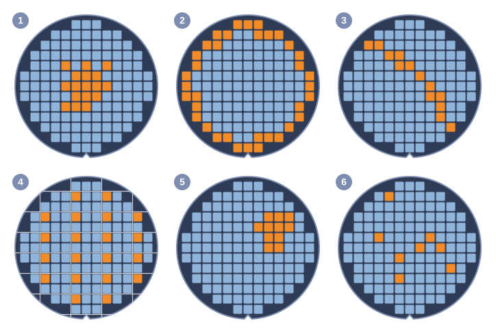

# 第 16 章　良率與故障分析：找出晶片壞掉的原因

> 📍 **晶圓位置**
>
> - 前一站：晶圓完成製程，並經過電性測試
> - **本章：分析良率，找出晶片壞掉的原因**
> - 下一站：把找到的原因回饋給製程，持續改善

---

## 良率就是錢

一片晶圓的製造成本大致是固定的。上面的好晶片越多，每顆晶片的成本就越低。所以良率直接決定了晶片的成本和工廠的獲利。

一個新製程剛開始量產時，良率通常不高，工程師要一個一個找出問題、解決問題，良率才會逐步爬升，這個過程稱為**良率學習曲線**。誰能讓良率爬得更快，誰就更有競爭力。

---

## 良率怎麼算

良率通常分成幾個階段來看：

- **晶圓良率**（Line Yield）：投入的晶圓中，有多少片順利完成前段製程，沒有在中途報廢。
- **晶粒良率**（Die Yield）：一片晶圓上，有多少比例的晶粒通過晶圓測試。
- **最終測試良率**：封裝後的晶片中，有多少比例通過最終測試。

整體良率是這幾個階段相乘。例如 98% × 90% × 99%，整體良率大約只剩 87%。

> [!NOTE]
> **📖 名詞｜良率（Yield）**
>
> - **定義**：產出的好產品占全部產品的比例。
> - **現場用法**：「這批的 CP 良率掉到八成。」
> - **相關名詞**：晶圓良率、晶粒良率、最終測試良率、良率學習曲線
> - **常見混淆**：聽到「良率」一定要先確認是哪一種。晶圓良率 98% 和晶粒良率 98% 代表的意義完全不同。

---

## 缺陷和晶粒大小

可以把缺陷想像成隨機落在晶圓上的雨滴。晶粒越大，被雨滴打中的機率就越高。所以在同樣的缺陷密度下，大晶粒的良率會比小晶粒低很多。這也是近年把大晶片拆成多顆小晶片的原因之一，見[第 21 章](../../5-backend/21-advanced-packaging/README.md)。

*動態圖解。[開啟互動版](https://simon99.github.io/Semiconductor_Manufacturing_Introduction/zh-TW/ch16/die-size-yield.html)自己動手調整看看。*

良率損失大致分成兩類：

- **隨機性**：例如微粒隨機落在晶圓上，只能靠提高整體潔淨度慢慢降低。
- **系統性**：有固定的原因，例如某種圖形特別容易出問題、某台機台異常、晶圓邊緣控制不好。找到原因，往往就能一次解決。

---

## 從晶圓圖看出線索

晶圓測試後，每一顆晶粒的好壞會畫成一張**晶圓圖**。壞晶粒的分佈形狀，常常就是找出原因的第一條線索。

| 圖形特徵 | 可能的方向 |
|---|---|
| 集中在晶圓中心 | 沉積、蝕刻或研磨在中心與周圍的差異 |
| 環狀，或集中在邊緣 | 晶圓邊緣的製程控制問題 |
| 一條直線或弧線 | 刮傷 |
| 每個曝光區的相同位置 | 光罩缺陷或曝光問題 |
| 群聚成一團 | 局部污染或局部異常 |
| 隨機散佈 | 微粒等隨機缺陷 |

*圖：常見的晶圓圖型態。藍色是好的晶粒，橘色是壞的晶粒。① 集中在中心 ② 環狀集中在邊緣 ③ 弧線狀的刮痕 ④ 每個曝光區的相同位置（白線是曝光區的邊界） ⑤ 群聚成一團 ⑥ 隨機散佈。*

> [!NOTE]
> **📖 名詞｜晶圓圖（Wafer Map）**
>
> - **定義**：把晶圓上每一顆晶粒的測試結果，依照位置畫出來的分佈圖。
> - **現場用法**：「這片的 Map 有一條刮痕。」
> - **相關名詞**：Bin、晶圓測試、缺陷分佈圖
> - **常見混淆**：晶圓圖是電性測試的結果，缺陷分佈圖則是缺陷檢測的結果。把兩張圖疊起來比對，可以判斷哪些缺陷真的造成晶片失效。

> [!TIP]
> **🔧 Know-how｜每個曝光區都壞在同一個位置，先查光罩**
>
> - **情境**：晶圓圖上的壞晶粒，在每一個曝光區裡都出現在相同的位置。
> - **做法**：優先檢查這一層使用的光罩，以及相關的曝光條件。
> - **為什麼**：曝光機每次曝光都使用同一片光罩，光罩上的缺陷會被「複製」到每一個曝光區。
> - **沒做會怎樣**：如果把它當成一般的隨機缺陷，會花很多時間在錯誤的方向上，而有問題的光罩還會持續影響後面的晶圓。
> - **相關章節**：[第 4 章 微影](../../2-process-modules/04-lithography/README.md)

---

## 共通性分析

當幾批晶圓的良率特別差，最有效的第一步，是找出這些晶圓的**共同點**：它們是不是都經過同一台機台、同一個腔體？是不是在同一段時間生產？是不是用了同一批化學品？

這種分析叫做**共通性分析**，靠的是工廠系統記錄下來的每片晶圓的完整履歷，見[第 23 章](../../6-beyond-the-fab/23-fab-systems/README.md)。

> [!TIP]
> **🔧 Know-how｜先找共同點，再找原因**
>
> - **情境**：好幾批晶圓良率異常，但原因不明。
> - **做法**：把良率差的晶圓和良率正常的晶圓，逐站比對經過的機台、腔體、時間與材料，找出只有壞晶圓才有的共同點。
> - **為什麼**：一片晶圓要經過數百站，不可能每站都詳細調查。共通性分析能快速把範圍縮小到少數幾站。
> - **沒做會怎樣**：調查漫無目標，問題持續影響更多晶圓。
> - **相關章節**：[第 6 章 蝕刻](../../2-process-modules/06-etching/README.md)

---

## 故障分析：找到「兇手」

統計分析只能告訴我們「可能是哪裡」，最後還需要**故障分析**（FA，Failure Analysis）找到實際的證據：

1. **電性定位**：用電性測試和特殊的影像技術，找出晶片上發生故障的位置。例如故障點常會發出微弱的光或熱。
2. **逐層剝除**：把晶片上方的材料一層一層去掉，逐層觀察。
3. **精準切割**：用**聚焦離子束**（FIB）在故障位置精準地切出剖面。
4. **觀察與分析**：用電子顯微鏡觀察結構，必要時分析材料成分，確認是短路、斷路、空洞還是污染。

---

## 本章重點

1. 良率直接決定晶片成本，新製程要經歷良率逐步爬升的學習曲線。
2. 良率分成晶圓、晶粒和最終測試等階段，整體良率是它們相乘。
3. 晶粒越大越容易被缺陷打中，良率越低。
4. 晶圓圖的形狀是找出原因的第一條線索，共通性分析能快速縮小範圍。
5. 故障分析透過電性定位和物理分析，找到故障的實際證據。

---

## 延伸閱讀

- Gary S. May、Costas J. Spanos，《Fundamentals of Semiconductor Manufacturing and Process Control》，良率相關章節
- EDFAS／ASM International，《Microelectronics Failure Analysis Desk Reference》

---

[← 上一章：第 15 章 量測與檢測](../../4-yield-and-quality/15-metrology/README.md) ｜ [目錄](../../README.md) ｜ [下一章：第 17 章 製程控制 →](../../4-yield-and-quality/17-process-control/README.md)
