# 第 18 章　異常處理與工程變更：出事時工廠怎麼反應

> 📍 **晶圓位置**
>
> - 前一站：製程控制發出了異常訊號
> - **本章：處理異常，並管理製程的變更**
> - 下一站：晶圓完成前段製程，準備進入測試

---

## 異常一定會發生

晶圓廠裡有上千台機台、數百個步驟，異常一定會發生：數據超出管制界限、機台發出警報、缺陷數突然增加、作業出錯。重點不是「永遠不出錯」，而是**出錯時能快速、一致地處理**，把損失降到最低。

處理異常的基本順序如下：

**發現異常 → 擋住影響 → 找出範圍 → 判定處置 → 找出根本原因 → 防止再發**

*動態圖解。[開啟互動版](https://simon99.github.io/Semiconductor_Manufacturing_Introduction/zh-TW/ch18/abnormality-response.html)自己動手調整看看。*

---

## OCAP：事先寫好的應變步驟

異常可能發生在半夜，當班的人不一定是最熟悉這個製程的工程師。所以工廠會為每一種常見的異常，事先寫好處理步驟。

> [!NOTE]
> **📖 名詞｜OCAP（Out of Control Action Plan，異常處理計畫）**
>
> - **定義**：針對特定異常，事先規定好「要檢查什麼、要做什麼、要通知誰」的處理步驟。
> - **現場用法**：「這個 OOC 照 OCAP 走，先停機台、量控片。」
> - **相關名詞**：OOC、Hold、SPC
> - **常見混淆**：OCAP 不是事後的檢討報告，而是異常發生「當下」的行動指引。它讓不同班別、不同的人都用同樣的方式處理。

---

## Hold：先擋下來

發現異常後，第一個動作通常是 **Hold**：把可能受影響的晶圓擋下來，暫停生產；有問題的機台也會被停用，不讓更多晶圓進去。

Hold 有幾個特點：

- 每一個 Hold 都要記錄原因和負責人。
- 只有被授權的人才能解除 Hold。
- 也可以設定**預約 Hold**（Future Hold）：讓晶圓先繼續生產，等走到指定的步驟時再自動擋下，例如等下一站的量測結果出來再判斷。

> [!TIP]
> **🔧 Know-how｜第一件事是擋住，不是修好**
>
> - **情境**：發現某台機台的結果異常。
> - **做法**：先停機台、Hold 可疑的晶圓，再開始調查原因。
> - **為什麼**：調查原因可能要花好幾個小時。如果邊查邊讓機台繼續生產，受影響的晶圓會越來越多。
> - **沒做會怎樣**：原本只影響一兩批的問題，擴大成十幾批甚至更多，損失成倍增加。
> - **相關章節**：[第 17 章 製程控制](../../4-yield-and-quality/17-process-control/README.md)

---

## 找出影響範圍

擋住之後，要確定**哪些晶圓可能受到影響**。這時工廠系統記錄的履歷就派上用場：查出在異常期間，有哪些晶圓經過這台機台、這個腔體。

> [!TIP]
> **🔧 Know-how｜影響範圍從「上一次確認正常」開始算**
>
> - **情境**：機台在今天下午被發現異常，但不知道是從什麼時候開始的。
> - **做法**：往回找到這台機台最後一次確認正常的時間點，例如上一次控片量測合格的時間。從那之後經過這台機台的所有晶圓，都列入可疑範圍。
> - **為什麼**：異常可能早在被發現之前就開始了。只擋發現當下的晶圓，會漏掉更早受影響的晶圓。
> - **沒做會怎樣**：有問題的晶圓被放行，到測試甚至客戶端才發現。這也是機台需要定期檢查的原因：檢查越頻繁，可疑的範圍就越小。
> - **相關章節**：[第 23 章 工廠如何被系統管理](../../6-beyond-the-fab/23-fab-systems/README.md)

---

## 判定：放行、重工或報廢

確定範圍後，要決定每一批晶圓的命運：

| 處置 | 意思 | 適用情況 |
|---|---|---|
| 放行（Release） | 確認沒有影響，繼續生產 | 異常不影響產品品質 |
| 重工（Rework） | 去除部分結果，重新做一次 | 可以重做的步驟，主要是微影 |
| 報廢（Scrap） | 晶圓不再繼續生產 | 損壞無法挽回，或繼續做的風險太高 |
| 有條件放行 | 繼續生產，但加強後續檢查或特別標記 | 影響還不確定，需要更多數據 |

影響較大或不確定的情況，會召開**物料審查會議**（MRB，Material Review Board），由製程、整合、品保等部門共同決定，必要時也會通知客戶。

決定處置之後，還要找出**根本原因**、執行改善對策，並確認同樣的問題不會再發生。

---

## 工程變更：改變也是一種風險

不只異常需要管理，「改變」本身也是風險。修改 Recipe、調整流程、更換材料或供應商、新增機台，都可能影響產品的電性、良率和可靠度。

所以任何變更都要經過正式的流程：評估風險、用實驗批驗證、必要時做可靠度測試，通過審核才能正式上線。重大的變更還必須事先通知客戶。

> [!NOTE]
> **📖 名詞｜ECN 與 PCN（Engineering Change Notice / Process Change Notification）**
>
> - **定義**：ECN 是工廠內部的工程變更通知與審核流程；PCN 是對客戶發出的製程或產品變更通知。
> - **現場用法**：「這個 Recipe 改動要走 ECN」「換材料要發 PCN 給客戶」。
> - **相關名詞**：變更管理、驗證、可靠度測試、分批實驗
> - **常見混淆**：不是只有大改動才要走流程。看起來很小的修改，例如調整一個溫度參數，也可能影響可靠度，所以同樣要經過評估。

---

## 本章重點

1. 異常一定會發生，重點是快速、一致地處理。
2. 處理順序是：擋住影響、找出範圍、判定處置、找出根本原因、防止再發。
3. OCAP 讓不同班別的人都用同樣的步驟處理異常。
4. 影響範圍要從上一次確認正常的時間點開始計算。
5. 任何工程變更都要經過評估與驗證，重大變更還要通知客戶。

---

## 延伸閱讀

- JEDEC，J-STD-046《Customer Notification Standard for Product/Process Changes by Electronic Product Suppliers》
- Gary S. May、Costas J. Spanos，《Fundamentals of Semiconductor Manufacturing and Process Control》

---

[← 上一章：第 17 章 製程控制](../../4-yield-and-quality/17-process-control/README.md) ｜ [目錄](../../README.md) ｜ [下一章：第 19 章 晶圓測試 →](../../5-backend/19-wafer-test/README.md)
