# 第 19 章　晶圓測試：WAT 與 CP

> 📍 **晶圓位置**
>
> - 前一站：前段製程完成，晶圓離開晶圓廠
> - **本章：晶圓測試，確認製程是否正常、每顆晶粒是好是壞**
> - 下一站：封裝

---

## 兩種晶圓測試

晶圓完成前段製程後，在切割之前會先經過兩種測試：

| 測試 | 測什麼 | 目的 |
|---|---|---|
| WAT | 切割道上的測試結構 | 確認製程是否正常 |
| CP | 每一顆晶粒的功能 | 找出哪些晶粒是好的 |

簡單來說，WAT 檢查的是「製程做得對不對」，CP 檢查的是「每顆晶片能不能用」。

---

## WAT：製程的成績單

晶粒和晶粒之間的切割道上，放著許多專門用來測試的小結構，稱為**測試鍵**（Test Key），例如單獨的電晶體、電阻、電容和一長串的導通孔。

WAT 用探針接觸這些測試鍵，量測電晶體的 Vt、導通電流、漏電流，以及電阻、接觸電阻、電容等參數。這些參數直接反映了製程的結果，例如線寬、膜厚和摻雜濃度有沒有偏移。WAT 不合格的晶圓，通常不會出貨。

> [!NOTE]
> **📖 名詞｜WAT（Wafer Acceptance Test，晶圓允收測試）**
>
> - **定義**：量測切割道上測試鍵的電性參數，確認晶圓的製程結果符合規格。
> - **現場用法**：「這批 WAT 的 Vt 偏高，要請整合工程師看一下。」
> - **相關名詞**：測試鍵、切割道、Vt、片電阻
> - **常見混淆**：WAT 測的是測試鍵，不是產品電路本身。它代表製程正常，但不保證每顆晶粒都是好的。

---

## CP：一顆一顆測

**CP**（Chip Probing，晶圓針測）要測試晶圓上的每一顆晶粒。它需要三個主要設備：

- **探針卡**：上面有許多極細的探針，排列方式對應晶粒上焊墊的位置。
- **針測機**：負責移動晶圓，讓探針精準地落在每一顆晶粒的焊墊上。
- **測試機**：送出測試訊號，判斷晶粒的反應是否正確。

每一顆晶粒測完後，會依照結果被分到不同的類別，稱為 **Bin**。所有晶粒的 Bin 依照位置排列，就成了第 16 章提到的晶圓圖。

*動態圖解。[開啟互動版](https://simon99.github.io/Semiconductor_Manufacturing_Introduction/zh-TW/ch19/cp-test.html)自己動手調整看看。*

> [!NOTE]
> **📖 名詞｜Bin（分類）**
>
> - **定義**：測試後依照結果把晶粒分成的類別，通常一個 Bin 代表合格，其他 Bin 代表不同的失效原因。
> - **現場用法**：「這片的 Bin 5 特別多，查一下是哪個測試項目沒過。」
> - **相關名詞**：晶圓圖、測試程式、良率
> - **常見混淆**：Bin 的編號和意義由各產品的測試程式自己定義，同一個編號在不同產品上可能代表不同的失效原因。

記憶體在 CP 階段還會進行**修補**：找出壞掉的記憶單元，用熔絲切換到備用電路，再重新測試一次，見[第 13 章](../../3-integration/13-memory/README.md)。

---

## 測試也是成本

測試機台非常昂貴，每顆晶粒的測試時間都直接轉換成成本。所以測試工程師要在「測得夠完整」和「測得夠快」之間取捨，也常同時測試好幾顆晶粒，提高效率。

> [!TIP]
> **🔧 Know-how｜WAT 過了，不代表每顆晶粒都是好的**
>
> - **情境**：一片晶圓的 WAT 全部合格，但 CP 良率卻很差。
> - **做法**：把 WAT 當成製程的健康檢查，把 CP 當成產品的實際體檢，兩者一起看。
> - **為什麼**：WAT 只量切割道上少數幾個位置的測試鍵，無法代表整片晶圓上每一顆晶粒的狀況，例如隨機分佈的缺陷就不一定會被測到。
> - **沒做會怎樣**：只看 WAT 會誤以為晶圓沒問題，錯過良率異常的線索。
> - **相關章節**：[第 16 章 良率與故障分析](../../4-yield-and-quality/16-yield-analysis/README.md)

---

## 晶圓圖交給封裝

CP 完成後，晶圓圖會以電子資料的形式，跟著晶圓一起送到封裝廠。封裝時，機台只會挑出被標為合格的晶粒，這些晶粒稱為 **KGD**（Known Good Die，已知良好晶粒）。

> [!TIP]
> **🔧 Know-how｜晶圓圖必須和晶圓一一對應**
>
> - **情境**：晶圓送到封裝廠，機台要依照晶圓圖挑出好的晶粒。
> - **做法**：用晶圓編號確認資料和實體晶圓是同一片，並用晶圓上的記號確認方向，確保圖上的每個位置都對應到正確的晶粒。
> - **為什麼**：晶圓圖只是一份資料，如果對應錯了，機台會依照錯誤的資料挑晶粒。
> - **沒做會怎樣**：壞的晶粒被封裝、出貨，好的晶粒反而被丟掉，問題往往要到客戶端才發現。
> - **相關章節**：[第 23 章 工廠如何被系統管理](../../6-beyond-the-fab/23-fab-systems/README.md)

---

## 常見異常

| 異常 | 可能原因 | 結果 |
|---|---|---|
| 接觸不良 | 探針磨損或沾污、焊墊表面異常 | 好的晶粒被誤判為壞的 |
| 針痕過深 | 探針壓力太大、重複測試太多次 | 焊墊受損，影響後續打線 |
| 測試機台之間有差異 | 不同機台或探針卡的特性不同 | 良率因機台而異 |
| 晶圓圖錯置 | 晶圓編號或方向對應錯誤 | 封裝時挑錯晶粒 |

---

## 本章重點

1. 晶圓測試分成 WAT 和 CP，前者檢查製程，後者檢查每一顆晶粒。
2. WAT 量測切割道上測試鍵的電性參數，是製程的成績單。
3. CP 用探針卡逐顆測試，結果分成不同的 Bin，形成晶圓圖。
4. 記憶體在 CP 階段會修補壞掉的單元。
5. 晶圓圖會跟著晶圓送到封裝廠，用來挑出好的晶粒。

---

## 延伸閱讀

- Michael L. Bushnell、Vishwani D. Agrawal，《Essentials of Electronic Testing for Digital, Memory and Mixed-Signal VLSI Circuits》
- Peter Van Zant，《Microchip Fabrication》，晶圓測試相關章節

---

[← 上一章：第 18 章 異常處理與工程變更](../../4-yield-and-quality/18-abnormality-handling/README.md) ｜ [目錄](../../README.md) ｜ [下一章：第 20 章 封裝 →](../../5-backend/20-packaging/README.md)
