# 第 20 章　封裝：讓晶片能被使用

> 📍 **晶圓位置**
>
> - 前一站：晶圓測試，已經知道哪些晶粒是好的
> - **本章：封裝，把晶粒變成可以裝到電路板上的晶片**
> - 下一站：最終測試

---

## 為什麼要封裝

剛從晶圓上切下來的晶粒又小又脆弱，上面的焊墊也小到無法直接焊到電路板上。**封裝**就像替晶粒蓋一間房子，它有四個主要任務：

- **保護**：隔絕濕氣、灰塵和外力。
- **連接**：把晶粒上微小的焊墊，轉接成電路板能焊接的接腳或錫球。
- **散熱**：把晶片運作時產生的熱帶走。
- **支撐**：提供足夠的機械強度，方便搬運和組裝。

---

## 傳統封裝的流程

**晶背研磨 → 切割 → 黏晶 → 打線 → 封膠 → 印字 → 植球或電鍍接腳 → 切單 → 檢查**

1. **晶背研磨**：從背面把晶圓磨薄，好放進輕薄的封裝裡。
2. **切割**：把晶圓貼在膠膜上，沿著切割道用鑽石刀或雷射切開。也有一種做法是用雷射在晶圓內部打出一層改質層，再把膠膜撐開，讓晶粒沿著改質層分開，稱為隱形切割。
3. **黏晶**：依照晶圓圖，只挑出好的晶粒，黏到導線架或基板上。
4. **打線**：用比頭髮還細的金線或銅線，把晶粒的焊墊連到導線架或基板上。
5. **封膠**：用環氧樹脂等材料把晶粒和導線包起來。
6. **印字**：用雷射在表面印上產品型號和批號。
7. **植球或電鍍接腳**：在底部植上錫球，或在接腳表面電鍍。
8. **切單**：把一整條基板上的封裝切成一顆顆獨立的晶片。

*動態圖解。[開啟互動版](https://simon99.github.io/Semiconductor_Manufacturing_Introduction/zh-TW/ch20/wire-bond.html)自己動手調整看看。*

> [!NOTE]
> **📖 名詞｜打線接合（Wire Bonding）**
>
> - **定義**：用極細的金屬線連接晶粒焊墊與封裝接點的技術，是最傳統、最普遍的封裝連接方式。
> - **現場用法**：「這批打線的拉力測試沒過。」
> - **相關名詞**：焊墊、導線架、覆晶
> - **常見混淆**：打線雖然是傳統技術，但至今仍是數量最多的封裝方式，因為成本低、技術成熟。

---

## 覆晶：把晶片翻過來

**覆晶**（Flip Chip）的做法完全不同：先在晶粒的焊墊上做出凸起的金屬凸塊，再把晶粒翻過來、正面朝下，讓凸塊直接焊到基板上。最後在晶粒和基板之間的縫隙填入膠材，稱為**底部填充**（Underfill），用來分散應力、保護凸塊。

和打線相比，覆晶的連接路徑更短，可以在晶粒整個表面布滿接點，電性和散熱也更好，所以處理器和繪圖晶片大多採用覆晶。

*動態圖解。[開啟互動版](https://simon99.github.io/Semiconductor_Manufacturing_Introduction/zh-TW/ch20/flip-chip.html)自己動手調整看看。*

> [!NOTE]
> **📖 名詞｜覆晶（Flip Chip）**
>
> - **定義**：把晶粒正面朝下，透過凸塊直接與基板連接的封裝方式。
> - **現場用法**：「這顆是覆晶封裝，要確認底部填充有沒有空洞。」
> - **相關名詞**：凸塊（Bump）、底部填充、基板、BGA
> - **常見混淆**：凸塊和錫球不一樣。凸塊連接晶粒和基板，錫球則在封裝的底部，連接封裝和電路板。

---

## 常見的封裝形式

| 形式 | 特色 | 常見用途 |
|---|---|---|
| 導線架封裝 | 成本低，接腳在四周或底部周圍 | 微控制器、電源管理晶片 |
| BGA（球柵陣列） | 底部整面布滿錫球，接點多 | 處理器、繪圖晶片 |
| 晶圓級封裝 | 直接在晶圓上完成封裝，尺寸接近晶粒本身 | 手機中的小型晶片 |

> [!TIP]
> **🔧 Know-how｜晶片也會「受潮」**
>
> - **情境**：封裝好的晶片放在一般環境中，封裝材料會慢慢吸收空氣中的水氣。
> - **做法**：晶片依照對濕氣的敏感程度分級，出貨時用防潮袋加乾燥劑真空包裝。拆封後超過規定時間沒用完，焊接前要先烘烤除濕。
> - **為什麼**：焊接到電路板時溫度會急速升高，封裝內的水氣瞬間汽化膨脹。
> - **沒做會怎樣**：封裝內部脫層甚至爆裂，這種現象被形象地稱為「爆米花效應」。
> - **相關章節**：[第 22 章 最終測試與可靠度](../../5-backend/22-final-test-and-reliability/README.md)

> [!TIP]
> **🔧 Know-how｜磨薄的晶圓非常脆弱**
>
> - **情境**：晶圓經過晶背研磨後，可能只剩一百微米左右甚至更薄，像紙一樣會彎曲。
> - **做法**：研磨前先在正面貼上保護膠膜或接合到承載晶圓上，之後的搬運也使用專用的機構支撐。
> - **為什麼**：薄晶圓很容易破裂和翹曲，內部的應力也會讓它彎曲變形。
> - **沒做會怎樣**：晶圓破片，或是產生肉眼看不見的微小裂痕，等到晶片使用一段時間後才失效。
> - **相關章節**：[第 21 章 先進封裝](../../5-backend/21-advanced-packaging/README.md)

---

## 常見異常

| 異常 | 可能原因 | 結果 |
|---|---|---|
| 崩邊 | 切割刀磨損、切割參數不當 | 晶粒邊緣破損，可能延伸成裂痕 |
| 打線黏不上 | 焊墊污染、針痕過深 | 斷路 |
| 沖線 | 封膠時的流動把細線推彎 | 相鄰導線短路 |
| 脫層 | 材料之間附著不良、吸濕 | 可靠度問題 |
| 空洞 | 封膠或底部填充沒有填滿 | 散熱變差、可靠度問題 |

---

## 本章重點

1. 封裝負責保護晶粒、連接外部、散熱和提供支撐。
2. 傳統封裝流程包括研磨、切割、黏晶、打線、封膠、印字、植球和切單。
3. 覆晶把晶粒翻過來，用凸塊直接連接基板，電性和散熱更好。
4. 封裝會吸收濕氣，焊接前要注意防潮和烘烤。
5. 磨薄的晶圓非常脆弱，需要特別的支撐和搬運方式。

---

## 延伸閱讀

- Rao R. Tummala，《Fundamentals of Microsystems Packaging》
- Peter Van Zant，《Microchip Fabrication》，封裝相關章節

---

[← 上一章：第 19 章 晶圓測試](../../5-backend/19-wafer-test/README.md) ｜ [目錄](../../README.md) ｜ [下一章：第 21 章 先進封裝 →](../../5-backend/21-advanced-packaging/README.md)
