# 第 21 章　先進封裝：把多顆晶片整合在一起

> 📍 **晶圓位置**
>
> - 前一站：晶圓測試，挑出了好的晶粒
> - **本章：先進封裝，把多顆晶片整合成一個系統**
> - 下一站：最終測試

---

## 為什麼需要先進封裝

過去，提升晶片效能主要靠微縮電晶體。但現在這條路越走越難、越走越貴，還遇到幾個限制：

- **晶粒不能無限大**：一顆晶粒的大小，受限於曝光機一次能曝光的範圍，大約 26 mm × 33 mm。
- **大晶粒良率低**：第 16 章提到，晶粒越大，越容易被缺陷打中。
- **不同功能適合不同製程**：運算核心適合最先進的製程，類比和輸入輸出電路用成熟製程就夠了，記憶體則需要專門的製程。
- **頻寬需求暴增**：人工智慧運算需要在處理器和記憶體之間搬運大量資料。

於是產業開始把一顆大晶片拆成幾顆小晶片，各自用最適合的製程製造，再用先進封裝把它們緊密地整合在一起，讓它們像一顆晶片一樣運作。封裝不再只是「保護」，而成了提升效能的關鍵。

---

## 2.5D：並排放在中介層上

**2.5D 封裝**把好幾顆晶片並排放在一片**中介層**上。中介層本身通常是一片矽，上面有非常細密的導線，讓晶片之間可以高速、大量地互相溝通；中介層再透過 TSV 連到下方的封裝基板。

最典型的例子，是把處理器和多組 HBM 記憶體並排放在同一片中介層上。中介層甚至可以透過多次曝光拼接，做得比單次曝光的範圍還大。

*動態圖解。[開啟互動版](https://simon99.github.io/Semiconductor_Manufacturing_Introduction/zh-TW/ch21/2p5d.html)自己動手調整看看。*

> [!NOTE]
> **📖 名詞｜中介層（Interposer）**
>
> - **定義**：放在晶片和封裝基板之間的一層轉接板，上面有細密的導線，讓多顆晶片之間能高速連接。
> - **現場用法**：「這個產品的中介層超過一個曝光範圍，要用拼接的方式做。」
> - **相關名詞**：2.5D、TSV、微凸塊、HBM
> - **常見混淆**：中介層不一定是矽，也有使用有機材料，或只在晶片之間埋入一小塊矽橋的做法，成本和效能各有取捨。

---

## 扇出型封裝

**扇出型封裝**不使用傳統的基板：先把晶粒排列在一片承載板上，用封膠把它們包成一片「重組晶圓」，再在上面做出**重佈線層**（RDL），把接點從晶粒往外「扇」出去，擴展到比晶粒更大的面積。這種封裝又薄又小，常用在手機等輕薄的產品中。

---

## 3D 堆疊：往上疊

**3D 堆疊**把晶片直接疊在另一顆晶片上，透過 TSV 上下連通，HBM 就是一個例子。晶片之間的連接方式也在演進：

| 連接方式 | 接點間距 | 代表應用 |
|---|---|---|
| 覆晶凸塊 | 一百微米以上 | 一般的處理器封裝 |
| 微凸塊 | 數十微米 | 2.5D 封裝、HBM 堆疊 |
| 混合鍵合 | 十微米以下 | 高密度的 3D 晶片堆疊 |

接點間距越小，同樣面積內的連接點越多，晶片之間能傳輸的資料就越多。

> [!NOTE]
> **📖 名詞｜混合鍵合（Hybrid Bonding）**
>
> - **定義**：不使用凸塊，讓兩顆晶片表面的銅接點直接接合，同時周圍的絕緣層也互相黏合的技術。
> - **現場用法**：「改用混合鍵合之後，接點密度提高很多。」
> - **相關名詞**：3D 堆疊、微凸塊、CMP、晶圓接合
> - **常見混淆**：混合鍵合的「混合」，指的是金屬和絕緣層兩種材料同時接合，而不是混合使用兩種封裝方式。

---

## 小晶片（Chiplet）

把一顆大型晶片拆成多顆功能獨立的小晶片，再封裝在一起，這種設計方式稱為 **Chiplet**。產業也在推動晶片之間互相連接的標準介面，目標是讓不同來源的小晶片能像積木一樣組合使用。

隨著先進封裝大量使用微影、電鍍、CMP 等原本屬於晶圓廠的製程，前段製造和後段封裝之間的界線也越來越模糊。

> [!TIP]
> **🔧 Know-how｜一顆壞晶片，拖垮整個封裝**
>
> - **情境**：一個先進封裝裡放了八顆晶片。
> - **做法**：每一顆晶片在封裝前都要經過充分測試，確保是已知良好晶粒（KGD），封裝過程中也盡量安排可以檢查的步驟。
> - **為什麼**：良率會相乘。就算每顆晶片的良率都是 99%，八顆全部都好的機率也只剩大約 92%。
> - **沒做會怎樣**：只要一顆晶片有問題，整個昂貴的封裝連同其他好晶片都一起報廢。
> - **相關章節**：[第 19 章 晶圓測試](../../5-backend/19-wafer-test/README.md)

> [!TIP]
> **🔧 Know-how｜混合鍵合需要前段等級的乾淨和平坦**
>
> - **情境**：兩顆晶片要用混合鍵合直接接合。
> - **做法**：接合面要經過極精密的 CMP，接合前的清洗和環境控制也要達到晶圓廠的等級。
> - **為什麼**：兩個表面之間沒有凸塊可以緩衝，一顆微粒就會撐出一個空隙，表面稍微不平也會接合不良。
> - **沒做會怎樣**：一顆微粒可能讓周圍大量接點同時失效。
> - **相關章節**：[第 8 章 CMP](../../2-process-modules/08-cmp/README.md)、[第 9 章 清洗與污染控制](../../2-process-modules/09-cleaning/README.md)

---

## 先進封裝的挑戰

| 挑戰 | 說明 |
|---|---|
| 散熱 | 晶片緊密排列或疊在一起，熱更難散出去 |
| 翹曲 | 不同材料受熱膨脹的程度不同，封裝越大越容易彎曲 |
| 測試 | 晶片疊起來之後，中間的晶片很難再單獨測試 |
| 良率相乘 | 任何一顆晶片或一個接點失敗，整個封裝都受影響 |

---

## 本章重點

1. 微縮越來越難，先進封裝成為提升效能的新方向。
2. 2.5D 封裝把多顆晶片並排在中介層上，常見於處理器加 HBM。
3. 扇出型封裝用重佈線層把接點往外擴展，適合輕薄產品。
4. 3D 堆疊從微凸塊走向混合鍵合，接點密度越來越高。
5. 良率會相乘，所以每顆晶片都必須是已知良好晶粒。

---

## 延伸閱讀

- John H. Lau，《Semiconductor Advanced Packaging》
- IEEE ECTC（Electronic Components and Technology Conference）歷年論文

---

[← 上一章：第 20 章 封裝](../../5-backend/20-packaging/README.md) ｜ [目錄](../../README.md) ｜ [下一章：第 22 章 最終測試與可靠度 →](../../5-backend/22-final-test-and-reliability/README.md)
