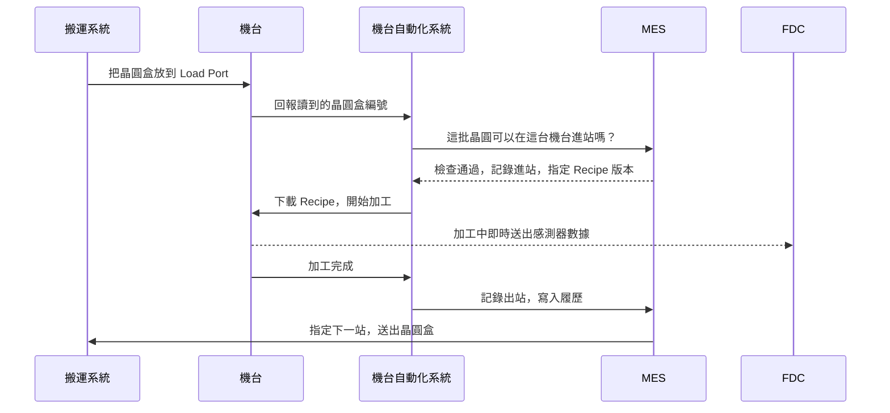

# 第 23 章　工廠如何被系統管理：一片晶圓為什麼不會走錯路

> 📍 **晶圓位置**
>
> - 前一站：跟著晶圓走完了整趟旅程
> - **本章：從系統的角度重新看一次工廠**
> - 下一站：晶片出貨後，製程如何影響韌體

---

## 一座不可能靠人記住的工廠

想像一下：工廠裡同時有數千批晶圓在生產，每一批都要經過數百個步驟；上千台機台各有自己的狀態和 Recipe；而且工廠 24 小時不停運轉。任何一批晶圓走錯一站、用錯一個 Recipe，都可能整批報廢。

這樣的工廠不可能靠人記住一切。現代晶圓廠裡，晶圓的每一個動作幾乎都由系統指揮和記錄，就像機場的塔台和物流中心的結合。

---

## 工廠裡的主要系統

| 系統 | 負責什麼 | 比喻 |
|---|---|---|
| MES（製造執行系統） | 記錄每批晶圓在哪裡、下一步是什麼，控制每一次進出站 | 工廠的大腦和帳本 |
| 機台自動化系統 | 連接機台與 MES，下載 Recipe、啟動製程、收集數據 | 機台的翻譯員 |
| 物料搬運系統 | 指揮天車和倉儲，把晶圓盒送到正確的位置 | 物流中心 |
| 派工系統 | 決定每台機台下一批要做哪一批晶圓 | 交通號誌 |
| Recipe 管理系統 | 管理每台機台的 Recipe 和版本 | 食譜資料庫 |
| 製程控制系統 | SPC、FDC、R2R，監控與控制製程品質 | 品管員 |
| 良率分析系統 | 整合製程和測試數據，分析良率 | 偵探 |

> [!NOTE]
> **📖 名詞｜MES（Manufacturing Execution System，製造執行系統）**
>
> - **定義**：管理生產現場的核心系統，記錄每批晶圓的位置、狀態與歷程，並控制晶圓能不能進入下一個步驟。
> - **現場用法**：「MES 上這批顯示 Hold，要先查原因。」
> - **相關名詞**：Track-in、Track-out、Route、Hold、派工
> - **常見混淆**：MES 不等於工廠的所有系統。它是核心，但機台連線、搬運、派工、製程控制通常由其他系統負責，彼此互相配合。

---

## 一批晶圓到站時，發生了什麼事

以一批晶圓抵達一台蝕刻機為例：

1. 天車把晶圓盒放到機台的 Load Port，機台讀取晶圓盒上的編號。
2. 系統逐一確認：這批晶圓現在應該在這一站嗎？這台機台可以做這個產品嗎？機台狀態正常嗎？晶圓有沒有被 Hold？Q-Time 有沒有超過？晶圓盒的污染等級和機台相符嗎？
3. 全部確認通過後，系統把正確版本的 Recipe 下載到機台，並記錄**進站**。
4. 機台開始加工，同時把感測器數據即時送給 FDC 監控。
5. 加工完成後記錄**出站**，把使用的機台、腔體、Recipe、時間等資料寫入這批晶圓的履歷。
6. 系統決定下一站，搬運系統把晶圓盒送過去，或先送進倉儲等待。

> [!NOTE]
> **📖 名詞｜進站與出站（Track-in / Track-out）**
>
> - **定義**：進站是晶圓開始在某一站加工時，在系統上的登記；出站是完成加工後的登記，並把晶圓推進到下一個步驟。
> - **現場用法**：「這批進站之後機台就 Down 了，要處理一下帳。」
> - **相關名詞**：MES、Route、履歷
> - **常見混淆**：系統上的狀態和實體晶圓必須一致。系統顯示已出站、但晶圓其實還沒做完，就是現場說的「帳實不符」，必須立即處理。

機台來自世界各地不同的廠商，為了讓系統能用同樣的方式和每一台機台溝通，產業制定了共同的通訊標準，最常見的是 **SECS/GEM**。它就像機台與系統之間的共同語言。

*動態圖解。[開啟互動版](https://simon99.github.io/Semiconductor_Manufacturing_Introduction/zh-TW/ch23/lot-at-tool.html)自己動手調整看看。*

---

## 防呆：讓錯誤無法發生

上面第 2 步的每一項確認，都是一條**防呆規則**。例如：

- 晶圓不在這一站，就不能進站。
- 機台沒有通過驗證，就不能做這個產品。
- Recipe 版本不對，就不能開始。
- Q-Time 超過、或晶圓被 Hold，就不能繼續。
- 接觸過銅的晶圓盒，不能放上前段的機台。

以前很多確認靠人工核對，現在則寫成系統規則，由系統自動擋下。人會疲倦、會分心，但系統每一次都會檢查。

> [!TIP]
> **🔧 Know-how｜每一條防呆規則背後，通常都有一次事故**
>
> - **情境**：急件趕著出貨，有人希望暫時跳過某個系統檢查。
> - **做法**：例外處理必須經過正式的申請和核准，並且留下紀錄，事後也要檢討規則是否需要調整。
> - **為什麼**：很多規則都是從過去的事故學來的。規則看起來麻煩，往往是因為它擋下的錯誤很少再發生，大家已經忘了它為什麼存在。
> - **沒做會怎樣**：同樣的事故再次發生，而且因為規則被跳過，事後也很難追查。
> - **相關章節**：[第 18 章 異常處理與工程變更](../../4-yield-and-quality/18-abnormality-handling/README.md)

---

## 履歷：每一片晶圓的完整紀錄

系統會為每一片晶圓留下完整的**履歷**：經過哪些步驟、用了哪台機台和腔體、哪個 Recipe 版本、什麼時間、量測結果是多少。

這些紀錄是整座工廠的記憶，用在很多地方：

- 良率異常時，做共通性分析，找出共同點，見[第 16 章](../../4-yield-and-quality/16-yield-analysis/README.md)。
- 機台出問題時，找出受影響的範圍，見[第 18 章](../../4-yield-and-quality/18-abnormality-handling/README.md)。
- 客戶回報問題時，從一顆晶片一路追溯到它的晶圓、批次和每一站的生產條件。

---

## 數據與智慧製造

一座晶圓廠每天產生的數據量非常龐大，包括機台感測器的數據、量測結果、測試結果和生產紀錄。這些數據正被用來做更多事情：

- **預測性保養**：從機台數據的變化，預測零件什麼時候需要更換。
- **虛擬量測**：根據機台在加工時的數據，推估量測結果，減少實際量測的次數。
- **人工智慧分析**：自動辨識晶圓圖的型態、找出良率損失的原因。
- **自動化派工**：根據即時狀態，自動決定最佳的生產順序。

> [!TIP]
> **🔧 Know-how｜系統停擺，工廠就停擺**
>
> - **情境**：MES 突然當機。
> - **做法**：核心系統採用備援架構，系統的修改要經過完整測試，並安排在影響最小的時段上線；工廠也會事先準備系統停擺時的應變程序。
> - **為什麼**：晶圓的每一次進出站都要經過系統，系統一停，機台就算正常也無法繼續生產。
> - **沒做會怎樣**：整座工廠停線，正在等待的晶圓還可能因為超過 Q-Time 而需要重工或報廢。
> - **相關章節**：[第 9 章 清洗與污染控制](../../2-process-modules/09-cleaning/README.md)

---

## 本章重點

1. 晶圓廠的複雜度遠超過人力能掌握，每一個動作都由系統指揮和記錄。
2. MES 是核心，搭配機台自動化、搬運、派工、Recipe 管理和製程控制等系統。
3. 晶圓進站前，系統會檢查步驟、機台、Recipe、Q-Time、Hold 和污染等級。
4. 每片晶圓的完整履歷，是良率分析、異常處理和客戶追溯的基礎。
5. 工廠數據正被用在預測性保養、虛擬量測和人工智慧分析上。

---

## 延伸閱讀

- Heiko Meyer、Franz Fuchs、Klaus Thiel，《Manufacturing Execution Systems: Optimal Design, Planning, and Deployment》
- Wallace J. Hopp、Mark L. Spearman，《Factory Physics》
- SEMI 的機台通訊相關標準（SECS/GEM）

---

[← 上一章：第 22 章 最終測試與可靠度](../../5-backend/22-final-test-and-reliability/README.md) ｜ [目錄](../../README.md) ｜ [下一章：第 24 章 製程如何影響韌體 →](../../6-beyond-the-fab/24-process-and-firmware/README.md)
