# 第 24 章　製程如何影響韌體：給軟韌體工程師的硬體真相

> 📍 **晶圓位置**
>
> - 前一站：晶片出貨，裝進了產品裡
> - **本章：晶片開始工作後，製程如何影響韌體和軟體**
> - 下一站：旅程結束，附錄有術語總表與延伸閱讀

---

## 軟體看不見的硬體真相

寫韌體或驅動程式的工程師，常常會遇到一些「規定」：記憶體要定期刷新、要開 ECC、快閃記憶體要做平均抹寫、某顆晶片有一份長長的勘誤清單。這些規定看起來像是硬體的脾氣，其實大多來自製程的物理限制。

本章把前面學到的製程知識，和軟韌體工程師每天面對的問題連起來。

---

## DRAM 為什麼要刷新

第 13 章提到，DRAM 用電容存放電荷，而電容會慢慢漏電。所以記憶體控制器必須定期把每一列資料讀出來再寫回去，通常每幾十毫秒就要把所有資料刷新一輪。

溫度越高，漏電越快。所以在高溫環境下，刷新的頻率通常要提高。刷新期間記憶體無法正常存取，也會消耗電力，所以刷新是 DRAM 效能和功耗的固定成本。

> [!NOTE]
> **📖 名詞｜刷新（Refresh）**
>
> - **定義**：定期讀出 DRAM 中的資料再寫回，補充電容流失的電荷，避免資料消失。
> - **現場用法**：「高溫時刷新頻率加倍，頻寬會掉一些。」
> - **相關名詞**：DRAM、電容、資料保存時間、記憶體控制器
> - **常見混淆**：刷新是由記憶體控制器和 DRAM 在背景自動進行的，不是作業系統或應用程式在做，但韌體會設定相關的參數。

---

## Row Hammer：記憶單元靠得太近

DRAM 的記憶單元越做越密，相鄰的單元之間也越容易互相干擾。研究人員在 2014 年公開發表：只要反覆、快速地存取同一列記憶體，就可能讓**相鄰列**的資料翻轉，這個現象稱為 **Row Hammer**。

這不只是可靠度問題，也是安全問題，因為攻擊者可能利用它修改不該修改的資料。現在的 DRAM 和記憶體控制器，都加入了偵測與額外刷新相鄰列的機制來防範。

*動態圖解。[開啟互動版](https://simon99.github.io/Semiconductor_Manufacturing_Introduction/zh-TW/ch24/dram-refresh-rowhammer.html)自己動手調整看看。*

---

## ECC：錯誤一定會發生

即使晶片完全正常，資料也可能偶爾出錯。例如封裝材料中微量的放射性物質，或來自宇宙射線的粒子，都可能打翻一個位元，這種錯誤稱為**軟錯誤**。再加上製程變異造成的體質較弱的單元，錯誤是無法完全避免的。

> [!NOTE]
> **📖 名詞｜ECC（Error Correction Code，錯誤更正碼）**
>
> - **定義**：在資料中加入額外的檢查位元，讓系統能偵測並更正少量的位元錯誤。
> - **現場用法**：「這台伺服器的記憶體一定要開 ECC。」
> - **相關名詞**：軟錯誤、位元翻轉、同位檢查
> - **常見混淆**：ECC 有能力上限，只能更正一定數量的錯誤，錯誤太多時只能偵測、無法更正。新一代 DRAM 晶片內部的 ECC，和系統層級的 ECC 也是兩件不同的事。

---

## NAND Flash 的脾氣

第 13 章介紹的 3D NAND，有幾個來自物理的限制，每一個都對應到韌體裡的一項功能：

| NAND 的物理限制 | 韌體的對策 |
|---|---|
| 不能直接覆寫，必須先抹除；而且抹除的單位很大 | 位址對應表（FTL）與垃圾回收 |
| 每次抹寫都會讓儲存層耗損，次數有限 | 平均抹寫（Wear Leveling） |
| 出廠時就有壞區塊，使用中還會增加 | 壞區塊管理 |
| 電荷會慢慢流失，讀取也會干擾相鄰單元 | 強力 ECC、讀取重試、定期搬移資料 |

每個記憶單元存的位元越多，代表要分辨的電荷狀態越多、彼此的間隔越窄，可以抹寫的次數就越少，需要的 ECC 也越強。這就是 SLC、MLC、TLC、QLC 等規格在耐用度上差異的來源。

---

## 每一顆晶片都不一樣

製程有變異，所以同一個設計做出來的晶片，速度和漏電都不完全相同。第 22 章提到的分級，就是因為這個原因。

有些晶片會在測試時，把每顆晶片的特性或校正值寫進晶片內的熔絲，韌體開機時讀取這些資料，為每顆晶片設定最適合的電壓和頻率。晶片的溫度和長期老化，也讓韌體需要做溫度保護，並在規格中保留安全餘裕。

> [!TIP]
> **🔧 Know-how｜韌體裡的「魔術數字」常常來自製程**
>
> - **情境**：韌體程式碼裡有一些看不出道理的時序參數、電壓值或等待時間。
> - **做法**：修改之前，先找出這些數字的來源，例如晶片規格書、特性量測報告或廠商的建議值。
> - **為什麼**：這些數字通常是根據大量晶片在不同溫度、電壓下的實測結果訂出來的，並且已經考慮了製程變異和老化的餘裕。
> - **沒做會怎樣**：在實驗室的幾片樣品上看起來沒問題，量產後卻在某些晶片、某些溫度下出現難以重現的錯誤。
> - **相關章節**：[第 22 章 最終測試與可靠度](../../5-backend/22-final-test-and-reliability/README.md)

---

## Errata 與晶片改版

晶片量產後，仍可能發現設計上的錯誤。廠商會把已知的問題和建議的避開方法整理成**勘誤表**（Errata），很多問題要靠韌體或驅動程式繞過。

真正修正問題，則需要推出新版本的晶片，版本通常稱為 **Stepping**。常見的命名慣例是：字母改變（例如 A 改成 B）代表底層的電晶體也有修改，需要重做大部分光罩；數字改變（例如 A0 改成 A1）代表只修改上層的金屬導線。實際規則依各公司而定。

> [!TIP]
> **🔧 Know-how｜只改金屬層，修正又快又省**
>
> - **情境**：晶片發現一個設計錯誤，需要盡快推出修正版。
> - **做法**：設計時預先在晶片各處埋入一些備用的邏輯閘。發現錯誤後，只要修改上層幾道金屬層的光罩，就能把這些備用閘接進電路。工廠甚至可以先把一些晶圓停在金屬層之前等待，修正版光罩一到就繼續生產。
> - **為什麼**：底層電晶體的光罩最多、最貴，製程時間也最長；只改上層金屬，可以省下大量的成本和時間。
> - **沒做會怎樣**：每一次修正都要從頭重做，等待好幾個月，成本也高出許多。
> - **相關章節**：[第 11 章 走一遍完整的 CMOS 流程](../../3-integration/11-cmos-process-flow/README.md)、[第 18 章 異常處理與工程變更](../../4-yield-and-quality/18-abnormality-handling/README.md)

---

## 本章重點

1. DRAM 的電容會漏電，所以必須定期刷新，溫度越高刷新越頻繁。
2. 記憶單元越密，越容易互相干擾，Row Hammer 是代表性的例子。
3. 軟錯誤無法完全避免，ECC 是重要的保護。
4. NAND 的物理限制，對應到 FTL、平均抹寫、壞區塊管理和 ECC 等韌體功能。
5. 晶片改版時，只改金屬層比重做全部光罩快得多、也省得多。

---

## 延伸閱讀

- Bruce Jacob、Spencer W. Ng、David T. Wang，《Memory Systems: Cache, DRAM, Disk》
- Rino Micheloni、Luca Crippa、Alessia Marelli，《Inside NAND Flash Memories》
- Yoongu Kim 等，〈Flipping Bits in Memory Without Accessing Them: An Experimental Study of DRAM Disturbance Errors〉，ISCA 2014

---

[← 上一章：第 23 章 工廠如何被系統管理](../../6-beyond-the-fab/23-fab-systems/README.md) ｜ [目錄](../../README.md) ｜ [下一站：附錄 A 術語總表 →](../../appendix/glossary.md)
